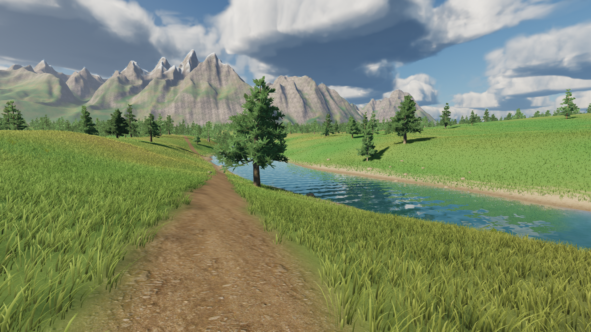
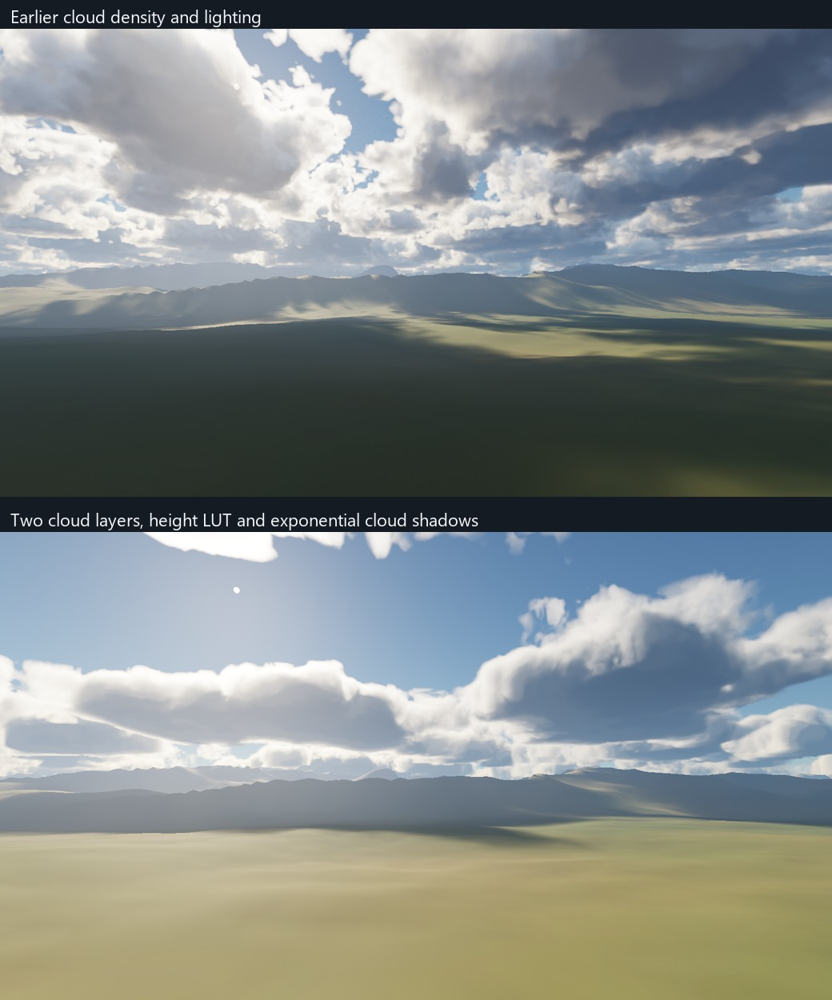
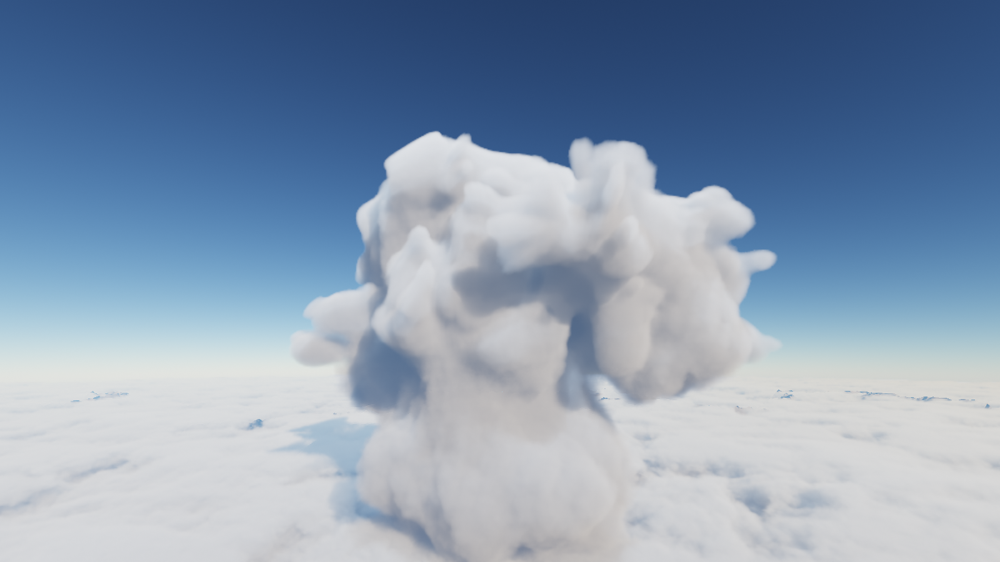
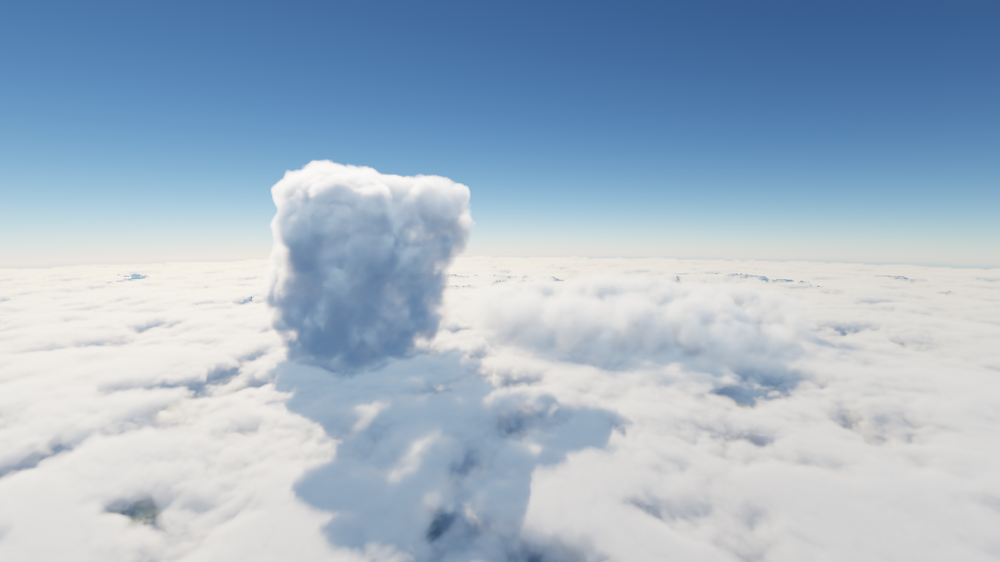
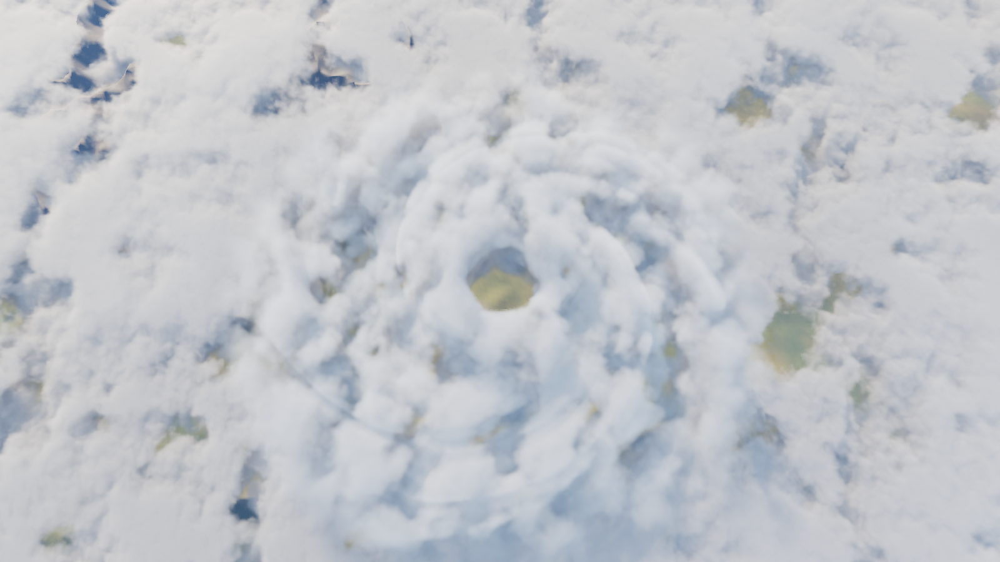
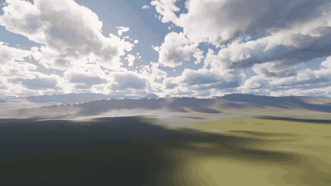
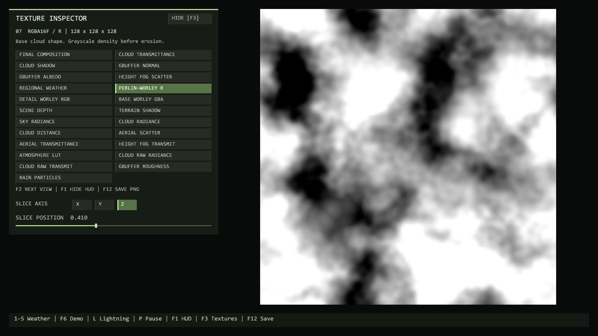
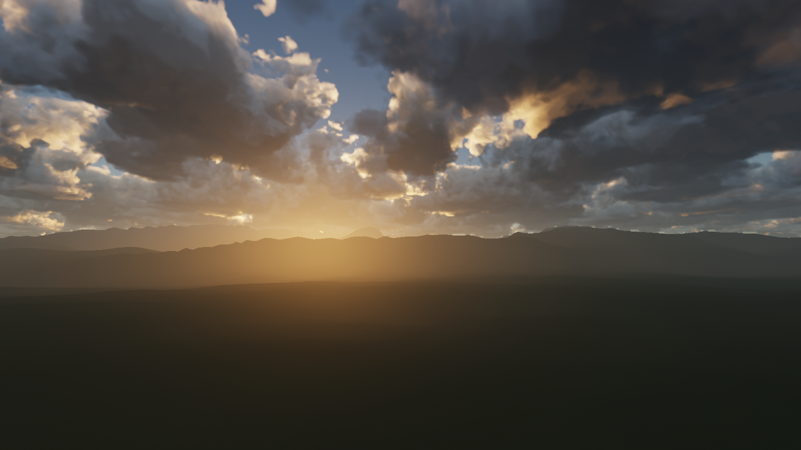

# CirrusEngine

C++20 / Direct3D 11で動く描画エンジンです。風で波打つ草原と川沿いを歩きながら、RDR2の公開技術資料を参考に実装した雲・雲影・光散乱・天候を確認できます。静的glTFのPBR描画にも対応します。



[川岸から見た草と水面の近景](docs/images/meadow-riverside.png)

## 探索とモデルの表示

ビルド後に `start.cmd` を開くと、午後の草原と川沿いから探索を始めます。`WASD` で歩き、`Shift` で走り、右ドラッグで視点を動かします。`G` で離陸・着地し、飛行中は `E` で上昇、`Q` で下降します。`T` で時計の停止・再開、`[` / `]` で30分ずつ時刻を変更できます。

```powershell
# 地上32 mから飛行探索を始める
.\start.cmd --camera fly

# 18:12で固定した探索画面
.\out\vs\Release\CirrusEngine.exe --camera walk --time 18.2 --day-seconds 0

# glTFモデルを開始位置の9m前に置く
.\out\vs\Release\CirrusEngine.exe --model "C:\path\to\model.glb" --model-scale 1 --time 15

# 同梱の材質検証パネルで金属度を表示
.\out\vs\Release\CirrusEngine.exe --model tests/pbr-panel.gltf --debug-view 29
```

静的モデルではベースカラー、金属度、粗さ、法線、AO、発光のテクスチャを読み、地形・草木と同じディファードGGX照明を使います。対応する材質や地形タイル、歩行、時計の実装は[探索とPBRの実装ガイド](docs/exploration.md)を参照してください。

通常の雲は天候デモの密度と照明に合わせています。3D Perlin–Worleyで大きな塊を作り、Worleyの別の周波数で表面の膨らみと薄い縁を作ります。雲に入るレイ区間の細分と、地表・霧の遮蔽深度はRockstarのSIGGRAPH 2019講演を参考にしています。[雲の密度の実装](docs/implementation-guide.md#3-ノイズから最終密度を求める) · [講演スライド](docs/cloud-research.md#rockstarのsiggraph-2019講演)。



## 実装済み

- **ボリュメトリック雲**：球面の雲層、周期的な Perlin / Worley 3D ノイズ、細部の侵食、風・高さによるシアー、密度のレイマーチング。
- **雲の照明**：Beer–Lambert 透過、二次レイによる自己遮蔽、前方と後方のHenyey–Greenstein位相関数、上方の雲密度に応じた天空光。
- **自然な雲影**：雲密度を太陽側から積分し、透過率と遮蔽深度を指数シャドウマップに保存。高度に応じたミップを選び、地表の直接光と霧に使います。
- **大気・散乱**：Rayleigh / Mie / オゾン吸収、太陽透過率 LUT、空の数値積分、空気遠近、影付きの高さフォグ、昼・夕方・夜。
- **天候**：晴れ・晴れ曇り・曇天・雨・嵐。滑らかな遷移、48秒の天候デモ、雲マップで位置を決める雨霧、風に流される3D雨粒、枝分かれする落雷と雲・地形・霧への照り返し、雨上がりにも残る地面の濡れ。
- **ディファードPBR**：ベースカラー・粗さ・金属度・法線・AO・発光・深度のG-buffer、GGX太陽光、近距離の草木・モデル影、HDR合成、ACES近似トーンマップ。
- **操作・検証**：歩行・飛行カメラ、クリック可能な操作パネル、4段階の画質、デバッグ表示、風を考慮する雲の時間再投影、深度を考慮するアップサンプリング、HLSL再読み込み、PNGとGPU診断JSON。
- **雲の軽量描画**：ハーフバッファ、半数を交互に計算するチェッカーボード、風・カメラを補正する再構成、履歴不成立画素の追加レイマーチ。
- **雲海の中の大型雲**：位置・半径・高さを持つ入道雲と、目・螺旋の雲帯を持つ回転渦。最大8領域の配置ファイル、影・散乱・再投影への統合。

## ビルドと起動

2026-11-08版では、入道雲を261個の階層セルから焼いた128³の3Dプロファイルへ変更しました。形状と座標変形のテクスチャは全領域で共有し、追加メモリは計6MiBです。近景・側面・内部の視点と、カメラ周回の比較経路、F3の3D形状・変形ノイズ表示を追加しています。

**[実装ガイド：配置→密度→レイマーチ→散乱・影→時間再構成](docs/implementation-guide.md)** に、関数の入口、式、追加データの構成、参照資料と残る近似をまとめました。[実GPUの検証記録](docs/validation.md)も参照してください。



同条件の[変更前](docs/images/cloud-volume-before-frontlit.png)、[ネイティブ解像度](docs/images/cloud-volume-frontlit-full.png)、[カメラの周回記録](docs/images/cloud-volume-orbit.gif)を保存しています。形状は静的な手続きアセットで、流体による雲の成長は未実装です。

Windows 10 / 11 x64、Direct3D feature level 11_0 対応 GPU、Visual Studio 2022 の「C++ によるデスクトップ開発」、Windows SDK、CMake 3.25 以上が必要です。外部ライブラリのダウンロードは不要です。

```powershell
cmake --preset windows
cmake --build --preset release --parallel
ctest --preset release
.\build\Release\CirrusEngine.exe
```

Visual Studio ではリポジトリ直下の **`CirrusEngine.sln`** を開き、`Release | x64` または `Debug | x64` でビルドできます。CMakeの事前実行は不要です。出力は `out\vs\Release\CirrusEngine.exe`（Debug は `out\vs\Debug`）です。ソリューション全体のビルドには、C#ツール用の.NET 8 SDKとVisual Studioの「.NET デスクトップ開発」も必要です。

`Shaders` ソリューションフォルダにHLSLがまとまっています。Visual StudioのビルドはC++のリンク後にシェーダーをコピーし、全25エントリーポイントをHLSLコンパイラーで検証します。シェーダーのエラーもビルド失敗になります。

`start.cmd` をダブルクリックすると、未ビルドの場合はビルドして起動します。配布物は `cmake --install build --config Release --prefix out/CirrusEngine` で生成できます。実行ファイルと `shaders`、`assets` フォルダを一緒に配置してください。C#ツールも同梱する場合は、[テクスチャ生成ツール](#テクスチャ生成ツール)の手順で構成します。

## 操作

| 操作 | 内容 |
| --- | --- |
| 右ドラッグ | 視点を回転 |
| WASD / Shift | 徒歩または飛行移動 / 走るまたは高速飛行 |
| G / E・Q | 探索中の離陸・着地 / 飛行中の上昇・下降 |
| 1～5 | 晴れ / 晴れ曇り / 曇天 / 雨 / 嵐へ18秒で遷移 |
| Space | 自動天候の切り替え |
| F6 / L | 48秒の天候デモを開始・停止 / 稲妻を手動発生 |
| P / T | 天候・時計を一時停止 / 時計の進行を切り替え |
| [ / ] | 太陽時を30分変更。手動太陽モードでは高度を変更 |
| C / H | 画質を切り替え / 雲影を切り替え |
| F1 / F2 | 操作パネルの表示切り替え / 次のデバッグ表示へ（全32表示） |
| F3 | テクスチャ一覧パネルを開く・閉じる |
| F4 | 雲の形と照明を Classic / Cumulus で切り替え |
| F5 | HLSL 再読み込み。失敗時は直前のシェーダーを維持 |
| F7 | 雲のチェッカーボード描画を切り替え |
| F8 / F9 | 大型雲をOFF→入道雲→渦→混在に切り替え / プリセットを見渡す視点へ |
| F12 / R / Esc | PNG と診断保存 / カメラ初期化 / 終了 |

左パネルで太陽時と露出、右上で天候を選べます。`--camera valley` などの雲の撮影用視点では太陽の高度と方位を手動調整できます。ノイズ生成シェーダーの編集は再起動で生成済みテクスチャへ反映されます。

## 雲のスタイル

**Classic** は天候デモの雲です。大小の雲塊を重ね、上方の雲の厚みから天空光の遮蔽を求めます。**Cumulus** は位置ごとの雲底・雲頂で丸い雲塊を作ります。太陽に近い方向の散乱と空の環境光で照らします。

起動時は Classic が既定です。Cumulus で起動するには `start.cmd --cloud-style cumulus` を使います。実行中は **F4** または左下の **CLASSIC [F4] / CUMULUS [F4]** で切り替えます。そのフレームで雲影と描画履歴を更新します。

`start.cmd --cloud-style classic --classic-fast` でClassicの軽量化を有効にします。雲の描画解像度を保ち、4相チェッカーボードで2×2画素のうち1画素ずつを更新します。太陽側と天空光の遮蔽は、密度と光の変化が小さい場所で複数の視線から共有します。左パネルは **CB4 [F7]** を表示します。 [描画と遮蔽の仕組み](docs/architecture.md#classicの4相描画と遮蔽共有)

## 飛行中の近距離雲

飛行で雲層に近づくと、手前160 mの視錐台を80×44×32のボクセルに分け、散乱光と透過率を奥行き順に積み上げます。視錐台の奥から遠景のレイマーチへつなぎます。雲底と雲頂には3Dノイズで凹凸を加えます。

`start.cmd --camera fly` で飛行を始め、**E** で上昇できます。`--camera inside` は雲層付近の視点から起動します。`--no-near-cloud-voxels` は近距離ボクセルを無効にする比較用の指定です。 [近距離雲の設計](docs/architecture.md#近距離の雲ボクセル)

## 雲海に入道雲・渦巻き雲を配置

**`cloud-formations.cmd`** を開くと、通常の雲海に大きな入道雲と渦巻き雲を置いたシーンが起動します。**F8**、または右側の **CLOUD FORMATIONS** パネルで切り替え、**F9** でプリセット位置へ視点を移動できます。渦単独では上から見下ろす視点になります。通常起動では大型雲はOFFです。

- **TOWERS**：対流セルの3D制御場を変形し、Perlin–Worleyで輪郭を削る入道雲。通常の雲頂を越える高さも描画します。
- **VORTEX**：中心の目、目の周りの高い雲、半径によって回転速度が異なる雲群。雲量の巻き込みと丸い雲塊のノイズを分け、外縁を普通の雲海へなじませます。
- **MIXED**：両方を同じ雲海に配置。入道雲の密度を加算し、渦の領域では雲海を局所的に置き換えます。
- パネルの **STRENGTH / SIZE / SPIN** で強度・大きさ・回転速度を調整。SPINが負なら逆回転、0なら回転停止です。**P** は風と回転を一緒に停止します。





Nubis 2017、Nubis Evolved 2022、Procedural Cloudscapes 2018の本文を参照して密度場を改修しました。[資料・参照ページ・実装対応表](docs/cloud-research.md)に採用範囲と未実装部分を記載しています。RDR2相当の画質には未達で、近距離の雲塊や成長表現には改善の余地があります。

```powershell
# 雲海＋入道雲＋渦
.\out\vs\Release\CirrusEngine.exe --weather overcast --formations mixed --camera formations

# 渦を上から見る。回転を2倍速にする
.\out\vs\Release\CirrusEngine.exe --weather overcast --formations vortex --camera vortex --formation-speed 2

# 自分で配置した領域を読み込む
.\out\vs\Release\CirrusEngine.exe --formation-file config/formations.clouds --weather overcast --camera formations
```

[`config/formations.clouds`](config/formations.clouds) は1行1領域、最大8領域です。距離・高度はm、回転は度/秒です。`#`以降はコメントになります。

```text
# 種類 x z 半径 雲底高度 高さ 密度
tower -5600 7000 6200 1800 8600 1.05
# 渦は末尾に角速度[度/秒]と巻き込み強度を追加
vortex 6400 12000 7000 900 4400 0.85 2.0 1.6
```

ファイル指定で起動した場合、**F5** は配置とHLSLを一緒に再読み込みします。不正な行やシェーダーエラーがあれば直前の設定を保ちます。F8やパネルでプリセットへ切り替えた後は、プリセットが有効になります。任意の位置に置いた領域には飛行カメラで移動してください。

`--formation-strength 0..2`、`--formation-scale 0.5..1.6`、`--formation-speed -3..3` も指定できます。大型雲は背景と同じ密度場・照明積分・雲影を使い、渦の回転も履歴の再投影へ反映します。形状は手続き的なモデルで、雲の流体計算ではありません。[実装解説](docs/architecture.md#大型雲の領域と回転)を参照してください。

## 天候変化・雨・雷

**`weather-demo.cmd`** をダブルクリックすると、晴れ→曇り→雨→雷雨→晴れを48秒で繰り返すデモが始まります。起動中は **F6** で現在の天候から補間してデモを開始できます。**4** は雨、**5** は嵐へ18秒で遷移し、手動で天候を選ぶとデモを停止します。**L** で落雷、**P** で天候と雨粒を一時停止できます。

- 雨はカメラ周囲240×140×240m内のGPU粒子です。風と落下速度に沿って移動し、地形の後ろには描画しません。雲底より上では雨粒を抑えます。
- 雷雨では4.5～9秒間隔で雷が発生し、一つの放電が複数回光ります。世界座標の折れ線と枝を描き、雲・地面・霧・雨粒を位置に応じて照らします。
- 地面の濡れは降水量と別に更新し、雨が止んだ後はゆっくり乾きます。濡れでアルベドと粗さが変わります。
- 左パネルの **DEMO [F6] / FLASH [L]** でも操作できます。降水量・濡れ・デモ時刻を表示します。

実GPUの48秒記録を2倍速で表示したものです。



[晴れから雨上がりまでの静止画比較](docs/images/weather-cycle.jpg)と[落雷時の描画](docs/images/weather-lightning.png)も確認できます。

```powershell
# 雨から起動 / 落雷を0.8秒に発生させて保存
.\out\vs\Release\CirrusEngine.exe --weather rain
.\out\vs\Release\CirrusEngine.exe --weather storm --lightning-at 0.8 --headless --no-ui --capture captures/lightning.png

# 48秒のデモを24fpsで連続保存。1152枚のPNGとtimeline.csv、最後のGPU診断JSONを出力
.\out\vs\Release\CirrusEngine.exe --weather clear --weather-demo --headless --no-ui --record captures/weather-frames --frames 1152 --width 960 --height 540 --quality medium
```

`--no-rain` は雨粒、`--no-lightning` は雷光と稲妻を無効にします。`timeline.csv` には時刻・対象天候・降水量・濡れ・雷の強さ・放電番号・風の移動量を記録します。録画の既定刻みは1/24秒で、単一PNG保存の既定1/60秒とは異なります。

## テクスチャ表示

**F3** または左下の **TEXTURES [F3]** を押すと、名前をクリックして描画中のテクスチャを確認できます。フォーマット・解像度・値の意味も表示します。通常の完成画像は **FINAL COMPOSITION** です。

- Perlin-Worley、基本形状用WorleyのGBA、詳細用WorleyのRGB。
- 地域天候マップ、大気の透過率LUT、空の散乱光。
- 雲影の透過率、地形の深度シャドウマップ。
- G-bufferのアルベド、法線、粗さ、シーン深度。
- 雲の散乱光・透過率・代表距離。時間再投影の前後を比較できます。
- 空気遠近法の散乱光・透過率、地表霧の散乱光・透過率。
- 合成前の3D雨粒のHDR散乱光（表示番号22）。
- 雲の再構成マスク（23）：緑=今回計算、青=履歴、赤=修復、灰=雲層と交差しない視線。
- 入道雲の128³形状プロファイル（24）、滑らかな64³変形ベクトル（25）。どちらもXYZ断面を確認できます。

3Dノイズを選ぶと、**X / Y / Z** ボタンで断面の向き、**SLICE POSITION** で位置を変更できます。マップの縦横比を保ち、幅1000px以上では一覧の右側に全体を表示します。小さいウィンドウでは一覧がページ分割されます。**F1** でUIを隠し、**F12** で表示中の画像をPNGに保存できます。

透過率は白が「光を通す」、黒が「光を遮る」です。深度・雲距離は見分けやすい対数距離で表示します。HDRの散乱光には表示用の露出・トーンマップを適用します。

```powershell
# Visual StudioのReleaseビルドから、Perlin-WorleyのZ断面を開く
.\out\vs\Release\CirrusEngine.exe --texture-viewer --debug-view 7 --texture-axis z --texture-slice 0.41

# 詳細WorleyのY断面を、UIなしでPNGに保存
.\out\vs\Release\CirrusEngine.exe --headless --no-ui --debug-view 8 --texture-axis y --texture-slice 0.6 --capture captures/worley-y.png
```



## テクスチャ生成ツール

**Cirrus Texture Studio** はC#のWindowsアプリです。雲の基本形状を作るPerlin–Worley、輪郭用の詳細Worley、天候マップ、雲の変位マップを周期境界付きで生成します。シード、3Dの解像度（32³・64³・128³）、密度と雲量の補正を指定できます。元のGPUシェーダーと同じ用途・チャンネル構成で、シードに応じて異なる雲の分布を作ります。

1. 配布フォルダの **`TextureStudio\CirrusTextureStudio.exe`** を開きます。Visual Studioからビルドした場合は `out\vs\Release\TextureStudio` にあります。実行には **.NET 8 Desktop Runtime（x64）** が必要です。
2. **生成** を押し、X・Y・Zの断面や色チャンネルを選びます。**3×3 タイル** で繰り返しを確認でき、表示中の断面をPNGで保存できます。
3. **DDS パックを書き出す** で4つのテクスチャと生成設定を保存し、**エンジンでプレビュー** で同じパックを使った飛行ビューを開きます。

| DDS | 内容 |
| --- | --- |
| `base-noise.dds` | RGBA16Fの3Dテクスチャ。RがPerlin–Worley、G/B/Aが4/8/16セルのWorley |
| `detail-noise.dds` | RGBA16Fの3Dテクスチャ。R/G/B/Aが4/8/16/32セルのWorley |
| `weather-map.dds` | 512²のRGBA16F。R/G/B/Aが雲量・湿度・雲種・積雲の芯 |
| `cloud-displacement.dds` | 512²のRG16F。雲塊の位置を曲げる2成分の変位 |

パックはDX10拡張付きの単一ミップDDSです。読み込み後にDirect3Dでミップを生成します。 [MicrosoftのDDS形式ガイド](https://learn.microsoft.com/ja-jp/windows/win32/direct3ddds/dx-graphics-dds-pguide)

コマンドラインから試す場合は、書き出したフォルダを指定します。`--cloud-textures` を省略した起動では、従来どおりGPUが標準テクスチャを生成します。

```powershell
.\out\CirrusEngine\CirrusEngine.exe --camera fly --cloud-textures "C:\path\to\CirrusTextures-17-xxxxxxxx"
```

.NET 8 SDKを入れた開発環境では、次の手順で同梱版を生成できます。

```powershell
cmake --preset windows -DCIRRUS_BUILD_TEXTURE_STUDIO=ON
cmake --build --preset release --parallel
cmake --install build --config Release --prefix out/CirrusEngine
```

## 再現可能な画像保存

```powershell
# 実 GPU で48フレーム描画して保存。非表示ウィンドウで Direct3D を使用。
.\build\Release\CirrusEngine.exe --headless --no-ui --capture captures/day.png --frames 48 --weather partly --debug-layer

# 夕景
.\build\Release\CirrusEngine.exe --headless --no-ui --capture captures/sunset.png --sun-elevation 5 --sun-azimuth -12

# 雲の上 / 雲の中
.\build\Release\CirrusEngine.exe --camera overview
.\build\Release\CirrusEngine.exe --camera inside

# 天候遷移の中間点（1秒 / 2秒）
.\build\Release\CirrusEngine.exe --headless --no-ui --capture captures/transition.png --weather clear --transition storm --transition-seconds 2 --frames 60

# 全シェーダーをソフトウェアデバイス上でコンパイル（描画検証とは別）
.\build\Release\CirrusEngine.exe --check-shaders --warp

# CPU テスト、シェーダー、49ケースの実描画、大型雲・再構成・雨・雷・天候まで検証
powershell -NoProfile -ExecutionPolicy Bypass -File scripts/validate.ps1
```

保存時は既定で固定刻み 1/60 秒になります。`--fixed-dt`、`--width`、`--height`、`--quality low|medium|high|ultra`、`--weather clear|partly|overcast|rain|storm`、`--sun-elevation`、`--sun-azimuth`、`--exposure`、`--no-cloud-shadows` を指定できます。通常の起動は実時間で進みます。

## ハーフバッファとチェッカーボード

既定のHighでは、画面1600×900に対して雲の再構成結果を800×450で保持します。チェッカーボードではその半数を交互にレイマーチし、生の雲・距離を400×450に詰めて保存します。基本レイ数は画面ピクセル数の **1/8** です。前フレームを風・カメラ移動で補正し、使えない画素は追加で計算します。初期フレーム、視点切り替え、急変、雷の発光時は全雲グリッドを更新します。

F7、または `CB [F7]` でON/OFFを切り替えられます。既定で有効です。`--cloud-buffer` は縦横の縮小率を指定します。halfの画素数は画面の1/4で、さらにチェッカーボードを組み合わせます。履歴バッファは再構成サイズを維持します。

```powershell
# 既定のHighと同じ、縦横1/2 + チェッカーボード
.\out\vs\Release\CirrusEngine.exe --quality high --cloud-buffer half

# 全雲グリッドを毎フレーム計算する比較モード
.\out\vs\Release\CirrusEngine.exe --cloud-buffer half --no-checkerboard

# 移動時の再構成を確認 / 計算・履歴・修復マスクを表示
.\out\vs\Release\CirrusEngine.exe --camera-path pan
.\out\vs\Release\CirrusEngine.exe --texture-viewer --debug-view 23
```

実装の流れとバッファ寸法は[設計解説](docs/architecture.md#ハーフバッファとチェッカーボード)、検証結果は[実機検証](docs/validation.md)に記載しています。公開された[RDR2の大気表現の講演](https://advances.realtimerendering.com/s2019/index.htm)を参考とする独自実装で、同作品との画質一致を示すものではありません。

## FPS

2026-11-05、RTX 5080 / 1600×900 / High / ハーフバッファ / Release / VSync OFFで、チェッカーボードOFF/ONを各8秒×2回測定しました。120フレームのウォームアップ後のメッセージ処理・描画・Presentを含みます。

| 雲の描画 | 平均FPS（フレーム数/時間の合算） |
| --- | ---: |
| ハーフバッファ、全雲画素を毎フレーム計算 | 98.2 |
| ハーフバッファ＋チェッカーボード | **125.8（+28.2%）** |

カメラ移動と晴れ→嵐・雷を含む6秒の180フレーム比較では、RGB平均差の時間平均は0.194 / 255、最大フレームは0.416 / 255でした。雲の輪郭などに局所的な差は残ります。[計測JSON](docs/benchmarks/checkerboard.json)と[比較画像](docs/images/checkerboard.jpg)を参照してください。雷の閃光や視点切り替え中は全更新するため、同じ速度向上を保証するものではありません。

以下は前回の照明計算・キャッシュ軽量化の記録です。

2026-11-04、RTX 5080 / 1600×900 / High / Release / VSync無効で、天候対応版 `e28c51d` と軽量化版を同じ条件で比較しました。120フレームのウォームアップ後、表示込みの実時間を各8秒測定しています。

| 場面 | 軽量化前 | 軽量化後 |
| --- | ---: | ---: |
| 昼・晴れ曇り（各2回の合算） | 62.3 FPS | **100.6 FPS** |
| 嵐（雷OFF、各1回） | 68.0 FPS | **124.7 FPS** |

雲の解像度800×450、視線384サンプル、光の最大12サンプル、雲影1024²は維持しています。隣接点での照明共有、風の移動を補正した雲影の更新分散、大気透過率LUTの再利用で計算を減らしました。[画像比較](docs/images/cloud-performance.jpg)と[計測JSON](docs/benchmarks/cloud-performance.json)を保存しています。

照明の共有は小さな近似を含みます。測定した5場面のRGB平均差は0.009～0.173 / 255です。Ultra、または `--full-cloud-lighting` では雲の照明を全点で計算し、雲影も毎フレーム更新します。FPSは天候・視点・GPU・VSync設定によって変わります。

```powershell
# 120フレームのウォームアップ後、表示を含む実時間で測定
.\build\Release\CirrusEngine.exe --benchmark-seconds 10 --no-vsync --no-ui --quality high --benchmark-output captures/fps-high.json
```

平均FPSと95/99パーセンタイルのフレーム時間を保存します。計測は起動・初期生成・ウォームアップ・PNG保存を除きます。画面のHUDにもFPSを表示します。



## 設計と現在の範囲

[コードの読み方・レイマーチングと影・散乱の解説](docs/architecture.md)と[実機での検証結果](docs/validation.md)を参照してください。C++とHLSLは処理ごとに改行し、主要な数式と描画順序に日本語コメントを付けています。描画の初版として、雲の微細形状、遠景での時間的安定性、地形の画質には改善の余地があります。RDR2 と同等の完成度を示す比較検証は行っていません。

背景の雲は単一層で、局所的な大型雲ボリュームを重ねます。多重散乱・環境光は近似です。物理的な雲の流体計算、ゲーム用のシーンエディター、アセット読込、GI、海洋描画は未実装です。雨は世界座標の粒子で描きます。大気と雲は代表深度で合成しており、雲内や雲と地形が交差する場面では完全な統合積分との差が出ます。

## 参考資料

- Fabian Bauer / Rockstar, [Creating the Atmospheric World of Red Dead Redemption 2: A Complete and Integrated Solution, SIGGRAPH 2019](https://advances.realtimerendering.com/s2019/index.htm)
- Andrew Schneider / Guerrilla, [Nubis: Authoring Real-Time Volumetric Cloudscapes with the Decima Engine, SIGGRAPH 2017](https://www.guerrilla-games.com/read/nubis-authoring-real-time-volumetric-cloudscapes-with-the-decima-engine)
- Sébastien Hillaire, [A Scalable and Production Ready Sky and Atmosphere Rendering Technique, EGSR 2020](https://sebh.github.io/publications/egsr2020.pdf)

本リポジトリのシェーダーは独自実装です。Rockstar のコード・ゲームアセットは含みません。MIT License。
