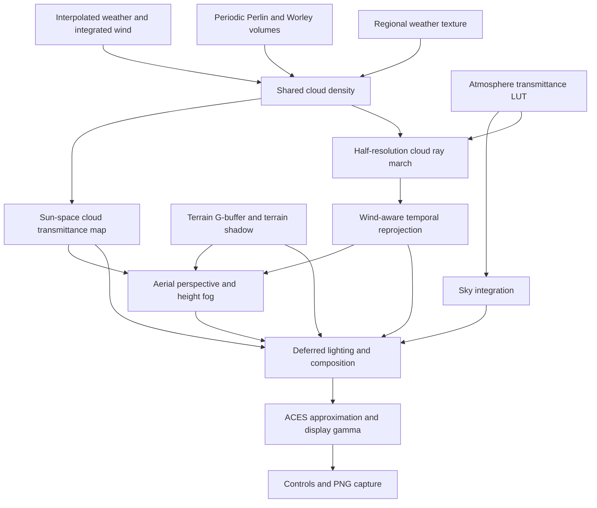

# 描画コードの読み方と設計

C++側は天候・カメラ・GPUリソースと描画順序を管理し、HLSL側が雲や大気の積分を行います。距離の単位はmです。照明は線形色空間で計算し、最後に表示用の色へ変換します。

## コードを読む順序

| ファイル・関数 | 役割 |
| --- | --- |
| [`src/main.cpp`](../src/main.cpp) の `wWinMain` | ウィンドウ、入力、時間刻み、1フレームの呼び出し |
| [`src/weather.cpp`](../src/weather.cpp) の `WeatherSystem::update` | 天候の補間、風の移動量、稲妻、自動遷移 |
| [`src/renderer.cpp`](../src/renderer.cpp) の `Renderer::frame` | 雲影、地形、空、雲、再投影、大気、最終合成の順にGPU処理を呼ぶ |
| [`shaders/noise.hlsl`](../shaders/noise.hlsl) の `NoiseCS` | 起動時にPerlin-WorleyとWorleyの3Dテクスチャを生成 |
| [`shaders/common.hlsli`](../shaders/common.hlsli) の `cloudDensity` | 天候・高度・ノイズから、空間中の一点の雲密度を返す |
| [`shaders/clouds.hlsl`](../shaders/clouds.hlsl) の `CloudCS` | 視線に沿って密度と散乱光を積分する雲の本体 |
| 同ファイルの `ShadowCS` / `TemporalCS` / `RepairCS` | 地面に落ちる雲影 / 雲の再構成 / 履歴不成立画素の再計算 |
| [`shaders/atmosphere.hlsl`](../shaders/atmosphere.hlsl) | 太陽透過率LUT、空、大気の遠近効果、地表霧 |
| [`shaders/scene.hlsl`](../shaders/scene.hlsl) の `CompositePS` | 地形の照明と空・雲・大気・霧を合成する |

`Renderer::frame` の番号付きコメントを入口にして、対応するHLSLへ進むと処理全体を追えます。CPUの `FrameData` とHLSLの `cbuffer Frame` は同じ配置で共有するため、片側だけフィールドを並べ替えないでください。各成分の意味と単位は `common.hlsli` にコメントしています。

## 雲のレイマーチング

1. 視線と球状の雲底・雲頂を交差させ、雲の中を通る開始・終了距離を求めます。地形の深度と100kmの上限で切り詰めます。
2. 空では大きな距離を進み、粗い雲形状に当たった区間を最大3回二分します。画質ごとの最大積分区間数と残り距離から最小ステップ幅を求めます。
3. `cloudDensity` は雲マップと高度LUTから雲の大枠を作り、変位したPerlin–Worleyで縁を侵食します。入道雲と渦の密度もここで合成します。
4. 雲がある点では、さらに太陽方向へ進んで自己遮蔽を求め、位相関数・天空光と合わせて照明を決めます。
5. 手前から奥へ散乱光を蓄積します。透過率が `0.005` 未満になれば終了します。太陽円盤の周囲は `0.00005` まで積分します。

積分の中心は次の関係です。`density` は雲密度、`ds` は区間長[m]、`0.006` は消散係数[1/m]、`T` はそれまでに残った透過率です。

```hlsl
float attenuation = exp(-density * cloudExtinction() * ds);
float weight = T * (1 - attenuation);
radiance += weight * lighting;
T *= attenuation;
```

雲テクスチャのRGBは蓄積した散乱光、Aは残存透過率です。一般的な不透明度とは逆で、A=1なら雲は透明です。距離メタデータには、寄与の重みで平均した雲の代表距離と地形距離を保存します。

## 雲影・地形影・散乱の違い

**雲影**は太陽側から `cloudDensity` を積分し、残存透過率と指数化した遮蔽深度をRG16Fへ保存します。範囲は48km四方、Highでは768²です。受光点の深度で影を計算し、推定半影幅に合ったミップを参照します。

**地形影**は2048²の深度シャドウマップです。65km四方の正射影と3×3の比較PCFを使います。ラスタライズ時の深度バイアスは200、傾きバイアスは1.5、比較時の追加バイアスは0.0004です。

**雲の散乱**には2オクターブのHenyey–Greenstein位相関数、太陽方向の減衰、空の散乱を縮約した天空光を使います。`single` が単一散乱、`multiple` が減衰と指向性を弱めた高次散乱の近似です。**大気の散乱**はRayleigh散乱・Mie散乱近似・オゾン吸収から計算します。地表霧も雲影と地形影を受け、光芒を作ります。

## 天候と風の連続性

天候は晴れから嵐までの5プリセットをsmoothstepで補間します。途中で変更された場合も、その時点の値を次の遷移の開始値にします。風の位置は毎回「平均風速×経過秒」を加算して求めるため、天候によって風速が変わっても雲が突然別の場所へ移動しません。

## 整形の方針

C++はルートの `.clang-format` で4スペース・約100桁・波括弧の改行を統一しています。Visual Studio付属のclang-format 17で `src/*.cpp`、`src/*.hpp`、`tests/*.cpp` を整形できます。HLSLは属性記法とセマンティクスを保つため手動で整えています。日本語コメントは処理の目的・単位・近似の範囲を説明します。

## 雲の軽量化

Low / Medium / Highでは、同じ視線上の隣接2点が近く、密度差が小さい場合だけ太陽方向の光学的厚さと天空光の遮蔽を共有します。距離の上限は描画ピクセルの世界サイズから20～160mに制限します。許容する密度差は `max(0.04, 現在密度 × 0.2)` で、それを超える点や空白を挟む点は計算し直します。密度・透過率・代表距離は全視線サンプルで積分します。Ultraと `--full-cloud-lighting` では照明共有を無効にします。

雲影は最大4フレーム、シミュレーション時間で最大約1/15秒間共有します。生成後の風の移動量を `CloudPerformance.xy` で渡し、地表・霧・雨からの参照座標を毎フレーム補正します。雲層・雲形・太陽・範囲・有効フラグの変化、リサイズ、シェーダー再読み込みではすぐに更新します。透過率が0.001を下回ると雲影の積分を打ち切ります。

大気の太陽透過率LUTは太陽角・高度の全域を保存しており、カメラや太陽の現在角度には依存しません。エアロゾル倍率が変わったときとシェーダー再読み込み時だけ再生成します。診断JSONの `cloud_optimization` に照明共有の有効状態・雲影/LUTの更新回数・雲影の経過時間を記録します。

## ハーフバッファとチェッカーボード

雲の論理解像度はLowが画面の縦横1/4、Medium/Highが縦横1/2、Ultraが等倍です。`--cloud-buffer full|half|quarter|auto` で画質プリセットから独立して変更できます。ここでhalfは**縦横とも半分、面積は1/4**です。地形・最終合成・雨の解像度は変えません。

既定では、この雲用グリッドのうち `(x + y) & 1 == frame & 1` の画素だけをレイマーチします。`CloudCS` のスレッド座標から次のように論理画素へ戻すため、半数を計算しないだけでなく、生の雲と距離のテクスチャを横方向に半分に詰めて保存できます。

```hlsl
pixel.x = id.x * 2 + ((id.y + parity) & 1);
pixel.y = id.y;
```

1600×900 / Highでは、再構成用の履歴は800×450、生バッファは400×450です。毎フレームの基本レイ数は180,000本、画面ピクセル数の1/8になります。修復が必要な画素は追加で計算します。奇数幅は切り上げ、余ったセルを初期化します。履歴2組は論理解像度のままなので、全VRAM使用量が半減するという意味ではありません。

`TemporalCS` は全800×450画素を処理します。未計算画素の代表距離は、同じ地形深度の上下左右の計算済み画素から推定します。雲の世界位置を風の移動分だけ戻し、前回のカメラへ投影してRGB・透過率・距離の履歴を取得します。雲距離、地形による遮蔽、画面範囲、現在の視線への戻り位置を照合し、有効な履歴を今回の近傍の色範囲へ制限します。今回計算した画素はTAA、未計算画素は履歴を採用します。

履歴不成立の未計算画素は `RepairCS` が **同じ `traceCloudRay`** で計算し直します。地形までに雲層と交差しない視線は、解析的に透明と確定できます。これらの判定により、地形の端や新しく画面に入った部分を空間補間だけで埋めることを避けています。

履歴が全体として使えない初期フレーム、リサイズ、F5、視点リセット、大きな位置・向きの変更、急な雲層変更、0.12秒を超えるシミュレーションの進行、雷の閃光時は、全論理画素を履歴出力へ直接描きます。次の有効フレームから半数描画を再開します。速い操作や雷が続く場面では、このため速度の改善が小さくなります。

SRV t19のR32_UINTマスクは `0=今回計算 / 1=履歴再利用 / 2=再計算 / 3=解析的に透明` です。Temporalがu2へ書き、RepairはそのSRVだけを読んで履歴出力のu0/u1へ書きます。履歴の読み側を切り替えるのは修復後なので、D3D11で同じリソースをSRVとUAVへ同時に束縛しません。

F7、またはパネルの `CB [F7]` で切り替えられます。`--no-checkerboard` は全雲グリッドを毎フレーム計算する比較モードです。テクスチャ表示23で計算・再利用・修復・透明を確認できます。19/20は詰めた生テクスチャの実寸で表示し、全更新フレームでは直接描画した全幅の履歴を表示します。保存JSONの `cloud_reconstruction` が実バッファ寸法とGPUマスクの各画素数、全更新・半数描画の回数を記録します。

`--camera-path pan|cut` は固定時刻での比較用経路です。panは平行移動と回転、cutは2秒ごとに谷→雲上→雲中を切り替えます。手動入力の確認とは別に、再投影と履歴破棄の画像検証に使えます。

## 大型雲の領域と回転

`cloud_formations.hpp` の `FormationSet` は最大8個の `CloudFormation` を保持します。1領域は位置XZ・雲底高度・半径、高さ・密度・種類・シード、回転速度・巻き込み強度・傾きの3個のfloat4です。C++/HLSLで48バイトを共有します。ファイルの行数、列、値域、非有限値を読み込み時に検証し、GPU配列の範囲を越える設定を拒否します。

背景の `backgroundCloudDensity` に、`formations.hlsli` の `compositeFormationDensity` を重ねます。入道雲は `cloud_volume.hpp` で261個の階層セルを128³の3Dプロファイルへ焼き、GPUのt20で共有します。座標変形は64³の滑らかな周期ベクトル場t21、密度の侵食は2D変位で読み出し位置をずらしたPerlin–Worleyを使います。追加リソースは合計6MiBです。雲海と入道雲の寄与は加算します。領域の外では追加の3Dノイズを参照しません。[実装の読み方と式](implementation-guide.md)、[参照資料と採用範囲](cloud-research.md)を参照してください。

渦は6つの半径帯の速度を連続補間してローカル座標を回転させ、skewを加えた低周波の雲量場でcoverageと雲頂を制御します。旧版の3本の対数螺旋を廃止しました。丸い塊の3Dノイズには強い静的skewを掛けず、同じ半径別の回転速度で移流します。中央の目・周囲の雲・外周の遷移を持ち、外縁は背景と連続補間します。`turns`は巻き込み強度で、帯の本数ではありません。速度変更は回転の積算位相へ加算するため、形状を瞬間的に飛ばしません。

`cloudDensitySample`は密度と、その点に寄与する雲の局所的な正規化高度を返します。通常の雲海、入道雲、渦の寄与を密度で重み付けし、天空光・雷の高度依存に使います。全領域を含む広い積分用の高さで通常雲の照明を正規化する処理は廃止しました。影や消散だけが必要な場所はfloat版の `cloudDensity` を使います。

背景の球殻と各領域の保守的AABBの交差をまとめ、視線が大型雲を通る場合だけ積分区間を広げます。AABBには球面高度の曲率と傾きの余裕を含めます。最小雲底・最大雲頂を太陽方向の自己遮蔽と雲影へも渡すので、背景の雲頂で大型雲を切りません。雲影は背景高度までの40区間を維持し、それより上を通る場合だけ24区間を追加します。

`previousCloudPosition` / `currentCloudPosition` は風の移動に加え、渦の半径別の角速度×今回の積算位相差を戻す／進める関数です。TemporalCSの再投影と距離照合で両方を使います。領域変更・強度・サイズ変更は履歴と雲影を破棄し、渦が回転している間は雲影を毎フレーム更新します。Pでシミュレーションを止めると回転位相も止まります。

設定ファイルはRendererが候補の `FormationSet` へ読み、F5ではシェーダーの候補と両方が成功してから採用します。通常の4プリセットはF8とパネルで選択できます。ファイル指定の配置は `custom` として診断JSONへ領域の寸法・密度・角速度・位相を保存します。

これは形状を制御する手続き的なボリュームです。雲の発生・上昇気流を解く流体シミュレーションではありません。複数の渦が重なる場合は配置順に雲海を補間し、局所的な回転補正を使います。標準の48km雲影アトラスの外、急速な運動、非常に大きな領域には、有限の積分回数・代表深度による近似が残ります。参照した発表の完全再現やRDR2同等の画質は保証していません。

## 雨と雷の描画

`rain.hlsl` の `RainVS` がインスタンスIDから雨粒の位置を生成し、速度と短い露光時間から細い四角形を作ります。水平移動は雲と同じ積分済みの風を使うため、風速変更で雨粒の位置が飛びません。`RainPS` はシーン距離と比較して遮蔽・交差部分のフェードを行います。

`Renderer::drawRain` は乗算済みアルファでRGBA16Fの雨バッファへ描き、CompositePSが線形色空間で合成します。雨バッファのAは不透明度です。雲バッファのAが透過率である点と区別してください。雨バッファはt18で、描画中は同じSRVを外して読み書き競合を防ぎます。GPU時間は `composite_ui` に含みます。

`WeatherSystem` は嵐の閃光イベントとシードを生成し、Rendererが視界前方の世界座標へ落雷位置を固定します。`lightning.hlsli` は20区間の主放電と2本の枝について、視線と線分の距離から芯・周囲光を描きます。地形深度で遮蔽し、雲底より上の部分は雲の透過率で減衰します。

`lightningIrradiance` は共通の光源位置から雲・霧・地表・雨へ照り返しを与えます。閃光中は雲の履歴を無効化し、明るさが残像になって残ることを抑えます。光が消えているときは分岐で追加計算を省きます。地面の濡れは約6秒の時定数で増え、乾燥は約65秒の時定数で進みます。

48秒のデモでは4秒で曇りへ、14秒で雨へ、24秒で嵐へ、36秒で雨へ、40秒で晴れへの遷移を開始します。各遷移を補間し、48秒でループします。手動変更はその時点の補間値を引き継ぎます。

## テクスチャ表示のコード

`Renderer::drawTextureInspector` が名前・解像度・説明と断面操作を描画し、`updateConstants` が `TextureInspection` に断面位置・軸・プレビュー領域を渡します。`scene.hlsl` の `textureDebugView` は、最終合成の代わりに対象のSRVを表示します。テクスチャはそのフレームで実際に使っているGPUリソースです。

| `--debug-view` | 表示内容 |
| --- | --- |
| 0 | 通常の最終合成 |
| 1 / 2 | 雲の透過率 / 雲影の透過率 |
| 3 / 4 / 21 | G-bufferの法線 / アルベド / 粗さ |
| 5 / 17 | 地表霧の散乱光 / 透過率 |
| 6 | 地域天候マップ（R=被覆率、G=湿度、B=雲形） |
| 7 / 8 / 9 | Perlin-WorleyのR / 詳細WorleyのRGB / 基本WorleyのGBA |
| 10 / 11 | 復元したシーン距離 / 地形のシャドウ深度 |
| 12 | 背景の空の散乱光 |
| 13 / 14 | 時間再投影後の雲の散乱光 / 雲の代表距離 |
| 15 / 16 | 空気遠近法の散乱光 / 透過率 |
| 18 | 大気の太陽透過率LUT |
| 19 / 20 | 時間再投影前の雲の散乱光 / 透過率 |
| 22 | 地形深度で遮蔽した3D雨粒のHDR散乱光 |

`noiseSlice` は固定する座標軸を選び、X=YZ面、Y=XZ面、Z=XY面を表示します。透過率・法線・粗さは値をそのまま表示し、HDRの散乱光だけトーンマップします。シーン距離と雲距離は `log2(1 + distance) / log2(1 + farDistance)` による表示です。地形シャドウは元の正射影深度です。

生の雲テクスチャはCompositePSのt17にだけ束縛します。CloudCSで同じテクスチャへ書き込む際のSRV/UAVの競合を避けています。最終合成0では通常の描画経路を使用し、表示選択で天候や雲の密度場は変えません。PNGと一緒に保存する診断JSONには、表示番号・名前・断面位置・軸・パネルの表示状態を記録します。

## Detailed rendering reference

The renderer is a small Windows / D3D11 executable. The CPU controls weather, camera motion, resources and pass scheduling; Shader Model 5 HLSL performs volumetric rendering. All world distances are in metres and shader radiance remains linear until the last pass.



## Persistent data

The base volume is 128³ RGBA16F. Its red channel is an actual Perlin-Worley combination: four periodic gradient-noise octaves (4, 8, 16, 32 cells) dilate a three-octave inverted-Worley fBm, `PW = lerp(WorleyFBM, 1, PerlinFBM)`, followed by range remapping. GBA retain the three Worley bands (4, 8, 16 cells). The detail volume is also 128³ RGBA16F, increased from 32³ in v0.1. Both include generated mip chains. The 512² weather field stores regional coverage, humidity/precipitation modulation and cloud type. They are generated by compute shaders at startup; there are no downloaded textures.

The cloud placement pass bakes a 512² two-channel map and a 1×128 height LUT from weather parameters. Two samples of a periodic 2D displacement texture shift a single 3D Perlin–Worley lookup to erode the coarse density. View rays, cloud self-shadow rays and the ground shadow map evaluate this same function. The cloud layer occupies a spherical shell above a 6,360 km planet, so near-horizon intersections use planet curvature.

## Passes

1. **Atmosphere transmittance**: 256×64 RGB LUT integrating Rayleigh, aerosol extinction and ozone to the top of the atmosphere. The LUT is refreshed for the weather-dependent aerosol coefficient.
2. **Cloud shadows** use a 48 km sun-space map. High quality uses 768². March from the light to obtain transmittance and an effective occluder depth. Store the exponential depth term for mip filtering and evaluate it at the receiver depth.
3. **Geometry**: draw a procedural 84 km terrain patch into linear albedo/roughness, normals and D32 depth. A separate 2048² directional depth map supplies terrain shadows.
4. **Sky** integrates atmospheric scattering into a camera-oriented 320×180 radiance texture. Reduce a separate set of hemispherical sky samples to an ambient color. Add the sun disk at full resolution during composition.
5. **Clouds** clip their ray interval against the scene depth. Halve the step up to three times when the coarse cloud shape is present. Integrate front to back and terminate after strong extinction. The secondary ray toward the sun starts with a 35 m step, then grows geometrically and samples the shadow map at its endpoint. Evaluate two HG octaves and reuse light visibility for sky ambient. Output premultiplied cloud radiance, transmittance and opacity-weighted distance.
6. **Temporal resolve**: reproject the representative cloud position through the previous camera, subtracting the integrated wind displacement. Reject invalid projection, depth mismatch and occlusion; clamp history to the current 3×3 neighborhood. Resize, shader reload, large light changes and teleport invalidate history.
7. **Aerial / fog** integrates the atmosphere to the representative cloud or geometry depth. Integrate height fog and a rain veil from the lower cloud map with cloud and terrain shadowing to produce volumetric light shafts.
8. **Deferred composition**: evaluate a GGX sun and approximate hemispherical ambient from G-buffers, apply both shadow systems, then compose sky/clouds/aerial/fog. Cloud and aerial upsampling reject depth discontinuities. Tone-map with the ACES fitted approximation and convert to display gamma before drawing controls.

| Quality | Cloud resolution | View samples | Light samples | Cloud shadow map |
| --- | --- | --- | --- | --- |
| Low | Quarter | 160 | 6 | 256² |
| Medium | Half | 224 | 8 | 512² |
| High | Half | 384 | 12 | 768² |
| Ultra | Full | 640 | 16 | 1536² |

All dispatch sizes round upward and shader bounds checks support odd-sized windows. Texture read/write bindings are explicitly cleared between passes. Shader reload constructs a complete candidate set before swapping it in.

## Weather and time

`WeatherSystem` captures the current interpolated state when a transition is interrupted, and blends all physical/art parameters with smoothstep. Wind velocity changes with weather, but position is the time integral of velocity; the phase never becomes `currentVelocity * absoluteTime`. A seeded adjacent-preset scheduler controls automatic weather. Lightning is also deterministic with the seed. Pausing stops simulation, while temporal sampling can still converge.

## Limits and tradeoffs

The sky has a bounded isotropic higher-order approximation, rather than a full multiple-scattering LUT solution. Cloud scattering uses a few analytic octaves rather than a path tracer. Cloud/atmosphere coupling uses the opacity-weighted cloud depth: cloud interiors and geometry intersecting clouds can show approximation artifacts. A single shadow atlas has finite coverage, and the base-plane projection is approximate near a curved horizon or terrain inside the cloud layer.

Environment irradiance is a weather-dependent hemisphere, not a dynamic probe or GI system. Rain uses procedurally instanced world-space streak billboards in a camera-centered volume, depth occlusion and an HDR scattering buffer. Lightning uses world-space line segments and local illumination; material wetness persists after precipitation. Weather presets are visual controls, not a meteorological fluid simulation. Microdetail, temporal stability during fast camera movement and cloud morphology are areas for further refinement.

## Verification boundaries

CPU weather invariants and HLSL compilation run in CI. Actual GPU rendering is checked locally with `scripts/validate.ps1`, saved PNGs, finite-value readbacks and image comparison of ground shadows enabled/disabled. GPU timestamps measure submitted rendering passes, not end-to-end presentation latency or guaranteed interactive FPS. The validation is an engineering smoke/regression suite; aesthetic parity with RDR2 has not been established.

`--benchmark-seconds` measures wall time around the window message pump, rendering and `Present` after 120 warmup frames. This captures the application frame rate including swapchain overhead; screenshots and shader/noise initialization are excluded. Average FPS uses total measured frames divided by total measured time. P95/P99 use the measured frame-time samples. The JSON records resolution, quality, VSync and adapter.
