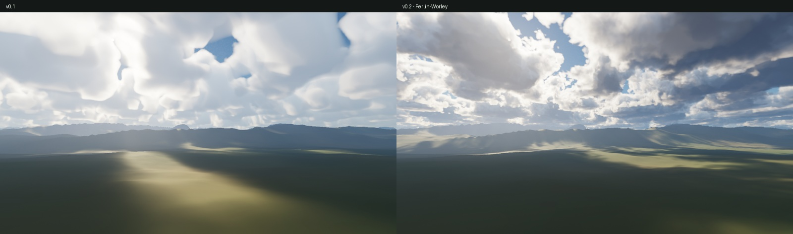
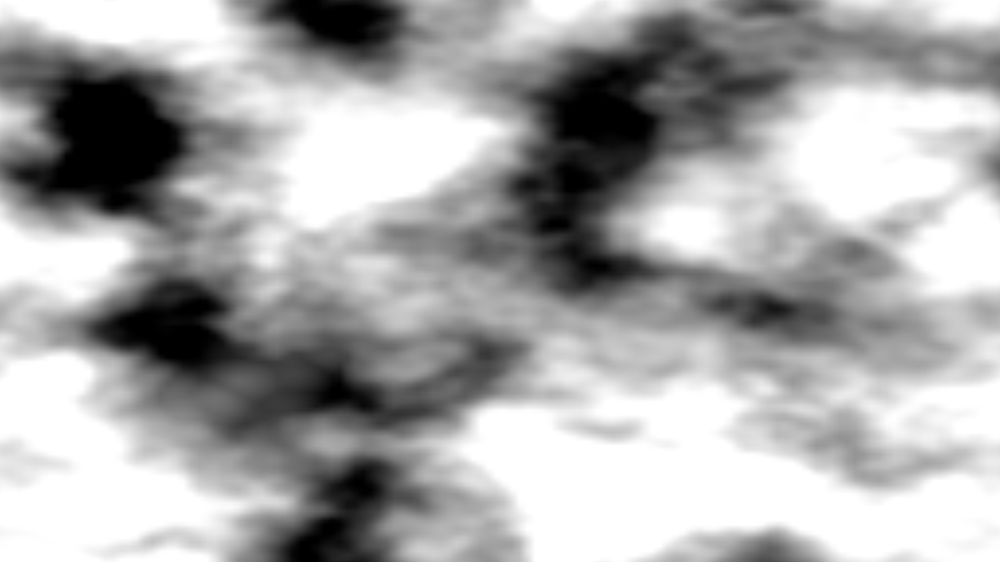

# Perlin–Worley cloud revision

v0.1 は雲の低周波形状が滑らかすぎ、細部が消え、広い平坦な明暗に見えていました。v0.2 では次を変更しています。

- 基本ノイズの R チャンネルを、純粋な Perlin から Perlin–Worley の合成値へ変更。
- 詳細 Worley ボリュームを 32³ から 128³ へ増加。
- 数百mの膨らみと、より細かな輪郭侵食を別々に評価。
- 晴天系の雲量・高度・厚さを調整し、雲塊の間に空を残しながら内部密度を増加。
- 視線方向は近い領域を細かく積分。太陽方向も35mの近傍から積分して、細い雲塊の自己遮蔽を拾う。
- 天空光の遮蔽を加え、雲底と内部の陰影を強化。光サンプルの方向をフレーム間で固定。
- Ultra は雲をフル解像度で描画。

この画像は `--debug-view 7` で、GPU生成した基本ノイズの断面を直接表示したものです。`--debug-view 8` は詳細 Worley の各帯域を RGB で表示します。雲本体、自己遮蔽、地表の雲影が同じ密度関数を使います。

## 表示込みの性能

RTX 5080、1600×900、Release、VSync無効、120フレームのウォームアップ後に10秒間測定しました。

| 画質 | 平均FPS | 平均フレーム時間 | P95フレーム時間 |
| --- | ---: | ---: | ---: |
| Medium | 132.18 | 7.57 ms | 8.08 ms |
| High | 47.93 | 20.86 ms | 26.08 ms |
| Ultra | 16.48 | 60.69 ms | 62.07 ms |

[Medium](benchmarks/medium.json) / [High](benchmarks/high.json) / [Ultra](benchmarks/ultra.json) に生の測定値を保存しています。GPUだけの時間から換算したFPSと、表示込みの実測FPSは別の値です。シーンと天候によっても負荷が変わります。

CPU 3,158チェックと13エントリーポイントのシェーダーコンパイル、20ケースのGPU描画に成功しました。雲の凹凸・輪郭・内部の陰影は実描画画像で確認しています。RDR2と同等の画質を示す比較検証は行っていません。
