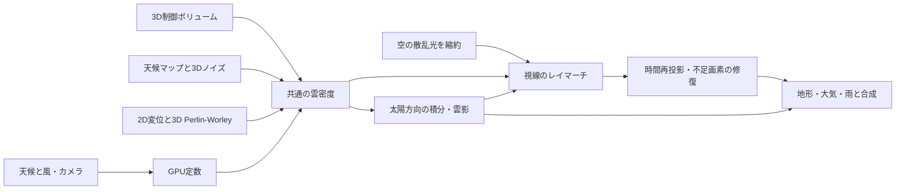

# 雲・影・散乱・天候の実装ガイド

このエンジンは、空間中の雲密度を求める関数を共有し、視線方向には「雲の色」、太陽方向には「雲の自己遮蔽と地表の影」を積分します。C++は天候・カメラ・GPUリソースを管理し、HLSLが各サンプルの密度と光を評価します。



## 読む順番

| 役割 | ファイルと入口 |
|---|---|
| 大型雲の配置・設定検証 | [`cloud_formations.hpp`](../src/cloud_formations.hpp): `CloudFormation`, `readFormations` |
| 入道雲の大まかな3D形状 | [`cloud_volume.hpp`](../src/cloud_volume.hpp): `cloudControlCells`, `bakeCloudControlVolume` |
| 密度と渦の座標変換 | [`formations.hlsli`](../shaders/formations.hlsli): `sampleTowerCloud`, `compositeFormationDensity` |
| 雲の配置マップと高度LUT | [noise.hlsl](../shaders/noise.hlsl) の CloudMapCS |
| 通常の雲海・散乱の共通式 | [`common.hlsli`](../shaders/common.hlsli): `backgroundCloudDensity`, `cloudDensitySample` |
| 雲の描画・自己遮蔽・再構成 | [`clouds.hlsl`](../shaders/clouds.hlsl): `traceCloudRay`, `ShadowCS`, `TemporalCS`, `RepairCS` |
| 天空光と雨霧 | [atmosphere.hlsl](../shaders/atmosphere.hlsl) の SkyAmbientCS と AerialCS |
| GPUリソースと描画順 | [`renderer.cpp`](../src/renderer.cpp): `initializeResources`, `resources`, `frame` |
| 天候の遷移・風・雷 | [`weather.cpp`](../src/weather.cpp): `WeatherSystem` |

## 1. 雲を置く

`CloudFormation`は3個のfloat4、48バイトです。位置XZ、雲底高度、半径、高さ、密度倍率、種類、seed、回転速度、巻き込み強度、傾きを保持し、最大8領域をGPUへ渡します。距離の単位はmです。

サンプル位置から積算した風の移動量を引き、領域中心を原点とする座標へ変換します。XZは領域の半径、高さは領域の高さで正規化します。これによって同じ3Dアセットを、大きさや位置が異なる入道雲へ使えます。

```text
q.xz = (world.xz - windOffset - center.xz) / radius
h    = (altitude(world) - cloudBase) / cloudHeight
```

惑星の曲率を含む`altitude`を使います。`h`は照明にも渡す局所高度です。全領域を囲むAABBの高さを通常の雲海の照明に流用しません。

## 2. 入道雲の3D形状を作る

2026-11-08版では、レイの各点で6個の解析セルを合成する方式から、起動時に作る**128³の3D制御ボリューム**へ変更しました。

`cloudControlCells`は9個の大きな形状を起点に、63個の子と189個の孫を配置します。合計261個です。大きな形状が対流柱と頂部、中くらいの形状が側面の張り出し、小さな形状が丸い突起を支えます。薄いanvilには球状の子を付けず、他の子は標準配置でほぼ球になる比率にします。固定seedなので起動ごとに形が変わりません。

各セルは有限の支持領域を持ち、領域外では厳密に0です。

```text
q = (position - cellCenter) / cellRadii
k = max(0, 1 - dot(q, q))
field += weight * k³
```

セルの範囲と交差するボクセルだけへ書き込み、最後に`field / sqrt(1 + field²)`で0～1へ収めます。テクスチャの6面は0にし、clampサンプリングが外側へ壁を伸ばすのを防ぎます。

C++で生成したfloat列を16bitへ変換し、変更不可の`R16_FLOAT`テクスチャとして登録します。形状の追加GPUメモリは **128 × 128 × 128 × 2 = 4MiB**。全ての入道雲が1枚を共有し、リサイズや各フレームで焼き直しません。`resources()`のt20へ束縛します。サンプル値は最終密度ではなく、雲が存在する大まかな3Dプロファイルです。

座標の変形には、独立した3成分を5次補間で生成する64³の周期ノイズを使います。GPUでは三線形サンプリングします。これは`RGBA16_FLOAT`、2MiBでt21へ束縛します。2枚の追加メモリは合計**6MiB**で、領域数によらず共有します。C++の形状データを変えた場合は再ビルド・再起動してください。F5はHLSLと配置設定の再読み込みです。

## 3. ノイズから最終密度を求める

`backgroundCloudShape`は、風の移動量を引いたXZ座標から65.536 km周期の天候マップを読みます。Rで雲量、Bで雲種に地域差をつけます。雲種は雲頂の減衰と鉛直方向のノイズの縮尺を決めます。雲量は形が残るしきい値に使います。

低周波の変位を加えた位置で、128³のPerlin–Worleyと中間スケールのWorleyを読みます。大きな塊と膨らみに高度プロファイルを掛け、雲底と雲頂で密度を減らします。視線レイは粗い密度とノイズ座標を引き継ぎ、雲がある場所で高周波のWorleyを2回読んで姿を細かく削ります。ノイズの生成式を編集したときはエンジンを再起動してテクスチャを焼き直します。

```text
threshold = 1 - coverage
density = saturate((shape - threshold) / max(coverage, 0.0001) * 2.1)
density = saturate((density - edgeErosion) / (1 - edgeErosion))
```

`sampleTowerCloud`は3D制御ボリューム、渦は雲量と1×128の高度LUTから粗い形を読みます。高度LUTのRGはしきい値、Bは侵食の柔らかさです。どちらも`erodeCloudShape`で2D変位を加えた位置のPerlin–Worleyを読み、表面を削ります。視線・自己遮蔽・雲影は合成後の密度を共有します。雨霧は`CloudMapCS`が作る被覆率マップの下層を参照します。[Rockstarの講演スライド14–18](https://advances.realtimerendering.com/s2019/slides_public_release.pptx)。

## 4. 渦を動かす

渦は雲量と雲頂を制御する低周波の場を巻き込み、内側が速く、外側が遅い6帯の速度を滑らかに補間します。中央の目、周囲の高い雲、普通の雲海へ戻る外周を持ちます。

雲量場へ掛ける強い静的なskewと、丸い塊を作る3Dノイズの回転移流を分けています。両方を強くねじると雲塊が細いチューブへ伸びるためです。`turns`は巻き込み強度で、本数の指定ではありません。

回転は絶対時刻×現在速度で作らず、`formationPhase_`へ時間差×速度を積算します。速度の変更で位相が飛ぶのを防ぎます。履歴を読むときは`previousCloudPosition`で風と半径別の回転を戻します。

## 5. レイマーチで色を求める

球面の雲層と大型雲の保守的AABBから、視線が雲を通り得る区間を求めます。地形より奥と100kmより先は積分しません。Highでは最大384の積分区間を使います。粗い形状に当たった区間は同じ始点から最大3回二分して境界を細かく追い、外へ出ると大きい歩幅へ戻します。残り距離を残り回数で割った値を区間幅の下限にします。

空の区間は照明計算を省き、雲がある区間は詳細密度と照明を求めます。視線サンプルの間隔`ds`と密度から、残る透過率をBeer–Lambert則で求めます。

```text
sigma = density * 0.006
segmentT = exp(-sigma * ds)
weight = accumulatedT * (1 - segmentT)
radiance += weight * lighting
accumulatedT *= segmentT
```

透過率が0.005未満なら終了します。明るい太陽円盤の周囲では0.00005まで積分します。出力RGBは既に透過率を織り込んだ散乱光、Aは**不透明度ではなく残存透過率T**です。基本の重ね方は`cloudRGB + T * backgroundRGB`で、大気・霧は別途合成します。

## 6. スキャッタリングと影

`lightOpticalDepth`は太陽方向へ35 mから歩幅を広げ、近傍では細部を含む密度を積分します。単一散乱は前方と後方のHG位相関数に`exp(-tau)`を掛けます。多重散乱は方向と減衰を弱めた項と等方の項で近似します。

雲の天空光は、上方120・360・900 mの雲密度から減衰を見積もります。高さによる天空光の色と合わせ、上に雲が重なるところが暗くなるようにします。近い視線サンプル間では、距離と密度差が小さい場合に太陽と天空の遮蔽を共有します。`SkyAmbientCS`は空の散乱を1色にまとめて、地表と霧の照明へ渡します。

`ShadowCS`は48km四方の各テクセルを太陽側から進み、透過率の4乗を重みに遮蔽深度を更新します。Highでは768²、通常層は40区間、大型雲が上に出ると24区間を追加します。RG16Fに残存透過率と指数化した深度を保存し、受光点の深度で復号します。半影の幅に応じて参照ミップを広げます。地形の影は2048²の深度マップと3×3 PCFです。[講演スライド28–36と実装対応](cloud-research.md#rockstarのsiggraph-2019講演)。

## 7. ハーフバッファとチェッカーボード

標準の1600×900 / Highでは、雲の論理グリッドは800×450。その半数を400×450の生バッファへ詰め、毎フレーム偶奇を交代させます。

前フレームの色と代表距離を、カメラ・風・渦の移動に合わせて再投影します。地形や雲の距離が合わない画素、履歴が画面外へ出た画素は、`RepairCS`でレイマーチし直します。単純に隣の画素で穴を埋める方式ではありません。カメラカットや雷の発光などでは全画素を更新します。

`--no-checkerboard`は同じ雲グリッドの全画素計算。`--cloud-buffer full --no-checkerboard`は出力と同じ解像度の参照画像です。この2つを区別して誤差を比較してください。

## 8. 天候と動作の確認

`WeatherSystem`が雲量・密度・雲底・厚み・降水量などを遷移させ、時間差を積分して風を動かします。雨霧は下層の雲マップに沿って出し、雲底から離れると薄まります。雨粒は世界座標の粒子、雷は世界座標の発光源と枝分かれした放電として描き、地形・雲・霧にも光を反映します。

```powershell
# 入道雲を近くから。光の向きを変えて凹凸を確認
.\out\vs\Release\CirrusEngine.exe --formations towers --weather overcast --camera tower-close --sun-azimuth 150
# 横から / 内部から
.\out\vs\Release\CirrusEngine.exe --formations towers --camera tower-side
.\out\vs\Release\CirrusEngine.exe --formations towers --camera tower-inside
# 3D形状の断面。最終密度のテクスチャではない
.\out\vs\Release\CirrusEngine.exe --debug-view 24 --texture-axis z --texture-slice 0.5 --texture-viewer
# 座標変形用のノイズ / カメラの周回で視差を確認
.\out\vs\Release\CirrusEngine.exe --debug-view 25 --texture-viewer
.\out\vs\Release\CirrusEngine.exe --formations mixed --weather overcast --camera-path tower-orbit
```

`F8`で大型雲を切り替え、`F9`でプリセットを見渡す視点へ移動できます。新しい近景の視点はCLIから指定し、飛行カメラでも移動できます。`F3`のテクスチャ一覧では雲の二層マップ（26）、高度LUT（27）、太陽側の遮蔽深度（28）を確認できます。

`scripts/capture-cloud-volume.ps1`で同じ時刻・カメラの画像と8秒の周回連番を生成できます。`-ReferenceShaders`には定数バッファが互換な旧HLSLのフォルダーを指定します。今回の比較元は`12bb5e4`です。実画像と誤差の内訳は[11月8日の検証記録](validation.md)に保存しています。

## 採用範囲と残る限界

3Dプロファイルをノイズで高詳細化する設計は、[Nubis³の著者公開PDF](https://d3d3g8mu99pzk9.cloudfront.net/AndrewSchneider/Nubis%20Cubed.pdf)のPDF pp.84、123–125を参照しました。発表では流体計算で育てた雲を編集してボクセルへ保存しています。本実装は独自の階層セルで形状を作っており、流体計算、圧縮SDFによる空間スキップ、発表の全照明モデルは実装していません。

ボリュームは静的な形状を共有し、風で移流します。浮力・凝結・乱流による成長は解いていません。有限の視線・光サンプル、単一の代表距離による時間再構成、近似多重散乱の限界も残ります。RDR2やNubisと同等の画質を保証するものではありません。[調査記録](cloud-research.md)と[実GPU検証](validation.md)も参照してください。
