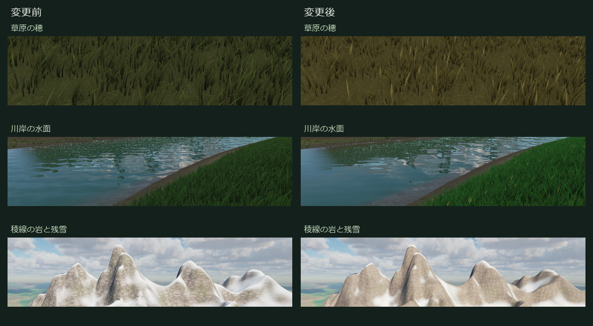

# 草・水・山と雲のプログラム解説

[同一視点の変更前後を切り替える](index.html) · [全章を続けて読む](reader.html)

| 読みたいこと | 本文 | 入口になる関数 |
|---|---|---|
| C++が描画の各段をどう動かすか | [地面の1画素を追う](frame.md) | `wWinMain` → `Renderer::frame` → `CompositePS` |
| 風が積雲の先端をどう曲げるか | [密度・照明・再投影](cloud-code.md) | `bendConvectiveTop`、`traceCloudRay`、`reprojectCloudAA` |
| 草の株から葉と穂をどう描くか | [草の配置と頂点](grass.md) | `GrassField::select`、`GrassPlacementCS`、`GrassVS` |
| 川床の上に流れる水をどう重ねるか | [水の流れと屈折](water.md) | `riverSurfaceDistance`、`riverSurface`、`shadeRiver` |
| 残雪が尾根と窪地をどう見分けるか | [標高から山の材質へ](mountains.md) | `buildRidgeLandforms`、`World::buildTile`、`GeometryPS` |

岩写真を縮めると格子が目立ち、遠くの写真を消すと岩の細部も失われた。山の章では、同じ岩壁の原寸切り出しで2つの試作と採用版を見比べられる。 [岩壁の4案](figures/rock-iterations.jpg) · [3箇所で測った繰り返しの強さ](rock-periods.json)

## 撮影位置で試す

Visual Studio の `CirrusEngine.sln` を `Release | x64` でビルドする。ソリューション直下で次を実行すると、その地点を歩いたり飛んだりできる。時刻付きの例は時計を止め、雲や水面の動きは通常どおり進む。 [ソリューション](../../CirrusEngine.sln)

```powershell
.\out\vs\Release\CirrusEngine.exe --camera walk --spawn 6 -66 --look 18 -17 --weather partly --time 16.2 --day-seconds 0
.\out\vs\Release\CirrusEngine.exe --camera walk --spawn 53 25 --look -25 -14 --weather partly --time 16.4 --day-seconds 0
.\out\vs\Release\CirrusEngine.exe --camera fly --spawn 240 3320 --look 6 20 --no-vegetation --weather clear --sun-elevation 39 --sun-azimuth -52
```

## 画面で確認する



草は手前の茎と穂、水は川岸から見下ろした波と川底、山は岩壁を分ける溝と残雪に注目する。画像比較ページは各視点の幅1920画素の画像を重ねて表示する。比較境界はキーボードの矢印でも動かせる。 [同じ視点を比較する](index.html)

乾いた草原の撮影位置では、GPUが選んだ根元は近景13,405株、中景17,771株、遠景41,190株。葉と穂の違いは同じ根元から頂点を作る段階に現れる。山腹のカメラの高度は220.38 m、稜線を望むカメラは1,453.32 m。高さによって岩の写り方がどう変わるかも見比べられる。 [使ったソースの比較用ハッシュ](sources.json)

比較の両側で `--width 1920 --height 1080 --quality high --frames 10 --fixed-dt 0.0166666666666667 --no-ui --headless --debug-layer` を使用した。草・川・谷は `partly`、山腹と稜線の専用視点は `clear`。撮影条件・画像差・D3D11の診断結果は機械可読の記録にも保存している。採用版は通常の Release 実行ファイルに `--shader-dir` で確定した一式を渡して撮影した。参照したシェーダーと通常起動先のシェーダーは全ファイルをハッシュで照合した。平均RGB差は見た目がどれだけ動いたかを示す表示階調で、リアルさや描画速度を評価する得点には使えない。 [検証記録](measurements.json) · [元の雲の観察と4K比較](../sky-study/README.md)

原寸PNG・ログ・カメラの診断JSONを保存した環境では、以下で同じ数値と図版を再生成できる。Python の NumPy と Pillow、およびWindowsのメイリオを使用する。 [集計と図版作成のコード](checks/measure-landscape.py)

```powershell
python docs/landscape-study/checks/measure-landscape.py captures/landscape-study/20261122 captures/landscape-study/recomputed
```

## 採用版での確認結果

Visual Studio の Release x64 と通常起動用のCMakeビルドが完了した。RTX 5080で撮った6視点と水面マスクは変更前後ともD3D11のエラー・警告が0件、レポート上の非有限値が0件だった。川岸の同じ291,110画素で水面同士を比較できる。全画面のうち、葉が水面を隠す境界は比較から外した。ブラウザーで6視点の切り替えとスライダー操作を確認した。

CTest は既存4件が通過。天候、特殊雲の設定、雲の制御ボリューム、HLSLコンパイルを確認した。HLSLの検証は描画と並行した試行で120秒の上限に達し、撮影終了後の最終実行では117.33秒で通過した。
