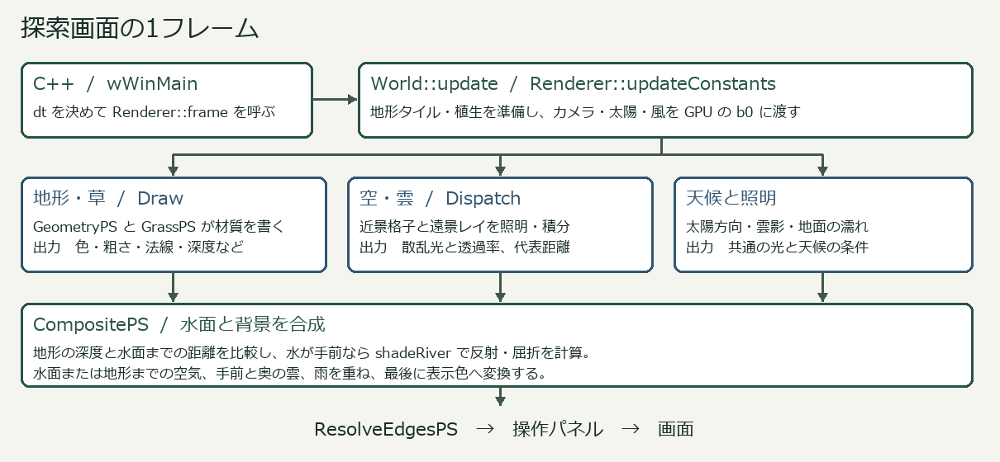

# 地面の1画素を、C++から画面まで追う

川岸を歩いたとき、目の前の草と遠くの山は同じ太陽で照らされる。その下の川は、すでに描いた地形の深度を使って、水に覆われる場所だけを塗り替える。この順序は `Renderer::frame` に集まっている。以下の関数名は Visual Studio の「ソリューション全体を検索」でも探せる。 [フレームの実装](../../src/renderer.cpp) · [Windowsの入口](../../src/main.cpp)



## CPUからGPUに渡る値を一つ見る

`wWinMain` がフレームの経過秒数を決め、`engine->frame(dt, ...)` を呼ぶ。探索時は `World::update` がカメラの周囲のタイルと植生を用意し、`Renderer::updateConstants` が現在と前回のカメラ、太陽、風、材質の描画設定を `FrameData` に詰める。次の抜粋では GPU が読む領域へ構造体をコピーし、同じバッファを頂点・ピクセル・コンピュートの各段のスロット0へ結び付ける。 [CPUのFrameData](../../src/renderer.hpp) · [GPUのcbuffer Frame](../../shaders/common.hlsli)

```cpp
std::memcpy(mapped.pData, &constants_, sizeof(constants_));
context_->Unmap(frameBuffer_.Get(), 0);
ID3D11Buffer *cb = frameBuffer_.Get();
context_->VSSetConstantBuffers(0, 1, &cb);
context_->PSSetConstantBuffers(0, 1, &cb);
context_->CSSetConstantBuffers(0, 1, &cb);
```

直前の `Map(..., D3D11_MAP_WRITE_DISCARD, ...)` で今回の書き込み先が得られる。HLSL側の `cbuffer Frame : register(b0)` がこのバッファを読む。草が曲がる向きと雲の移動を調べるときは、`WeatherEffects.yz` が風速、`Wind.xy` が積算した移動量であることに注意する。単位が m/s と m なので、同じ方向でも使い道が異なる。 [定数の書き込みと束縛](../../src/renderer.cpp) · [Microsoftによる定数バッファの説明](https://learn.microsoft.com/en-us/windows/win32/direct3d11/overviews-direct3d-11-resources-buffers-intro)

## 草と山が共有するG-buffer

草は `GrassPS`、山肌は `GeometryPS` が材質を作る。どちらも `encodeMaterial` を通る。ここでは影付きの完成色を焼かず、照明時に必要な値を3枚へ分ける。例えば草の表裏の法線を変えると2枚目が変化し、後の照明で葉の明暗が変わる。 [草のシェーダー](../../shaders/grass.hlsl) · [地形と照明](../../shaders/scene.hlsl) · [G-bufferの定義](../../shaders/geometry.hlsli)

| 出力 | RGB | A |
|---|---|---|
| `SV_Target0` | 線形アルベド | 粗さ |
| `SV_Target1` | ワールド法線を0～1へ変換 | 金属度 |
| `SV_Target2` | 自己発光 | 材質の遮蔽率 |

地形の実寸の位置は深度と逆ビュー射影行列から復元する。`surfaceLighting` が材質と太陽、雲影、周囲光を組み合わせる。同じ法線画像でも、午後から夕方へ時間を進めれば山の岩壁や草の陰の落ち方が変わる。 [地形から最終照明まで](../../shaders/scene.hlsl)

## 川と雲を合成する順序

1. `drawGeometry(false)` が不透明な地形・草木の材質と深度を確定する。地形と草の影はこの前段で別の視点から描く。
2. `CompositePS` がカメラから不透明面までの距離を `opaque` として得る。`riverSurfaceDistance(ray, opaque)` の結果がそれより手前なら、`shadeRiver` に川床側の照明色と両方の距離を渡す。
3. 川が手前なら水面まで、地形なら地形までの距離で空気遠近と霧を評価する。雲の自己散乱光と透過した背景を合成し、その後に雨と表示用のトーンマップを適用する。探索の通常表示では最後に画面の縁もフィルタする。 [合成のHLSL](../../shaders/scene.hlsl) · [川を描く関数](../../shaders/river_water.hlsli)

## Visual Studioでたどる

`CirrusEngine.sln` の `Release | x64` をビルドする。起動引数に `--camera walk --spawn 53 25 --look -25 -14 --time 16.4 --day-seconds 0` を入れると川の比較位置に立てる。`Renderer::updateConstants` にブレークポイントを置くとCPU側の `constants_.sunDirection` などが確認できる。GPUの出力は F3 の一覧の `GBUFFER NORMAL`、`GBUFFER ROUGHNESS`、`RIVER SURFACE` を順に選ぶと、法線・粗さ・水面判定を最終色と照合できる。 [ソリューション](../../CirrusEngine.sln) · [デバッグビューの実装](../../src/renderer.cpp)
