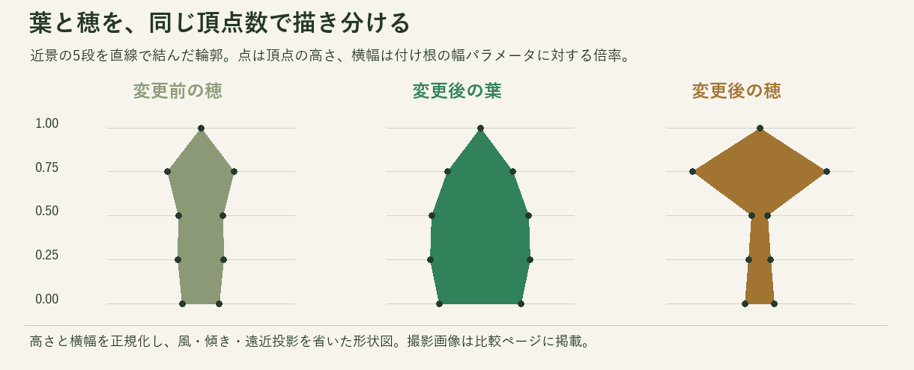

# 草原のプログラムを株から画素まで追う

歩くカメラの足もとで、背の低い緑の葉と、そこから突き出す黄褐色の穂が一緒に揺れる。今回手を入れたのは、GPUが一枚の葉を立ち上げる形と色、そして草原を横切る風の波だ。川に近い所では普通の葉が高く育ち、乾いた所では葉先が色づき、穂が増える。

## C++が地形を渡す

1. `Renderer::frame` がカメラ位置を `World::update` に渡す。カメラが64 mのセルをまたぐか地形タイルが更新されると、`World::updateGrassHeight` が歩行地形の表面を4 m間隔、193×193点でサンプリングする。地面からカメラまでの高さが120 m未満のときに草の近景描画が有効になる。[world.cpp](../../src/world.cpp) · [world.hpp](../../src/world.hpp)
2. `GrassField::setTerrain` が高さを1画素1個の32ビット浮動小数テクスチャに転送する。`GrassField::select` はカメラを中心に3段の配置格子を作り、各段の原点・間隔・距離を定数バッファ `b4` に渡す。前回と同じ視点行列・シェーダーなら、生えている株のリストを再使用する。高さの更新時には再選択が必要になる。[grass.cpp](../../src/grass.cpp)
3. `GrassPlacementCS` は8×8スレッドで候補地を走査する。セル座標のハッシュで根の位置を少しずらし、地形の三角形と同じ対角線で高さと勾配を復元する。水際の水没地点、急斜面、踏み跡では間引く。残った株だけを `SelectedGrass.Append(site)` で記録する。[grass.hlsl](../../shaders/grass.hlsl)

各株のデータは計32バイト。根の世界座標3成分の後に、株の種となる整数、地面のX・Z勾配、湿り具合、水際からの近さが続く。湿り具合は世界座標の大小二つの模様を滑らかに混ぜた値で、水際からの近さは川の形から別に求める。乾燥・湿潤の区画はカメラを戻すと元の位置に現れる。[配置に使う共通関数](../../shaders/meadow.hlsli)

## 同じ頂点列から、葉と穂ができる

`GrassVS` は `SV_InstanceID` で株を、`SV_VertexID` で株の中の何枚目、何段目、左右どちらの縁かを選ぶ。近景の葉には高さ方向に5段ある。根を0、先端を1とする高さ `t` に応じて各段の幅を変え、左右の頂点を結ぶ。CPUは既に選んだ株数を `CopyStructureCount` で描画引数に移し、`DrawIndexedInstancedIndirect` を呼ぶ。CPUが毎フレーム葉の頂点を一枚ずつ書き換える処理は要らない。[GPU側の頂点生成](../../shaders/grass.hlsl) · [C++側のインデックスと間接描画](../../src/grass.cpp)



従来の穂は普通の葉を土台にし、高さを決める同じ乱数が小さいと穂になった。このため、穂を選ぶと元の葉の背丈まで小さい側に偏った。今回の `GrassVS` では、株内の最初の2本を穂の候補とし、選択と背丈に異なるビット列から得た値を使う。各候補が穂になる確率は湿った区画で8%、最も乾いた区画で38%。これとは別に、普通の葉の背丈と幅、葉先が枯れ色になる程度に湿り具合を反映する。ここでの「湿り」は地形上の植生分布で、雨で葉が濡れる度合いは `WeatherEffects.x` が別に担当する。

形を変更するときの入口は `leafProfile` と `culmProfile`。普通の葉は下から中ほどに幅がある。穂の形は細い稈に、上部のふくらみを加えて作る。次は実装にある2つの式である。

```hlsl
float ear = smoothstep(0.49, 0.71, t) * (1 - smoothstep(0.76, 1.0, t));
float culmProfile = 0.23 * (1 - t) + 0.98 * ear;
```

`t=0` の横幅倍率は0.23、`t=0.75` では約1.04、先端では0。近景の5段は0、0.25、0.5、0.75、1を通るので、上側のふくらみが三角形の輪郭に現れる。葉は高さに応じて幅方向の軸も少し回す。根に芯が残り、先端へ向かうほど葉の面がひねられて、左右の縁が違う方向から光を受ける。

## 一本の葉と地面の風をそろえる

天候側は風速を時間積分して、世界のX・Z方向に風がどれだけ進んだかを保持する。`Renderer::updateConstants` は積算移動量を `Wind.xy` に、現在の風速を `WeatherEffects.yz` に入れる。草と地面のどちらも `meadowGust` を呼ぶ。ここでは `p - 0.58 * Wind.xy` の位置の波を評価するため、静かな瞬間にカメラだけを動かしても風の模様は地面に残る。[weather.cpp](../../src/weather.cpp) · [定数を書き込む箇所](../../src/renderer.cpp) · [風の関数](../../shaders/meadow.hlsli)

広い波が二つの細かい波の位相をずらし、現在の風向に合わせて二つを混ぜる。風向の変更でも世界全体の波の座標軸は回転しない。草側は風による変位に `t*t` を掛ける。根では変位0、中ほどでは先端の4分の1になる。離れた場所では地面の `GeometryPS` が同じ風の値で下草の明暗を弱く動かす。風が谷を進む方向を近景の葉と遠景の地表でそろえる役割がある。[草の頂点](../../shaders/grass.hlsl) · [地形の画素](../../shaders/scene.hlsl)

## 遠さで省くもの、影に残すもの

| 株の段 | 候補格子の間隔 | 1株の葉×頂点の段 | 1株の三角形 | 切り替わりの範囲 |
| --- | ---: | ---: | ---: | --- |
| 近景 | 0.25 m | 12枚×5段 | 84 | 22～35 mで中景へ |
| 中景 | 0.50 m | 6枚×4段 | 30 | 86～123 mで遠景へ |
| 遠景 | 0.98 m | 4枚×3段 | 12 | 246～310 mで消える |

近景と中景には穂が立つ。遠景は太めの葉で面積を確保し、草の格子の先には下草の地表色が続く。段の切り替えではセルごとの固定乱数と距離の重みを比較して株を減らす。今回も各段の候補数、三角形数、株データの大きさは同じ設定を使う。変形や風を評価する頂点演算は増えており、三角形数だけからGPU時間を換算することはできない。[LODの実数値](../../src/grass.cpp)

距離の切り替えでは、各段がそれぞれの格子から別の株を選ぶ。歩いて距離境界を越えると、一株ずつ出入りすることがある。穂を決める乱数は時刻に依存しない。一方、幅2.5 cmの穂を深度30 mで真正面から見ると、垂直画角62°・720pで約0.50画素しかない。この大きさでは風や視点の移動で画素を横切り、明るさが変わりやすい。雲専用のTAAは地形や草のG-bufferの描画後、雲バッファに対して働く。

`GrassShadowVS` は `GrassVS` と同じ位置計算を呼ぶ。草影が有効な場合、色を描く前に足もと44 m四方の1536×1536深度マップへ近景の株を投影する。曲がった葉と影が同じ風に追随する。色描画では `GrassPS` がアルベド・粗さ・法線・遮蔽を書き、近景だけ葉脈テクスチャも参照する。`encodeMaterial` の最後の引数 `-ao` は、後段の `surfaceLighting` で葉の透過光を有効にする符号でもある。最終的に地形上へ落ちる草影、草そのものが見せる根元の暗さ、逆光の葉先はそれぞれ別の計算から届く。[影の描画順](../../src/renderer.cpp) · [G-bufferの格納先](../../shaders/geometry.hlsli) · [透過光と影の合成](../../shaders/scene.hlsl)
