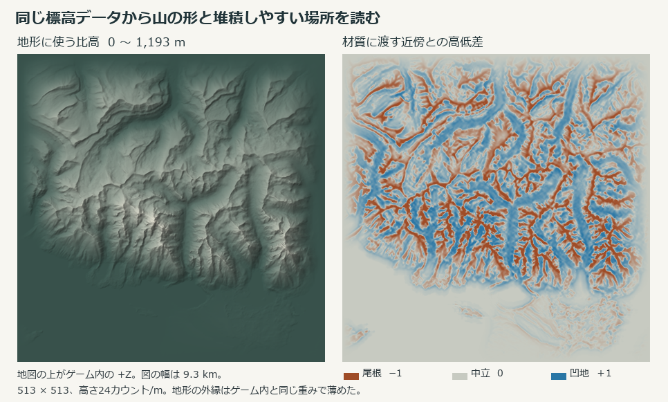

# 山のプログラムを読む

画面のどこに雪が残るかは、山の高さだけでは決まらない。この山では、標高が同じ地点でも、突き出た尾根には岩が出て、その隣の窪地には雪が残る。地形頂点の高さと、その頂点で使う材質の情報を同じ標高データから作る。



## 1. C++で実測地形を読み、尾根と谷を判定する

`World::World` が `assets/world/teton-relief.r16` を符号なし16ビットの配列に読み、`buildRidgeLandforms` を一度呼ぶ。元データは米国ワイオミング州ティトン山地のUSGS標高データ。ゲーム内で回転・縮小した比高を、9.3 km四方、513×513点、1 mあたり24カウントで保存している。格子の間隔は約18.16 m。 [読み込みと地形の判定](../../src/world.cpp#L325) · [元データと加工手順](../../assets/world/credits.md)

各格子点で、東西南北4点の平均と中央の標高との差を取る。急でも一枚の平面になっている斜面は、周囲の平均が中央に戻るので値がほぼゼロになる。尾根は中央が高いので負、谷は低いので正になる。

```text
d4  = 半径4格子の周囲平均 − 中央の標高      約73 mの地形を読む
d12 = 半径12格子の周囲平均 − 中央の標高     約218 mの地形を読む
F = 0.62 × clamp(d4 / 30 m, −1, 1) + 0.38 × clamp(d12 / 88 m, −1, 1)
```

小さい半径は細い沢筋を、大きい半径は幅のある窪地を拾う。地図中央付近の主峰（XZ = 451, 5214 m）を実データで調べると比高は1,192.875 m、`F = −1`。図中の青と茶は、この値を材質へ渡す前に色で可視化したもの。ゲームの地面の最終標高には、さらに周辺の丘陵などが加わる。

## 2. 地形タイルからピクセルシェーダーへ値を渡す

`World::buildTile` が各頂点で `terrainHeight` から高さを、周囲の高さの差から法線を求める。材質には `sampleRidgeField(ridgeLandforms_, px, pz)` で取り出した `F` を入れる。標高と分類は同じ4点で双線形補間し、実測範囲の外縁では滑らかにゼロへ落とす。タイルが遠くなると頂点間隔が広がるので、最も遠い描画では小さな沢筋ほど見えにくくなる。 [頂点生成](../../src/world.cpp#L469) · [標高と分類の標本化](../../src/world.cpp#L304)

```cpp
float landform = sampleRidgeField(ridgeLandforms_, px, pz);
vertices.push_back({{px, y, pz}, normal, {landform, 0, 0, 0.91f}});
```

`Renderer::drawGeometry` が地形用シェーダーを設定し、`World::bindTerrainMaterials` が草地・土・砂利・岩の7枚を `t37` から `t43` に結びつける。入力レイアウトの `COLOR` は浮動小数点4成分で、負の値も通る。探索地形の `GeometryVS` がこの値を渡すと、GPUは三角形の内部で補間する。`GeometryPS` は `v.material.x` を地形分類、`v.material.a` を乾燥時の基本粗さとして読む。 [描画する側](../../src/renderer.cpp#L1557) · [受け取る側](../../shaders/scene.hlsl#L161)

## 3. 岩、崖の下の石くず、残雪を描き分ける

| 入力 | シェーダーの変数 | 見え方 |
|---|---|---|
| 山の凹凸 | `hollow = max(F, 0)`, `crest = max(−F, 0)` | 尾根を露岩に寄せ、緩やかな窪地には石くずを集める |
| 幾何法線のY | `cliff`, `snowShelf` | 崖では岩が見え、雪を載せられる傾斜では岩肌が雪に覆われる |
| 幾何法線のZ | `snowLine` | 固定した向きの斜面で積雪開始高度を下げる |
| 世界座標 | `rockPlane`, `fracture` | 岩壁に数十～百m規模の明暗を加える。細かい粒は岩の写真から読む |
| 雪の被覆 | `snow` | 色を雪色へ寄せ、露岩の法線の凹凸を最大85%抑える |

雪が出始める高さの中心は1,330 m。尾根では最大175 m高く、窪地では最大245 m低くし、方位と既存の地表模様で境界を崩す。そこから下55 m・上85 mの幅で切り替え、さらに斜度を掛ける。たとえば、同じ標高でも尾根の岩と沢に残る雪が隣り合う。雪が積もる過程や融雪の時間発展を計算する部分はなく、固定した雪の分布に時刻ごとの日射と影が動く。 [材質と雪の式](../../shaders/scene.hlsl#L242)

岩の色と法線は地面の向きに応じて、XY・XZ・ZYの3平面から投影する。高所の凹地にたまる石くずには、読み込み済みの砂利と岩の明度を使う。湿った地面、露岩、崖の下の石くず、残雪では粗さも変える。`encodeMaterial` が色、粗さ、法線をG-bufferに書き、`surfaceLighting` が太陽・雲影・環境光を評価する。色の段階に固定した暗い影を描き込む処理は使っていない。 [G-bufferへの格納](../../shaders/geometry.hlsli) · [照明の読み戻し](../../shaders/scene.hlsl#L281)

### 三角形ごとのサンプルで岩写真の反復を崩す

最初の山腹レンダーでは、岩写真1枚を約77 m間隔で貼ったため、同じ角のある岩が何段も並んだ。約11.5 mに縮めて座標を曲げた案では、遠くの岩壁に細かい斜めの格子が出た。さらに遠景の写真をすべて手続き模様に置き換えた案では、岩の粒が薄れ、閉じた曲線が目立った。採用案は岩写真の一辺を25 m相当にして、写真のどの位置を読むかを場所ごとに変える。 [同じ位置から見た岩壁の試作比較](figures/rock-iterations.jpg)

`mountainRock` は高地の世界座標を約28°回し、三方向に15・18・14 mの振幅で滑らかに曲げる。岩面の向きに合わせ、XY・XZ・ZYの各面に写真を投影する。各投影面の三角格子で、格子の頂点を種にして写真上のずらし量を決める。三角形の内部では3枚のパッチを補間する。対角線の `f.x + f.y = 1` では両側の三角形とも重みが `(0, f.x, f.y)` になる。境界の2頂点とずらし量を共有するので、平滑化して正規化した後も同じ2枚が同じ重みでつながる。 [三角格子と乱数の種](../../shaders/scene.hlsl#L87) · [三方向でのサンプル](../../shaders/scene.hlsl#L114)

```text
頂点ごとの重み = 三角形内の重心座標を smoothstep で滑らかにした値
画素の色       = Σ (重み × 各頂点でずらした写真の色) / Σ 重み
```

写真と法線には同じずらし量と同じ重みを使う。各パッチの `SampleGrad` に渡す画面方向の勾配は、ずらし量を加える前の連続した投影座標から計算する。距離に応じてミップを選び、境界で乱数が変わってもミップ幅が跳ねにくい。法線の勾配は変形のヤコビアンの転置で元の空間へ戻す。低地で使う写真の参照は従来の色3回・法線3回。高地は3方向 × 3パッチ × 色・法線の18回、標高260～475 mの遷移域では両方を使う。これらは岩写真だけの参照数である。

三角格子の3パッチは Heitz と Neyret の論文を参考にした。原論文は事前に求めたヒストグラム変換と逆変換で入力写真の分布を保つ。この実装は合計1に正規化した重みで色と法線を混ぜるため、パッチが重なる所では元写真よりコントラストが弱くなる場合がある。 [Heitz & Neyret, High-Performance Graphics 2018](https://eheitzresearch.wordpress.com/722-2/)

## 4. 歩いている高さとの関係

地形分類は材質用の頂点成分だけに入る。地面の高さを問い合わせる `World::ground` は近距離タイルと同じ4 m格子・同じ対角線で三角形を補間する。植物の配置には `World::surface` を使う。地形そのものの高さ、歩行面、川底と水面の位置関係を共有したまま、同じ地点で露岩と残雪の見え方を比較できる。分類用配列の追加メモリは513×513×4バイトで約1.00 MiB。GPUの頂点サイズと地形テクスチャの枚数は同じ。 [歩行面](../../src/world.cpp#L719) · [描画した三角形の高さ](../../src/world.cpp#L649)

### 実データで歩行面を照合した結果

改修前後の `valleyRidges`、`terrainHeight`、`ground` の関数本体を別の名前空間へ取り出し、同じ実測データを入力にMSVC x64の単精度浮動小数点で計算した。格子の節だけで一致しても補間の変更を見落とすので、各セルの中央と偏った位置も調べた。

| 調べた位置 | 延べ照合地点数 |
|---|---:|
| 513×513の全格子点 | 263,169 |
| 512×512の全セルの中央 | 262,144 |
| 各セルの中心を外した2点 | 524,288 |
| 4辺と裾の補間境界、その直前・直後の浮動小数点座標 | 12,312 |
| 川を横切る測線 | 109,181 |
| 合計 | **1,171,094** |

3種類の高さの計3,513,282比較すべてで、変更前後の32ビット表現が一致した。各高さの最大絶対差は0 m、非有限値は0件。川の境界などで同じ位置が重なるので、表は照合回数を数えた。 [入力ファイルのハッシュと各群の結果](mountain-height-validation.json) · [比較に使用したC++プログラム](checks/compare-mountain-height.cpp)

再実行するにはVisual StudioのDeveloper PowerShellを開き、リポジトリのルートから次を実行する。

```powershell
$sourceFile = (Resolve-Path docs/landscape-study/checks/compare-mountain-height.cpp).Path
$heightFile = (Resolve-Path assets/world/teton-relief.r16).Path
Push-Location $env:TEMP
try {
    cl /nologo /O2 /std:c++20 /fp:precise /EHsc /Fe:compare-mountain-height.exe $sourceFile
    if ($LASTEXITCODE -ne 0) { throw "ビルド失敗" }
    .\compare-mountain-height.exe $heightFile
} finally {
    Pop-Location
}
```

## 5. 山腹と残雪を別の視点で確かめる

山腹の岩の繰り返しは、谷側から仰角20°で比べると見つけやすい。この画面は手前の尾根が高く、主峰近くの雪が隠れる。

```powershell
.\out\vs\Release\CirrusEngine.exe --camera fly --spawn 240 3320 --look 6 20 --weather clear --no-vegetation --sun-elevation 39 --sun-azimuth -52
```

残雪を見るカメラは主峰の北東側（ゲーム内の+X・+Z）に置く。カメラから主峰までの水平距離は約1.62 km、主峰の仰角は約8.7°で、垂直画角62°に収まる。撮影点を選ぶ際は前後各2.5%を除いた視線の160点で、実際の地形高さを標高格子に評価して比較した。視線と地形との間に、格子上の推定で最小約54 mの余裕がある。谷側へ光が差して雪と露岩を追えるよう、太陽方位を5°へ回している。

```powershell
.\out\vs\Release\CirrusEngine.exe --camera fly --spawn 1261 6617 --look -150 -3 --weather clear --no-vegetation --sun-elevation 38 --sun-azimuth 5
```
