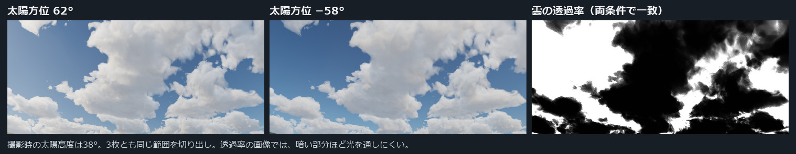
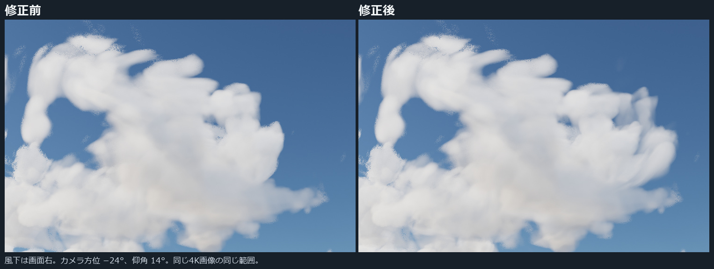
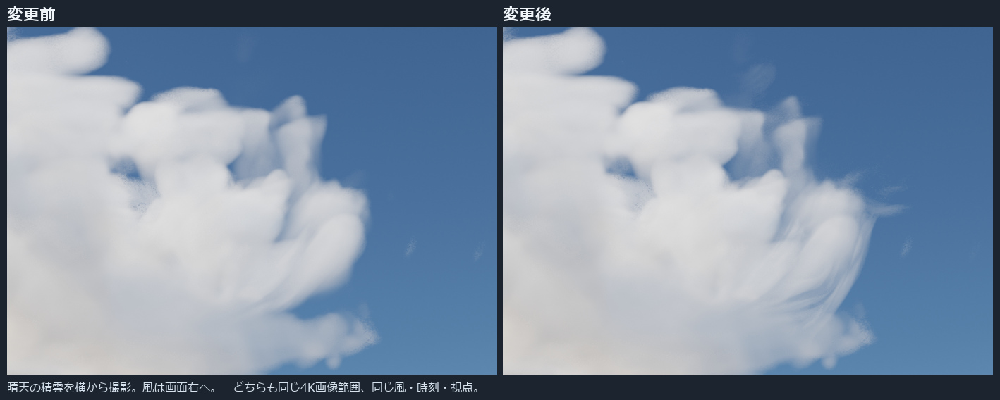
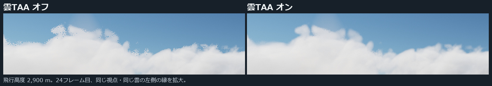

# 普通の積雲が写真と違って見える理由を調べる

CirrusEngine の地上と飛行視点で見る晴天・晴れ間の積雲を対象に、研究論文15本と制作講演4件を調べた。今回もっとも参考になったのは、雲頂の成長を追った断面図と、雲の密度を与えたうえで写真から照明を合わせた比較図だった。既存の Perlin–Worley を基準に、どの空間スケールの形や光が不足しているかを調べられる。

実写3例と同一視点の4Kレンダーでこの形を確かめた。[図入りの実装・検証記録](sky-study/README.md)

## 最初に見る図

- **曲がった先端の内側で何が起きるか。** Zhao & Austin の図4は、浅い積雲の同じ上昇部を7.5、8.5、9.5、10.5分に切った鉛直断面。図4c–dでは雲の頭が右に張り出し、その下にくびれができる。矢印は雲頂に対する相対流、実線は雲水の等値線。図8では同じ時刻の浮力分布も読める。一つの塊を傾ける操作と、「根元から立ち上がって、頭の片側だけが巻く」形を見分けやすい。これは大規模渦シミュレーション（LES）の一例。 [図4、本文 p.1297](https://www.gfdl.noaa.gov/wp-content/uploads/files/user_files/miz/papers/zhao05life2.pdf#page=7) · [図8、本文 p.1301](https://www.gfdl.noaa.gov/wp-content/uploads/files/user_files/miz/papers/zhao05life2.pdf#page=11)
- **丸いこぶが連続した雲面に見える条件。** Bouthors & Neyret の図1の実写では、大きな膨らみの肩に小さい丸みがあり、隣の膨らみとの間には浅い溝が残る。著者らは親の面上で子の位置・つぶれ方・隣同士の接し方を扱っている。CirrusEngineの試作で楕円体を重ねたときに現れた、丸い塊が同じ太さで二段に積まれた印象との比較に向く。 [著者資料](https://evasion.inrialpes.fr/Publications/2004/BN04/)
- **形が同じでも、明るい肩と暗い谷は変わる。** 土橋らの図1では、各小窓が実写、大きな画像が推定したパラメータによる合成結果。図10では色合わせと散乱を含む推定を比較し、視点や光の方向も変えている。色ヒストグラムで見た目を合わせる手法なので、輪郭や奥行きの一致は別に評価する必要がある。 [図1、論文PDF](https://www.cs.columbia.edu/~yonghao/siga12/dobashi-cloud-rendering-parameter.pdf#page=1) · [著者の解説](https://cg.it.aoyama.ac.jp/yonghao/siga12/abstsiga12.html)

実写の基準には、横風で傾いた発達中の積雲と、夕方の海上で複数の雲頂が並ぶ例を使った。前者では張り出す先の厚み、後者では母体の暗部の上に複数の明るい面が立つ様子が見える。太陽の位置・撮影距離・露出が異なるため、2枚を同じ明るさに合わせる目標には使えない。 [Janne Naukkarinen撮影の積雲](https://commons.wikimedia.org/wiki/File:Cumulus_congestus_slant_1.JPG) · [Ralph F. Kresge撮影、NOAAの大西洋の並積雲](https://commons.wikimedia.org/wiki/File:Cumulus7_-_NOAA.jpg)

## 雲の内部と、雲と雲の間隔を調べた研究

| 研究 | 対象と結果 | この空で見る点 |
| --- | --- | --- |
| Joseph & Cahalan（1990） | 海上15海域のLandsat画像で晴天積雲の最近傍間隔を測定。間隔の分布は雲の実効半径に依存し、小さい雲の群れも見られた。 | 雲量が同じでも空の抜け方が違う。大小別に、隣の雲までの間隔を見る。 [NASAの論文記録](https://ntrs.nasa.gov/citations/19900061594) |
| Blyth, Lasher-Trapp & Cooper（2005） | フロリダの浅い積雲の航空観測。上昇部で外向きの流れ、縁で下降流を多く観測した。内部で液水量が減り、飛行経路上で完全に途切れた例も2件あった。 | 雲の中心にも濃淡や途切れはある。画面上の穴を一律に塞ぐ判断には根拠が足りない。 [著者所属大学の要旨](https://experts.illinois.edu/en/publications/a-study-of-thermals-in-cumulus-clouds/) |
| Zhao & Austin（2005） | 一つのLESから浅い積雲6例を追跡。上昇する気塊が繰り返し雲を成長させ、鉛直シアの下で巻き込みや混合が片側に偏った。 | ひとつ前の膨らみと新しく育つ膨らみで、高さと横位置が違ってよい。 [論文](https://journals.ametsoc.org/view/journals/atsc/62/5/jas3415.1.xml) |
| Damiani, Vali & Haimov（2006） | 航空機のデュアルドップラーレーダーで上昇気塊の環状循環を観測。対象は雲底の高い大陸性の積雲で、深さは2–3 km。風の鉛直シアがある例では循環も傾いた。 | 発達した雲の肩の参考になる。報告された寸法をすべての晴天積雲に当てはめる根拠はない。 [論文](https://journals.ametsoc.org/view/journals/atsc/63/5/jas3701.1.xml) |
| Heus & Jonker（2008） | 浅い積雲の周囲で空気が下降する薄い領域をLESで解析。調べた条件では雲水の蒸発冷却による負の浮力が下降の主因。 | 乾いた空気を取り込む縁と、上昇中の丸い頂の違いに着目する。 [論文](https://journals.ametsoc.org/view/journals/atsc/65/3/2007jas2322.1.xml) |
| Wang, Geerts & French（2009） | 3地域、1,624回の積雲の航空横断を集計。図15・16で中心から縁に向かう液水・鉛直速度などを比較し、雲縁付近の液水の減少と下降を示した。 | 濃い上昇部と、液水が減っていく境界の位置関係を見る。 [著者公開PDF](https://www.uwyo.edu/atsc/directory/faculty/geerts-research/images/wang_jas.pdf) |
| Stevens ほか（2020年巻号） | 熱帯大西洋の冬季の衛星画像900枚を分析し、複数の代表的な雲群パターンを識別した。 | 群れの偏りと大きな晴れ間の参考になる。一個の雲頂の模様を決める資料とは観測スケールが違う。 [論文](https://rmets.onlinelibrary.wiley.com/doi/full/10.1002/qj.3662) |

## 体積の形をどう作るか

| 研究 | 方法と、このエンジンに関係する点 |
| --- | --- |
| Bouthors & Neyret（2004）, *Modeling Clouds Shape* | 大きさの異なる膨らみを親の表面に配置し、隣接粒子に応じて陰関数の面を変形させる。中央を切っても繋がる母体と、外から読める溝を両立させる発想。 [Eurographics](https://diglib.eg.org/items/89fce801-93d6-4c4b-9273-9367b73b89d2) |
| Dobashi, Shinzo & Yamamoto（2010）, *Modeling of Clouds from a Single Photograph* | 写真から画素ごとの明るさと不透明度を推定し、積雲には3D体積、巻雲には2Dテクスチャを構成した。一枚から奥行きを与える部分にはモデルの仮定が入る。 [北海道大学の論文PDF](https://eprints.lib.hokudai.ac.jp/repo/huscap/all/47036/CGF29-7_2083-2090.pdf) |
| Goswami & Neyret（2017）, *Real-time Landscape-size Convective Clouds Simulation and Rendering* | 気塊の浮力と周囲との混合を粗い粒子で扱い、体積ノイズで細部を補う。上昇部ができる場所・時刻を決める仕組みと、現在のノイズ資産を併用できる実例。 [Eurographics](https://diglib.eg.org/items/20f37d97-4db9-42a3-857a-99e5ea02de1e) |
| Webanck ほか（2018）, *Procedural Cloudscapes* | 図5で雲種別の大形状と、細部を差し引いた結果を比較している。地図上でどこに群れを置くかと、個々の群れがどう見えるかを別々に調べられる。 [著者公開PDF](https://perso.liris.cnrs.fr/eric.galin/Articles/2018-cloudscapes.pdf) |

## 光と密度をどう見分けるか

| 研究 | 方法と、このエンジンに関係する点 |
| --- | --- |
| Bouthors ほか（2008）, *Interactive Multiple Anisotropic Scattering in Clouds* | 散乱次数ごとに、見ている点に届く光が雲のどの照射面から入ったかを近似する。中心を一様としたモデルでも、照らされた面の広がりが陰影に効く。 [著者公開PDF](https://evasion.inrialpes.fr/Publications/2008/BNMBC08/clouds.pdf) |
| 土橋 ほか（2012）, *An Inverse Problem Approach for Automatically Adjusting the Parameters for Rendering Clouds Using Photographs* | 合成雲の密度を入力し、多重散乱を考慮して実写に合う描画パラメータを推定。輪郭がほぼ合うのに白い面と暗い谷が出ないときの比較に使える。 [著者の論文ページ](https://cg.it.aoyama.ac.jp/yonghao/siga12/abstsiga12.html) |
| Levis ほか（2015）, *Airborne Three-Dimensional Cloud Tomography* | 多視点から見た散乱光と3D放射輸送を使い、体積内の散乱体分布を逆推定する。地上からの静止画に加えて、横からの透過率も見る理由になる。 [ICCV論文](https://www.cv-foundation.org/openaccess/content_iccv_2015/html/Levis_Airborne_Three-Dimensional_Cloud_ICCV_2015_paper.html) |
| Kallweit ほか（2017）, *Deep Scattering* | 観測点と光源の周囲の密度を複数のスケールで入力し、参照解の入射放射輝度を学習する。目の前の密度が等しい2点でも、周囲の雲の厚みで光が変わる。 [Disney Research](https://la.disneyresearch.com/publication/deep-scattering/) |

## ゲームの公開講演と照合した結果

| 講演 | 公開された設計 |
| --- | --- |
| Guerrilla, *The Real-time Volumetric Cloudscapes of Horizon: Zero Dawn*（2015） | 実写の丸い塊、密に重なる膨らみを観察し、天候・高度で制御する基本形に複数帯域のノイズを使う。 [講演スライド](https://d3d3g8mu99pzk9.cloudfront.net/AndrewSchneider/The-Real-time-Volumetric-Cloudscapes-of-Horizon-Zero-Dawn.pdf) |
| Guerrilla, *Nubis*（2017） | 被覆率・雲種・高度で密度分布を変える。高周波Worleyで外側を侵食する際に値を再マップし、中心の密度の過剰な減少を抑える。ノイズの種類と、密度に適用する方法は個別に点検できる。 [講演スライド](https://d3d3g8mu99pzk9.cloudfront.net/AndrewSchneider/Nubis-Authoring-Realtime-Volumetric-Cloudscapes-with-the-Decima-Engine-Final.pdf) |
| Fabian Bauer／Rockstar, *Creating the Atmospheric World of Red Dead Redemption 2*（2019） | スライド14は上面視の配置、16は高度別形状のLUT、17–18は低周波形状への2D変位テクスチャの2回の参照と1回の3D Perlin/Worleyによる侵食。28・35–36は散乱と可視性、42・49–50は近距離の視錐台格子と遠距離のレイマーチ。スライド18には細部を加える前後が並ぶ。 [公式講演ページ](https://advances.realtimerendering.com/s2019/) · [発表者ノート付きスライド](https://advances.realtimerendering.com/s2019/slides_public_release.pptx) |
| Guerrilla, *Nubis³*（2023） | 雲内を飛行する用途で、流体シミュレーション由来の雲体積、圧縮距離場によるレイマーチ加速、暗い縁と内部の輝きに対応する照明を扱う。輪郭と内部密度を作る工程があり、格子の解像度だけではこの見え方は決まらない。 [開発元の発表](https://www.guerrilla-games.com/read/nubis-cubed) |

## 形状を変更する前の照明比較

**雲頂の曲がり。** 変更前の `bendConvectiveTop` は天候の水平風と相対高度から、密度を読む位置をずらす。局所的な回転中心は空間の区画と雲頂マップから決まる。上昇気塊がいつ、どこから育ったかを保持する状態はこの関数にない。したがって、風下への傾きは表せても、Zhao & Austin の図4のように、同じ雲の内部でひとつの頭が育ち、巻き込み、次の膨らみが別の位置から育つ過程までは規定していない。 [雲の形状](../shaders/common.hlsli)

**平板に見える陰影。** `shadeCloud` は太陽方向の光学的厚さから直達光と多重散乱の近似を求める。Classicでは上方の3点で天空光の遮蔽も推定する。両スタイルとも遮光が深くなると間接光を補う項があり、膨らみ同士の明暗差を弱める候補になる。これが写真との差の主因かは、散乱項単独の比較を要する。 [雲の照明](../shaders/clouds.hlsl)

**太陽を動かす比較にある落とし穴。** `CloudMapCS` は低い太陽のときに被覆率にもバイアスを加える。昼と日没を比べると雲の密度と光の両方が変わり得る。太陽高度・カメラ・時刻・風・天候を固定し、太陽方位だけを変えると、同じ雲で光の寄与を見られる。 [配置マップ](../shaders/noise.hlsl)

同じ晴天、Classic／Ultra、カメラ位置 (1800, 213.039, 850) m、視線の方位150°・仰角17°、太陽高度38°で、太陽方位だけを62°から−58°へ変えた。通常の雲だけをフルバッファ960×540で各2フレーム撮影した。左右の条件で生の雲透過率を可視化した8ビットPNGは、**518,400画素すべて一致**した。比較図はカラーと透過率の同じ範囲を切り出している。

画像の上半分で透過率が0.2以下の112,284画素を選ぶと、表示RGBから求めた明るさの差の絶対値は平均 **11.2／255**、中央値 **8.4／255** だった。明るさは各画素で `0.2126R + 0.7152G + 0.0722B` とした。雲と手前の大気を合成した表示画像に対する値で、評価対象はこの視点で太陽方位を変えたときの明暗差に限られる。

この比較で優先したのは、横から見た透過率に、土台から続く主な膨らみと片側のくびれが出るか、その同じ位置で明るい面と影が読めるか、という二点である。透過率に出ない特徴は照明を変えても輪郭には現れにくい。透過率に出ている特徴がカラー画像で消える場合は、太陽方向の遮蔽・天空光・多重散乱の配分に絞って比較できる。

## 風下へ張り出す雲頂

`shapeDownwindCrown` は、風上にある柱の雲頂と被覆率を現在位置の柱と比較する。風下へ低くなる肩では上部の密度を風上から移し、風下へ張り出す頭を作る。移動距離は局所的な雲の厚みの34%と、雲の水平サイズに応じた上限のうち、小さい方に風の強さを掛けて決める。頭を支える本体は肩で部分的に追従し、そのすぐ下の高さ帯だけを風上へ少し戻す。雲の頭と本体は既存のPerlin–WorleyとWorleyを同じ式で読み、密度の大きい方を採る。表面を侵食した後で頭の密度が本体を上回り得る場合だけ、頭の詳細ノイズを追加で読む。変形の強さは雲種・降水・風速から決まる。近景の視錐台ボクセル、遠景レイマーチ、太陽方向の遮蔽と地上の雲影は、この共通の密度場を参照する。 [形状シェーダー](../shaders/common.hlsli) · [参考にしたZhao & Austinの図4](https://www.gfdl.noaa.gov/wp-content/uploads/files/user_files/miz/papers/zhao05life2.pdf#page=7)

晴天、Classic／Ultra、3840×2160、フル解像度、4フレーム目で比較した。カメラは (451, 1730.26, 5214) m、方位 −24°、仰角14°。太陽は高度38°、方位 −102°。風 (9, 4) m/s はこの方位ではほぼ真横、画面右に向かう。次の比較は両方とも雲TAAオフで、同じ範囲を切り出した。

元画像上で透過率が0.5以下の右側の輪郭を各行で測った。孤立点を除くため横7画素以上つながる雲を対象とし、対象の雲だけが入る x=1820–2569 を使った。輪郭の移動量の中央値は頭（y=735–823）で右へ113 px、直下（y=865–902）で右へ29 px、下部（y=988–1019）で0 px。頭とその直下の張り出し方に差がついた。 [雲の中と同じ高度2,900 mで水平に近い方向を見た比較](images/cumulus-downwind-flight.jpg)

## 風に巻かれて薄くなる積雲の先端

浅い積雲では、風の鉛直シアに伴って雲頂の片側で巻き込みと混合が強まる例がある。航空機による1,624回の積雲通過をまとめた観測でも、雲縁に近づくにつれて液水量や雲粒の数濃度が下がる傾向が見られる。この二つを、風下の房が曲がる向きと、縁に向かう密度の減衰に取り入れた。曲率と希釈率の係数は描画用に調整した。 [Zhao & Austin（2005）図4](https://www.gfdl.noaa.gov/wp-content/uploads/files/user_files/miz/papers/zhao05life2.pdf#page=7) · [Wang, Geerts & French（2009）](https://www.uwyo.edu/atsc/directory/faculty/geerts-research/images/wang_jas.pdf)

`shapeDownwindCrown` が見つけた風下の肩で、本体と雲頂の密度が低い点ほど外気との混合を強める。水平方向の移動距離は風速とその場の雲の厚みから決まり、下降量は軌道に沿った進行度の二乗で増える。各地点から軌道を風上へ戻し、既存の風変形とPerlin–Worleyを適用した親雲の密度を一度サンプルする。距離に応じたミップを使い、運ばれるうちに蒸発する分を湿度に応じて減らす。近景の視錐台ボクセル、遠景のレイマーチ、遮蔽、地上の雲影がこの密度を共有する。 [実装](../shaders/common.hlsli)

晴天のClassic／Ultraを、カメラ位置 (451, 1730.26, 5214) m、方位 −24°、仰角14°で撮影した。風は (9, 4) m/sで画面右へ向かう。比較はフル解像度3840×2160、雲TAAオン、60 Hz固定の4フレーム目。図は元画像の同じ範囲の切り出し。

生の透過率画像から、元画像 x=2226–2630、y=567–899 のうち、変更前の透過率が8ビット値26–229の 40,640 画素を選んだ。同じ画素の平均透過率は 54.7% から 59.0% になった。x=1820–2569で横に7画素以上続く雲の右端を各行で調べると、透過率50%の縁と90%の縁の間隔の中央値は、雲頂の張り出し（y=735–823）で 16 → 38 px、その直下（y=865–902）で 62 → 93.5 px。白に近いほど、雲を抜けて背景へ届く光の割合が高い。 [同じ範囲の透過率比較](images/cumulus-wind-margin-transmission.jpg)

## 雲の縁の時間アンチエイリアス

チェッカーボードの修復後、大気と地形を合成する前に `CloudAntialiasCS` を実行する。雲のレイマーチだけが画素内の8通りの位置を順にたどる。3×3近傍のばらつきが大きい場所では、同じ背景の奥行きを持つサンプルで散乱光と透過率を整える。風とカメラの動きを戻して履歴を再投影し、距離が違う雲や地形の裏にあった履歴を棄却する。空と雲が交互に採取される縁には、近傍の雲の代表距離を使う。チェッカー再構成と表示用TAAは独立した履歴を使い、解決した雲の散乱光と透過率を合成へ渡す。通常起動で有効、比較時は `--no-cloud-taa` で無効にできる。 [描画パス](../src/renderer.cpp) · [雲のTAAシェーダー](../shaders/cloud_antialias.hlsl) · [Yang, Liu & SalviのTAA解説](https://research.nvidia.com/labs/rtr/publication/yang2020survey/)

晴天、Classic／Ultra、960×540、フル解像度、60 Hz固定で24フレームを収録した。上図の範囲 x=20–409、y=155–254 の39,000画素を対象に、9〜24フレーム目の隣り合うフレーム間で表示輝度の絶対差を平均すると、オフで0.948階調、オンで0.497階調だった（255階調スケール）。静止カメラで風は通常どおりに進めている。画像は同じ範囲・同じ倍率の24フレーム目。 [固定視点と移動時の比較動画](images/cumulus-taa-motion.mp4)

移動と旋回を含む連番に加え、大きく視点を切り替えた最初のフレームを比較した。切り替え後は、履歴を常時棄却する検証用シェーダーと640×360の全230,400画素が一致した。奇数サイズの雲バッファ321×181で、Classic Fastの4相とCumulusの2相でも実GPU描画を確認した。
