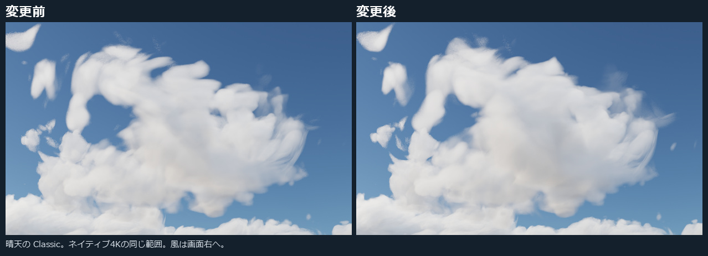
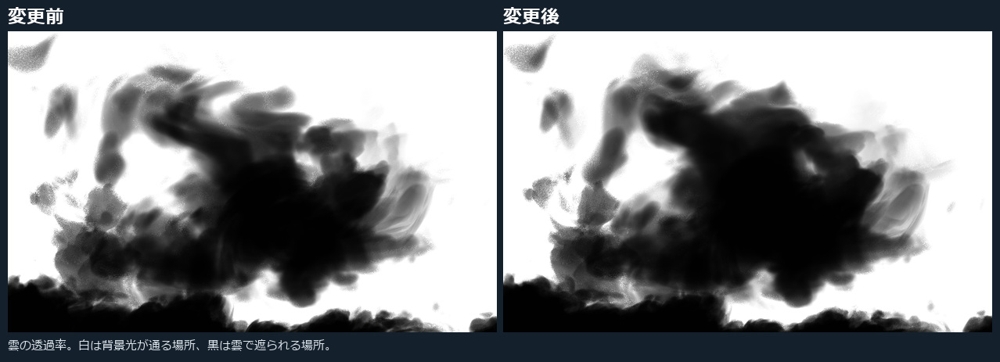

# 実写から積雲の形を検証する

[図をスライダーで見比べる](index.html) · [解説をまとめて読む](reader.html) · [雲のC++・HLSLをコードから追う](../landscape-study/cloud-code.md)

Classicの積雲の肩に雲水を残し、風で移動する房の表面に小さな3D変位を加えた。太い雲頂の下に見えていた青空が減り、薄い縁から厚い房へ続く形が見やすくなった。前回からある風下の曲がりと組み合わせた。Cumulus は飛行視点での比較を受けて、元の内部密度に小さめの3D変位を適用した。

[4K原寸の変更前](data/ridge-previous.png) · [4K原寸の変更後](data/ridge-final.png)

## 実写に照らして分かったこと

大西洋の並積雲と昼間の雄大雲から明るい雲頂を選び、幅256サンプルにそろえて比較した。境界幅は空と雲の局所的な表示色が25%から75%に変わる距離の中央値。うねりは上縁の細かな起伏と広い起伏の差の絶対値の中央値。値はこの倍率でのサンプル数で、メートルや元の4K画像の画素数には換算していない。 [実写の選び方](photo-analysis/photo-analysis.md) · [切り出し位置と閾値を変えた全測定](photo-analysis/photo-render-comparison.md)

| 対象 | 境界幅 | 上縁のうねり | 内部の明暗の方向係数 |
|---|---:|---:|---:|
| 大西洋の並積雲 | 2.475 | 1.285 | −0.112 |
| 昼間の雄大雲 | 1.792 | 1.548 | −0.061 |
| エンジン・変更前 | 1.472 | 0.863 | −0.480 |
| エンジン・変更後 | 1.753 | 1.893 | −0.387 |

雲頂の境界幅は昼間の雄大雲の例に近づいた。一方、うねりは2例を超え、内部には横長の明暗が強く残る。方向係数は同じ平滑化帯域（σ2/8）で測り、この例では負の値が大きいほど横長の模様への偏りが強い。ハワイの別の晴天積雲は公開画像で小さいので、こちらは幅96で独立に比べた。境界幅は実写2.020に対して改修後0.959。雲種・光・撮影距離が異なり、例数も少ないため、自然界の基準範囲を決める測定には使えない。 [NASA掲載の写真と撮影者](https://spaceplace.nasa.gov/review/weather-slyder/text-version.html) · [大西洋の写真の撮影記録](https://commons.wikimedia.org/wiki/File:Cumulus7_-_NOAA.jpg)

## 光が通る隙間と画面全体

同じ晴天、同じ太陽と風、同じ4K視点のレンダーの生の透過率 T を調べた。カメラ位置は (451, 1730.26, 5214) m、方位 −24°、仰角14°。太陽高度38°・方位 −102°。Classic／Ultra、雲TAAオン、フル解像度、チェッカーオフ、60 Hz固定の4フレーム目。選んだ地点では近景ボクセルの透過率が全域1で、対象雲は遠景パスに収録されている。

| 領域 | 指標 | 変更前 | 変更後 |
|---|---|---:|---:|
| 中央の穴 x=1510–1769、y=620–859 | T>0.90の面積率 | 47.0% | 33.5% |
| 雲頂を囲む領域 x=1320–2499、y=365–1079 | 平均T | 0.579 | 0.533 |
| 画面上部1000行の全幅 | T>0.90の面積率 | 82.8% | 81.9% |

## 別視点と数値積分

Cumulus の飛行視点で見つかった過剰な白かぶりは、最終設定で修正した。遠景バッファの平均透過率は変更前0.522、中間案0.303、採用版0.520だった。この飛行視点は調整に再利用しており、独立な最終評価には数えない。 [飛行視点の3案比較](figures/flight-control.jpg)

- 低い飛行視点では晴天の Classic を960×540の4フレーム目で比較した。高度2,900 mでは晴れ間の Cumulus を同じ大きさの5フレーム目で比較した。前後ペアごとにカメラ位置、積算風、光、天候、履歴の位相が一致する。 [低い視点](figures/ground-compare.jpg) · [雲と同じ高度](figures/partly-compare.jpg)
- 対流の弱い曇天では、Cumulus の640×360画像で 230,400/230,400 画素のRGBが一致した。全景に同じ変化を掛けていないことを確認する対照例である。
- 640×360で、視線方向の遠景・近傍の細分予算を4倍、空と仮定する基準歩幅を1/4にした検証用シェーダーを用意した。通常設定と細かい設定の生のTを、同じ4フレーム目の画素ごとに引いた。雲を含む矩形 x=220–419、y=60–177 の平均絶対差は変更前 0.0138、変更後 0.0125。変更後の95パーセンタイルは 0.0667。全画面平均は順に 0.0038、0.0036。これは同じモデルの積分刻みへの感度で、写真との誤差や連続積分の真値ではない。太陽レイの予算は両方同じ。
- 実機はRTX 5080。通常のRelease配置と比較用シェーダーのSHA-256を照合した。 [数値と画像ハッシュ](measurements.json) · [測定スクリプト](scripts/measure_render.py)

ハーフバッファ、Classic Fast、4相チェッカー、雲TAAでも20フレームずつ連続撮影した。風が動く静止カメラの風下側で、隣接フレームの平均表示輝度差は0.170から0.159階調、95パーセンタイルは両方とも0.928階調だった。 [時間方向の測定](temporal-check.md)

Classic の4K画像は飛行向け調整の直前に収録。最終版と照合すると、Classic の視線・近景照明・雲影・修復の最適化済みバイトコードがそれぞれ一致した。飛行視点の Cumulus は最終設定で再撮影した。 [コンパイル結果](shader-validation.json)

## 解説と再現

| 資料 | 扱う内容 |
|---|---|
| [実際の空の観察帳](observations.md) | WMO撮影時の風と方位、10分後の雲頂、航空機・ライダーで見る外縁 |
| [今回の形状変更](shape-change.md) | 肩の密度、3D変位の空間スケール、縦に伸ばしすぎた不採用例 |
| [描画エンジンの読み方](rendering-guide.md) | Perlin–Worley、視錐台格子とレイマーチ、照明・影・TAA |
| [検証を再現する手順](verification-lab.md) | カメラ・風・時刻の固定、テクスチャ表示と測定の注意点 |
| [実写の測定ノート](photo-analysis/photo-analysis.md) | 元画像3枚、色比による上縁の抽出、倍率、実写のクレジット |
| [実写と4K描画の定量比較](photo-analysis/photo-render-comparison.md) | 閾値や範囲を変えた感度と、雲内部の明暗の方向性 |
| [実時間設定の検証](temporal-check.md) | ハーフバッファ、4相チェック、雲TAAを使ったフレーム列 |

再測定には Python、NumPy、Pillow を使う。リポジトリ直下で `python docs/sky-study/scripts/measure_render.py captures/sky-study/20261122 measured.json` を実行する。PNGは描画器の直接出力で、図版のJPEGはそれを縮小・切り出したもの。比較の基準は前回の風下の縁を実装した作業ツリーで、その4K画像を再使用した。変更前後のシェーダー差分と、高サンプル参照の差分を同梱した。 [実装差分](scripts/implementation.patch) · [積分刻みの参照差分](scripts/integration-reference.patch)
