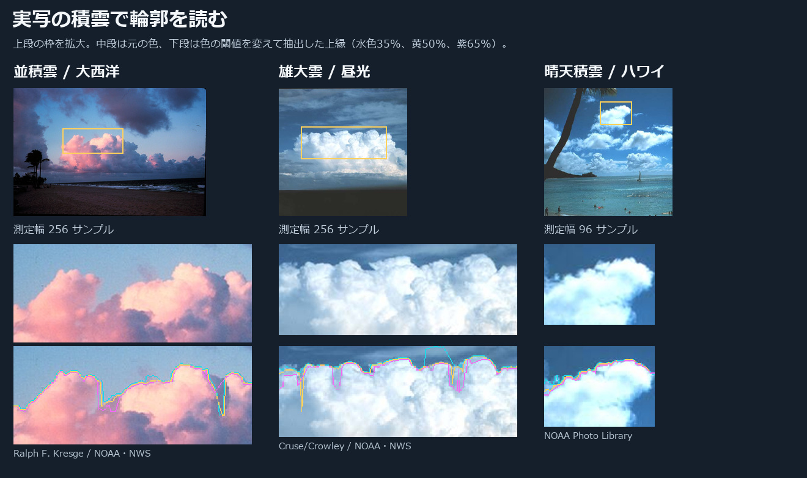

# 実写で積雲の輪郭を測る

実写をよく見ると、一つの雲の中にも、明るい房がくっきり立つ箇所と、後ろの青空がにじむ箇所がある。この資料では明るい雲頂と背景の境目をRGB画像から取り出し、カメラに見える縁の幅と、丸い房が連なる凹凸を調べた。夕方の並積雲、昼間の雄大雲、ハワイの晴天積雲を使った。写真ごとの気象条件を分けて読む。



上の枠を中段と下段に拡大した。水色・黄・紫が離れる箇所を見ると、雲のどこを「縁」と数えるかで見かけの形が変わる。中央の写真の水色線は一部で上空の別の層を拾い、左の写真の紫線は影に落ち込んでいる。3本が8サンプルを超えて離れる列は測定から除いた。図中の拡大は表示用で、数値は下表の測定幅で計算した。

## 写真から読み取ったこと

- **大西洋の並積雲**では、暖色に照らされた手前の房、奥の青い影、手前の房に部分的に隠れた小さな膨らみが一緒に見える。右寄りの暗部は、色の閾値を動かすと空との境目が急に深くなる。形と陰影の両方が輪郭の抽出に効く例である。
- **昼間の雄大雲**では、雲の塊の上に幅の違う丸い房が並ぶ。輪郭が鋭い箇所のすぐ内側に、別の明るい面と影が続く。積雲の発達段階が異なるため、雄大雲の縦横比は晴天の小さい雲の設計値には使えない。
- **ハワイの晴天積雲**には、明るい大きな塊と、その脇でちぎれるほど淡い小片が同居する。小さい雲なので幅96で独立に測った。風向の記録は得られておらず、画像に写った小片から風の向きは決められない。

## 色の縁の幅と丸み

「色の縁の幅」は、雲の外から内へ横切ったとき、空側と雲側の局所的な色の差の25%から75%に達するまでの距離である。「うねり」は上縁を二つの大きさでならした線の差の絶対値の中央値で、中規模の房が作る凹凸の一つの指標である。どちらも切り出しを表記幅にそろえた**画像上のサンプル単位**。閾値0.50での値を示し、括弧内は閾値0.35・0.50・0.65の間での幅中央値の範囲を示す。

| 対象 | 測定幅 | 有効法線数 | 色の縁の幅 | うねり |
| --- | ---: | ---: | ---: | ---: |
| 大西洋の並積雲 | 256 | 210 | 2.475（2.437–2.475） | 1.285 |
| 昼間の雄大雲 | 256 | 176 | 1.792（1.792–1.853） | 1.548 |
| 改修の基準にしたClassicの積雲 | 256 | 222 | 1.472（1.453–1.546） | 0.863 |
| ハワイの晴天積雲 | 96 | 72 | 2.020（2.020–2.187） | 0.514 |
| 同じClassicの積雲を幅96に縮小 | 96 | 45 | 0.900（0.900–0.925） | 1.143 |

幅256の切り出しで、基準のClassicはこの2枚の実写より明るい雲頂の色の境界が短く、うねりも小さかった。一方、幅96の晴天積雲のうねりは、同じ幅のClassicを下回った。撮影された雲の大きさ・距離・雲種は異なり、縮小でも細部は変わる。この数値は掲載した領域についての比較である。全ての雲に一定のぼかしや凹凸を足す根拠には使えない。

改修を加えた後も同じ範囲を再測定し、雲の中の模様がどちらへ長く伸びるかを比較した。 [改修前後と実写の比較](photo-render-comparison.md)

## 再現手順

1. 明るい主雲頂とその上の空が両方入る範囲を固定する。表の元となる `[左, 上, 右, 下)` は大西洋が `245 202 545 326`、雄大雲が `74 128 361 238`、ハワイが `187 45 292 122`。いずれも同梱の画像上の座標である。4Kレンダーは `1520 384 2240 687`。
2. アスペクト比を保ったまま、Lanczosで幅256または96に縮小する。各画素の `(R−B)/(R+B)` を求め、切り出し内の第8・第92百分位を0と1に写す。これは空と雲を区別する表示色の指標で、写真の露出・ホワイトバランス・大気の霞に依存する。
3. 各列を上から走査し、閾値以上の画素が3個続く最初の位置を上縁とする。3閾値とも検出され、位置の幅が8サンプル以内の列を残す。うねりには標準偏差1.5と8サンプルのガウス平滑を使い、端から24サンプルを除いて線の差の絶対値の中央値を求める。
4. なめらかにした上縁に直交して、外側10から内側10サンプルまで0.25間隔で色を補間する。各側7〜10サンプルの色の中央値を各法線の空側と雲側の基準にする。色の差が小さい法線、25%・50%・75%を複数回通過する法線、中央交点が検出上縁から4サンプルを超えてずれる法線などは除く。残った法線ごとに25%と75%の距離を求め、その中央値を表に載せた。

Python・NumPy・Pillowを使う。スクリプトは入力画像に書き込まない。同梱の参照画像と測定結果にはSHA-256、元の画素寸法、閾値ごとの採用数がある。画像や画質の版が変われば同じROIを再確認する。 [計測コード](measure_crown.py) · [全写真の数値](photo-profiles.json)

```powershell
python measure_crown.py references/atlantic.jpg --roi 245 202 545 326 --width 256 --json atlantic-results.json --overlay atlantic-outline.png
python measure_crown.py path/to/3840x2160.png --roi 1520 384 2240 687 --width 256 --json render-results.json --overlay render-outline.png
```

各写真の風速鉛直分布、同時刻の雲水量、太陽・カメラの較正値、被写体までの距離は未取得。1枚のJPEGからメートル単位の混合幅や雲の光学的透過率を求めることはできない。モデル内の物理的な透過率の変更は、同条件で撮影したレンダーの透過率バッファで別に検証する。近接する法線は同じ雲を横切るため、有効本数を独立した雲の標本数とはみなせない。

## 撮影者と資料

- **atlantic.jpg**。Ralph F. Kresge #1126-c、NOAA Photo Library / Historic National Weather Service Collection、画像ID `wea00081`。1980年9月、米国フロリダ州ディアフィールドビーチ付近。Commonsで公開されている960×639の版を使用した。作品ページに米国でのパブリックドメイン表示がある。 [作品情報](https://commons.wikimedia.org/wiki/File:Cumulus7_-_NOAA.jpg)
- **congestus.jpg**。Cruse/Crowley、NOAA Photo Library / National Weather Service Collection。NASA Space Place *Piled up clouds* の430×430配信版。 [NASAの画像とクレジット](https://spaceplace.nasa.gov/review/weather-slyder/text-version.html) · [配信画像](https://spaceplace.nasa.gov/review/weather-slyder/_images/slider32.jpg)
- **hawaii.jpg**。NOAA Photo Library。NASA Space Place *A perfect day* の430×430配信版。NASAは撮影地をハワイと記載している。 [NASAの画像とクレジット](https://spaceplace.nasa.gov/review/weather-slyder/text-version.html) · [配信画像](https://spaceplace.nasa.gov/review/weather-slyder/_images/slider33.jpg)

切り出し、色の境界線、測定結果、比較図はこのエンジンの検証用の加工である。写真のクレジットと利用条件は各原典に従う。 [NOAAの画像利用案内](https://oceanservice.noaa.gov/about/faq.html) · [NWSの利用案内](https://www.weather.gov/disclaimer)
