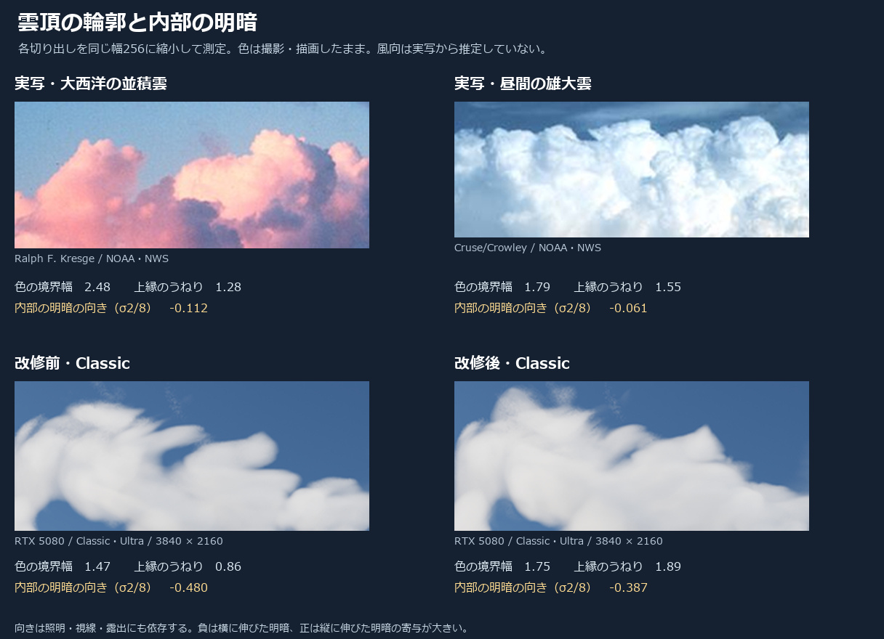

# 実写と改修前後を同じ方法で読む

写真2枚とClassicの改修前後を、各画像の中で明るい雲頂と空が接する領域に限って比較した。各領域は同じ横幅256サンプルで観察し、レンダーの2枚は同じ視点・同じ範囲から切り出した。写真は異なる気象条件で別の雲を撮影した資料である。



| 対象 | 法線数 | 色の境界幅 | 上縁のうねり | 方向係数 σ1/4 | σ2/8 | σ4/16 |
| --- | ---: | ---: | ---: | ---: | ---: | ---: |
| 実写・大西洋の並積雲 | 210 | 2.475 | 1.285 | -0.094 | -0.112 | -0.161 |
| 実写・昼間の雄大雲 | 176 | 1.792 | 1.548 | -0.036 | -0.061 | +0.097 |
| 改修前・Classic | 222 | 1.472 | 0.863 | -0.400 | -0.480 | -0.439 |
| 改修後・Classic | 206 | 1.753 | 1.893 | -0.392 | -0.387 | -0.290 |

境界幅は1.472から1.753サンプルに広がり、昼間の雄大雲で測った1.792に近づいた。夕方の並積雲の2.475よりは狭い。内部の方向係数も3帯域すべてでゼロ側に動いたが、σ2/8では実写の−0.112と−0.061に対して改修後が−0.387であり、横方向の模様の偏りが残る。上縁のうねりは0.863から1.893に増え、この切り出しでは実写2例を超えた。雲頂をより盛り上げる場合は、親の丸い面に対する突出の幅や、この撮影角度で尖った先が続いて見えるかも確認したい。

## 内部の明暗が向く方向

色の境界幅とうねりは比較資料と同じ方法で求めた。方向係数は、房の中の明暗が縦・横のどちらへ長く続くかを読むための補助量である。雲と空を分けた閾値0.5のマスクの縁を4サンプル縮めて、中の画素を使った。画像端から6サンプルを除外した。[色の境界と輪郭の手順](photo-analysis.md)

1. 表示RGBの輝度を `0.2126 R + 0.7152 G + 0.0722 B` で計算する。ガウスぼかしの差から、対象とする大きさの明暗を取り出す。たとえばσ2/8では、標準偏差2でならした画像から標準偏差8でならした画像を引く。
2. その画像の左右方向と上下方向の輝度勾配を計算する。マスク内で両勾配を二乗して足し、大きい方の半数の画素を残す。その中で左右勾配の二乗和を `Ex`、上下勾配の二乗和を `Ey` とする。
3. 方向係数を `(Ex−Ey)/(Ex+Ey)` とする。水平な帯の境目は上下方向に大きな勾配を持つので、横に続く帯で値が負に、縦に続く帯で値が正に寄る。+45°と–45°の筋はこの係数だけでは区別できない。

写真の太陽方位、カメラの露出、トーンカーブ、フィルムとJPEGの特性がそろっていない。輪郭に出た差は見かけの形、内部の指標には密度と照明が一緒に寄与する。これらは較正された消散や3D密度の誤差を表さない。比較の意味は、個々の変更で長く連なった横の明暗が残ったか、雲の内側の凹凸まで削っていないかを点検できることにある。

```powershell
python measure_orientation.py references/congestus.jpg --roi 74 128 361 238 --width 256
python measure_orientation.py path/to/3840x2160.png --roi 1520 384 2240 687 --width 256
```

[方向係数の実装](measure_orientation.py) · [各閾値の全測定結果と元画像のSHA-256](photo-render-results.json) · [撮影者・利用条件と元写真](photo-analysis.md)

## 切り出し位置を変えたとき

同じ雲を中央の範囲で測った値に、左右どちらかを幅の5%詰める2条件、枠全体を高さの3%上または下に動かす2条件を加えた。各回で色の基準を取り直し、抽出閾値0.50で測った5条件の最小〜最大を示す。範囲が重なれば、この切り出しの選び方では優劣を区別しにくい。独立な写真から計算した信頼区間とは性質が異なる。

| 対象 | 抽出成功 | 色の境界幅 | 上縁のうねり | 方向係数 σ2/8 |
| --- | ---: | ---: | ---: | ---: |
| 実写・大西洋の並積雲 | 5/5 | 2.462～2.569 | 1.114～1.435 | -0.117～-0.026 |
| 実写・昼間の雄大雲 | 5/5 | 1.713～1.792 | 1.438～1.810 | -0.061～-0.046 |
| 改修前・Classic | 5/5 | 1.472～1.492 | 0.817～0.952 | -0.502～-0.441 |
| 改修後・Classic | 5/5 | 1.750～1.869 | 1.775～2.045 | -0.423～-0.360 |

## 小さい雲での別の比較

ハワイの雲頂は公開写真上の幅が105画素である。拡大補間による細部を測らないよう、レンダーも同じ幅96サンプルに縮小した。幅256の表とは別の観察であり、上下の撮影角度と被写体の発達段階も異なる。

| 対象 | 法線数 | 色の境界幅 | 上縁のうねり |
| --- | ---: | ---: | ---: |
| 晴天積雲・ハワイ | 72 | 2.020 | 0.514 |
| 改修前・Classic | 45 | 0.900 | 1.143 |
| 改修後・Classic | 62 | 0.959 | 1.072 |

ハワイの晴天積雲を使った幅96の比較では、改修後の境界幅0.959は実写の2.020より狭く、うねり1.072は実写の0.514より大きい。夕方・昼間の二枚に寄った変化を、異なる距離の晴天積雲すべてに一般化することはできない。
