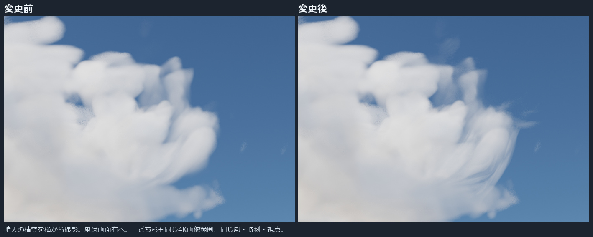

# 積雲の一画素ができるまで

画面右へほどける房を例に、配置、立体の形、照明、時間方向の復元を順に追う。通常の積雲は Classic と Cumulus の両方にある。F4 で切り替わるのは雲の描画スタイルで、天気の「晴れ」「晴れ間」とは独立している。

## 雲を置く場所と、そこにある雲水の量

`CloudMapCS` は地域の天候から、地面に平行な地図を作る。R と G は各列の下部と上部の被覆率、B と A は雲層の厚みを 1 とした局所的な雲底と雲頂。湿った上昇域では地図上の雲頂が高くなるので、同じ高度から横に見ても、積雲の肩と頭を区別できる。この地図は約 65.5 km ごとに繰り返す。薄雲・筋雲・うろこ雲には別の雲種マップと被覆率マップがある。普通の積雲だけを比べるときは `--no-texture-cloud-layers --formations none` を指定する。 [配置マップの生成](../../shaders/noise.hlsl) · [高層の薄い雲の定義](../../shaders/cloud_layers.hlsli)

`cloudBodyShape` は、地図で決まる高さの範囲と被覆率を使い、その点に雲があるかを3次元で評価する。Perlin–Worley が大きな塊を作り、Worley の異なる周波数帯が房の大小や縁の切れ込みを作る。細部を読む前の密度は、細部を削った後の密度の上限になる。視線を大きな歩幅で進めるときも、この上限を見て、次に細かく調べる区間を選べる。 [密度を作る関数](../../shaders/common.hlsli)

## 風下だけに薄い房を作る

風が画面右へ吹く例では、まず現在位置とその風上の柱を比べる。風上側の雲頂が高く、風下側へ被覆率が落ちる肩が候補になる。`shapeDownwindCrown` が肩の上を先に進め、その下を少し引いてくびれを作る。露出度が高く密度が低い部分では、上流の雲体を曲線に沿って参照し、残る雲水を混ぜる。進行に対して水平変位が一次、下降と横へのずれが二次なので、伸びた房は先ほど下側に巻く。乾いた天候ほど運ばれた密度は早く小さくなる。各房の曲率と希釈率は、既存の雲水分布から毎フレーム求める描画用の近似である。 [風下の雲の数式と実装](../../shaders/common.hlsli)

この既存比較で風向は画面右。左図の丸い輪郭の外側だった場所に、右図では青空を透かす細い房ができている。撮影条件と近い画素の透過率も記録されている。 [この図の撮影条件と測定範囲](../ordinary-cumulus-literature.md)

## 近くの雲と遠くの雲を一度ずつ積分する

| 視線上の区間 | 評価される量 | 距離の使い方 |
| --- | --- | --- |
| カメラ付近 | `LightNearCloudCS` が各セルの消散と散乱光を評価し、`IntegrateNearCloudCS` が視点側から各列を累積する | 格子は 80×44×32。奥面はカメラの前方向に 160 m。深度境界はスライス番号の二乗で配分されるので、手前のセルほど薄い。斜めに見る画素では、視線が格子内を進む距離は長くなる。 |
| 格子奥面から雲層・特殊雲まで | `traceCloudRay` がカメラから雲層までの交差区間を求め、散乱光・透過率・代表距離を蓄積する | 地形や川面より奥へ進まない。雲の近くでは、格子直後から近距離範囲の終端まで約 40 m 以下の細かな区間で追う。遠景では粗い密度に当たると区間の先頭へ戻り、条件を満たす間は最大3段まで歩幅を半分にする。 |
| 最終画素 | `CompositePS` が近景の積分結果を取り出し、大気、遠景雲、地表または空を合成する | 格子を使った分だけ遠景の開始点を奥へ動かす。視点の高度と周囲の雲で格子の有効・無効が切り替わる。 |

雲だけを考えると、一つの区間で背景光が残る割合は `segmentT = exp(-extinction × distance)`。そこへ届いた光の割合を `T` とすると、区間の色は `T × (1 − segmentT)` を重みに加算し、その後で `T ← T × segmentT` とする。同じ式で近景と遠景を合成できる。典型的には白い縁の向こうに青空が残り、密な雲を長く通るほど背景が隠れる。 [視線・近景の積分](../../shaders/clouds.hlsl) · [近景を有効にする条件](../../src/renderer.cpp) · [最終合成](../../shaders/scene.hlsl)

## 雲の中の光と、地面に落ちる影

視線上の点が雲の中なら、`lightOpticalDepth` がその点から太陽までの遮蔽を求める。最初の区間長は 35 m、以降は 1.65 倍ずつ伸ばす。Classic は光の軸の周りへサンプル点を少しずらし、上空3点の遮蔽から天空光も求める。Cumulus は短い太陽レイの後を雲影マップで補う。散乱光の見積もりには、散乱角に応じた位相関数と、直達光より弱く減衰する多重散乱の近似が入る。雲の輪郭が同じでも、太陽方位を変えると房同士の陰影は変わる。 [光学的厚さ・位相関数・照明](../../shaders/clouds.hlsl)

| 品質 | 遠景の視線ステップの基本予算 | 太陽レイの基本予算 | 雲影マップの一辺 | 自動設定での雲バッファの縦横 |
| --- | ---: | ---: | ---: | ---: |
| Low | 160 | 6 | 256 | 画面の 1/4 |
| Medium | 224 | 8 | 512 | 画面の 1/2 |
| High | 384 | 12 | 768 | 画面の 1/2 |
| Ultra | 640 | 16 | 1536 | 画面と等倍 |

太陽レイは必要な距離を進んだ時点や、遮蔽が十分に深くなった時点で終了する。Low の標準照明では末尾2区間をまとめるので上限は5回。視線側は近距離区間や細分化の影響を受け、表の数字と実際の密度評価回数は異なる。地面や他の雲から引く雲影マップは 48 km 四方の RG16F で、R に透過率、G に遮蔽深度の情報を持つ。例えば Ultra の影のテクセル幅は 48,000 ÷ 1,536 = 31.25 m。 [品質別の初期値と雲影の範囲](../../src/renderer.cpp)

## チェッカーと雲専用TAA

1. チェッカーが有効な通常フレームでは、一定の位相の画素だけをレイマーチする。Classic Fast は4相、通常の Classic および Cumulus は2相。履歴が無効になった最初のフレームは全画素を更新する。
2. `TemporalCS` が未更新画素の候補を前フレームから再投影する。適切な履歴を得られなかった画素は `RepairCS` が同じ積分で埋める。
3. `CloudAntialiasCS` が雲の色と透過率の縁を処理する。雲の視線に8位置のサブピクセル列を適用し、チェッカー1巡ごとに次の位置へ移る。再投影では代表距離と風の移動量を使い、前回と違う奥行きや地形に隠れていたサンプルを棄却する。色と透過率は現フレームの3×3近傍の範囲でも制限する。

このTAAは雲バッファの解像度で動く。例えば High・自動設定なら縦横半分の雲を安定化してから画面へ展開する。形を調べる撮影ではフル解像度を選ぶと、雲そのものの密度と再構成の寄与を追いやすい。 [雲専用TAA](../../shaders/cloud_antialias.hlsl) · [チェックと再描画](../../shaders/clouds.hlsl) · [比較の手順とデバッグ表示](verification-lab.md)
