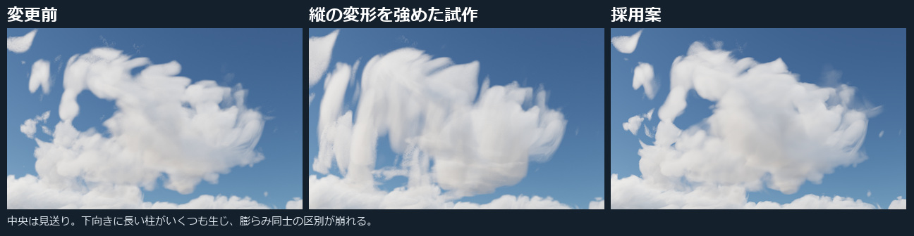
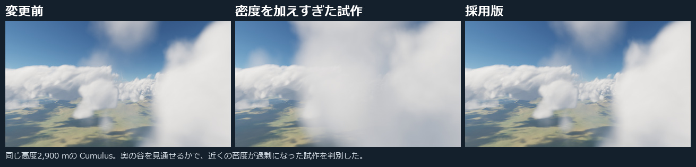

# 雲の房がつながり、輪郭に凹凸が生まれる仕組み

今回の変更は普通の積雲の密度を作る HLSL の二か所にある。風下へ張り出す頭と希薄な先端は前段階の実装を利用する。[共通シェーダー](../../shaders/common.hlsli)

## 肩の内側に雲水を残す

一つの柱にある底から頂までを0～1とする高さを `localHeight` として、上昇域の「肩」を選ぶ。実装では天候から求めた対流の強さ、その地点の被覆率、地図上の柱の厚みを掛ける。肩の強さは、底から3～20%の間で滑らかに立ち上がり、52～88%でゼロに戻る。これはレンダリング用の調整値で、航空機が測った混合率の推定値とは区別する。

元の大きな形の値を `e`、上記の条件を掛けた重みを `w` とすると、補強後は `e + (1 − e) × w × smoothstep(0.15, 0.53, e)`。重みの上限は0.52。すでに雲水が少しある場所が隣の房へ続き、空の柱では何も生じない。Classic は被覆率と閾値からこの補強を評価する。Cumulus はもともと雲の内部を補強する式を持つため、飛行視点での再検証を受けて追加の密度補強は Classic に限った。大きなPerlin–Worleyと細部を刻むWorleyはどちらも既存の資産を読む。

Classic は細かなノイズを読む前に、雲が存在し得る最大値を計算する。この補強は元の値に対して単調増加する。したがって最大値にも同じ補強を適用してから判定すれば、新しい房を空として飛び越すことを防げる。雲影や太陽側からの遮蔽にも同じ密度関数が使われる。

## なぜ一様に縦へ伸ばさなかったか

比較の中央では、肩の下で密度を読む座標を大きく上へ動かした。固定視点の青空の穴は狭くなったが、普通の積雲の腹に、下へ引いた絵の具のような縦の列が生じた。上縁の数値だけを合わせても、この破綻は検出しにくい。採用案では3D座標を上へ大きく集める操作を外し、元の柱に残る雲水を調整した。

## 雲頂の凹凸を風とともに運ぶ

同じ高度で均一なノイズを画像に足すと、雲が移動しても模様だけが画面に残りやすい。そこで、風で移流した座標を使って、CPUで生成済みの周期的な3Dベクトル場を1回読み、密度を参照する位置を三方向へ少し動かした。標準の水平サイズでは格子間隔は約258 m、各軸の最大変位は Classic が50 m、Cumulus が32.5 m。これらは雲粒の大きさではなく、房の表面に与える変形の空間スケールである。振幅は高度と対流の強さに応じて変わる。雲層の底と上限で滑らかに消す。 [ベクトル場の生成](../../src/cloud_volume.hpp)

同じ変位を近景の視錐台格子、遠景のレイ、光の参照位置が共有する。画面上で動く細部は既存の雲TAAで再投影する。描画コストには変位場の3Dテクスチャ参照が加わる。レイの予算、TAAの履歴の強さ、散乱係数はこの変更の調整対象に含めていない。

## 雲に入ったときの見通し

Cumulus でも Classic と同じだけ房の中を濃くした試作では、カメラ前方の白い雲が広がり、手前を雲が流れる様子や地形が見えにくくなった。晴れ間・高度2,900 mで保存した遠景雲バッファの平均透過率は、変更前0.522、試作0.303、採用版0.520。採用版では Cumulus の既存の内部密度を採用し、中程度の3D変位で肩を崩す。同じ場面を調整に使ったので、この視点は修正後の回帰確認として扱う。

## どこまで物理として読めるか

実写や浅い積雲の研究では、ひとつの雲の中で成長する房と薄れていく縁が同時に見える。ここではその空間的な違いを近似した。気塊の寿命や凝結・蒸発を時間積分したり、写真から風速を逆推定したりする機能は持たない。複数の房が重なる投影では、正面の青空の穴だけから、3Dの雲が物理的に分離しているかを一意に決めることもできない。 [WMO の撮影記録と時系列](observations.md) · [Wang & Zocchi の積雲形状モデル](https://journals.aps.org/prl/abstract/10.1103/PhysRevLett.104.118502) · [Bouthors & Neyret の階層的な雲形状](https://diglib.eg.org/items/89fce801-93d6-4c4b-9273-9367b73b89d2)
