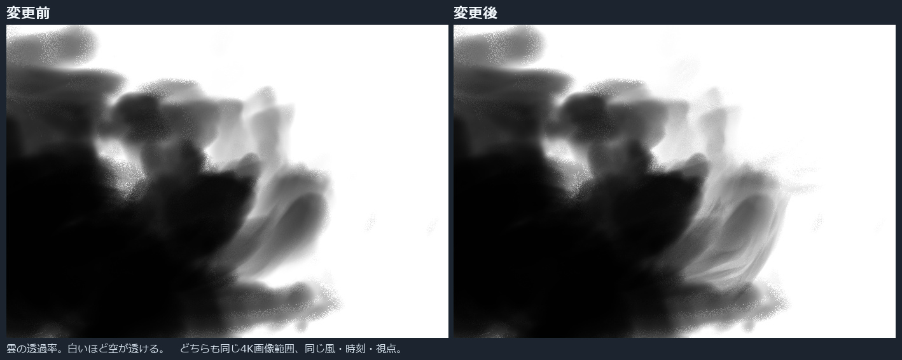

# 実写とレンダリングを照合する撮影・測定手順

ここでは「白い積雲の縁が風下でほどける」という見え方を、①実写にある形、②レンダラーが出した透過率、③表示画像の時間変化から調べる。次のコマンドで同じ視点を再撮影できる。すでに保存してある初期の比較結果は本文の図から確認できる。

## 1　比較したい現象を写真上で決める

| 写真から読むもの | 記録する方法 | 解釈する際の条件 |
| --- | --- | --- |
| 主な房と小さな房の大きさ | 雲の端が空と交わる位置をたどり、丸い山と隣り合う谷に印を付ける。各山の幅を、その雲全体の投影幅に対する割合で残す。 | 撮影距離や画角が違う写真では、画像上のピクセル数をそのまま比較できない。全体が画面外に切れる雲は別扱いにする。 |
| 片側でほどける方向 | 房の付け根、折れ曲がる点、目視できる先端の3点を記録する。風が分かる場合は、その方向へ投影した変位と直交方向の変位を比較する。 | 雲の高度の風は、移動を追える連続写真や同時刻の高度別観測から判断する。一枚の写真だけなら「画面右側」などの記述に留める。 |
| 人工的に見えやすい反復 | 隣り合う房について、同じ径・同じ傾き・等しい間隔が何回続くかを記録する。斜光と逆光の例は分ける。 | 画像圧縮、白飛び、前後に重なった別の雲は輪郭の判定を変える。判断できない区間は長さの集計から外す。 |

晴天積雲、発達中の積雲、崩れてちぎれた雲では、同じ高さで見ても肩の丸みと縁の見え方が変わる。写真の作者、元のページ、取得条件、撮影方向、雲種を残す。著者による雲種の記録と、こちらで図から読んだ特徴は別々に書く。実写と3D画像の色を比較するには、太陽方位、露出、ホワイトバランス、トーンカーブも関係する。通常のカラー写真から、雲の透過率を直接測るには追加の放射測定が必要になる。 [既存の実写・観測研究の資料](../ordinary-cumulus-literature.md)

## 2　山の上から同じ積雲を再撮影する

リポジトリのルートで PowerShell を開き、Release 版をビルドしてから実行する。画面右へ吹く風を横から見る視点で、太陽高度38°、方位−102°を固定した。比較に使う先頭4フレームだけを進めて、通常のカラー画像と生の透過率を保存する。

```powershell
$repo = (Get-Location).Path
$engine = Join-Path $repo 'out/vs/Release/CirrusEngine.exe'
$captureDir = 'captures/sky-study'
[void][IO.Directory]::CreateDirectory((Join-Path $repo $captureDir))

$scene = @(
    '--headless', '--no-ui', '--no-vegetation',
    '--width', '3840', '--height', '2160', '--frames', '4',
    '--fixed-dt', '0.0166666666666667',
    '--camera', 'fly', '--spawn', '451', '5214', '--look', '-24', '14',
    '--weather', 'clear', '--sun-elevation', '38', '--sun-azimuth', '-102',
    '--quality', 'ultra', '--cloud-style', 'classic', '--cloud-buffer', 'full',
    '--no-checkerboard', '--no-texture-cloud-layers', '--formations', 'none'
)
foreach ($view in 0, 20) {
    $capture = "$captureDir/ridge-view-$view.png"
    $options = $scene + @('--debug-view', "$view", '--capture', $capture)
    $run = Start-Process -FilePath $engine -ArgumentList $options -WorkingDirectory $repo `
        -WindowStyle Hidden -Wait -PassThru
    if ($run.ExitCode -ne 0) { throw "Capture failed with exit code $($run.ExitCode)" }
}
```

各 PNG と同名の JSON で `adapter`、`camera_position_m`、`wind_offset_m`、`frames`、`simulation_seconds`、`cloud_anti_aliasing`、`cloud_reconstruction`、`texture_view.index` を照合する。基準撮影では視点は約 (451, 1730.26, 5214) m。地形・視線・太陽を含む起動引数と、使用したシェーダーのバージョンも保存する。CMake でビルドした場合は上の実行ファイルを `build/Release/CirrusEngine.exe` に置き換えられる。 [引数と撮影の実装](../../src/main.cpp) · [Visual Studio ソリューション](../../CirrusEngine.sln)

変更前後の比較では、同じ実行ファイルにそれぞれのシェーダー一式を `--shader-dir` で渡せる。対象に C++ や入力テクスチャの変更もある場合は、それぞれのビルドと入力を記録して比較する。太陽方位だけを変えると陰影の寄与を調べられる。太陽高度を変える場合は配置マップが雲量にもバイアスを掛けるので、透過率画像も一組撮る。 [配置マップ](../../shaders/noise.hlsl)

## 3　何を見ているかを表示ごとに確認する

| `--debug-view` | 画面が示す値 | 見分けられる症状 |
| ---: | --- | --- |
| 0 | 大気・雲・地表を合成した最終カラー | 観察者から見た雲の印象。表示変換と画面のエッジ処理を含む。 |
| 20 | 現フレームの遠景レイマーチの透過率。白が1、黒が0 | 雲自体の輪郭や、疎な線が輸送された場所。全解像度・チェッカーオフで座標をカラーと対応させる。 |
| 1 | 時間処理後の雲バッファの透過率 | 20 と同じ位置で比較すると、輪郭の平滑化や残像を見つけられる。 |
| 19 / 13 | 現フレーム / 時間処理後の雲の散乱光 | 房の光と影の境界で散乱光がどの程度ならされるかを見る。表示用に変換された RGB。 |
| 14 | 不透明度で重み付けした雲の代表距離の対数表示 | 奥の雲と手前の雲が重なる場所で、時間処理の参照距離が飛ぶかを調べる。 |
| 23 | 各画素を得た経路。緑は今回のレイ、青は履歴、赤は修復、灰は空と判定 | 輪郭に沿って修復が集中するか、その色がカメラ移動に追従するかを見る。 |
| 26 / 7 / 8 | 配置マップ / 基本ノイズのR / 細部のWorleyのRGB | 群れの分布、個々の雲の大形状、縁の細部の各段階を確認する。 |
| 2 / 28 | 太陽から見た雲層の透過率 / 遮蔽深度の表示 | 地形の雲影に筋や不連続が出た場合に、太陽側にも同じ形が現れるかを見る。 |

格子の内部を飛ぶとき、表示20は近景ボクセルの合成結果を含まない。表示0と JSON の `near_cloud_voxels` を合わせて見る。`active` は格子が有効か、`transmittance.min` は格子に光を遮る雲が入ったかを示す。格子が有効でも、そのフレームの全セルがほぼ透明なことはある。 [表示番号と内容](../../src/renderer.cpp) · [最終画素での近景合成](../../shaders/scene.hlsl)

## 4　縁が「ほどけた」ことを測る



**既存の山上視点での測り方。** 生の透過率 PNG は白黒8ビットなので `T = 灰色の値 / 255` として読む。右側の房を横切る各行について、x=1820～2569 の範囲で、しきい値以下の画素が横に7画素以上連続する一番右の位置を求める。50%と90%の2本の輪郭の間隔を行ごとに取り、あらかじめ決めた高さ帯で中央値を出す。頭の高さ y=735～823 では、前回の風下変形の前後でこの幅が16 pxから38 pxへ変わった。この数値は画像幅、視点、濃度しきい値とセットで読む。 [前回の測定条件](../ordinary-cumulus-literature.md)

**新しい空へ広げるとき。** 雲の風上側にも同じ方法を適用し、風下と同じだけ薄くなっていないかを調べる。密な芯の輪郭、肩のすぐ下、雲底の3帯を分け、各帯の有効行数も添える。別の雲が後ろで重なる行や、丸い山が二股になる行は、どこまでを同じ房とするか先に決める。斜めに伸びる房は境界の外向き法線に沿った断面も比べると、斜めの線を横に走査したことで生じる見かけの広がりを抑えられる。複数視点ではピクセル幅に加え、房の投影幅に対する比率も残す。

**照明を点検するとき。** 生の透過率、最終カラー、雲の散乱光を同じ位置で見る。透過率に山と谷が出ていてもカラーで潰れる場合は、太陽方位を変えて天空光と直達光のバランスを調べる。カラーだけで雲頂が消える場合は、露出と背景の空の明るさも記録する。 [同じ雲を異なる太陽方位から照らした例](../images/cumulus-illumination-control.jpg)

## 5　移動中にも成立するか調べる

| 撮影条件 | 確認する現象 | 観測値の扱い |
| --- | --- | --- |
| 静止した視点、一定の風 | 薄い縁の画素だけが明滅していないか。8位相以上の履歴がたまる前と後を見る | 明るさの絶対フレーム差を縁の範囲で集計し、雲が自然に移動する分を含む指標と明記する。 |
| 横パン、急なカメラ切り替え | 古い白い房を青空へ引きずっていないか。移動直後だけ、画素の経路と代表距離も見る | `--camera-path pan` または `--camera-path cut` を使う。パンを含む連番で単純な画素差を取ると、正しい移動も大きな誤差になる。 |
| 雲層と同じ高度からの飛行 | 視錐台端での切れ目、地形の前に出る色むら、近景だけ固定されるような動き | 上の固定視点引数から `--camera fly --spawn 451 5214 --look -24 14` を除き、`--camera inside` に置き換える。近景の統計とカラーを同時に記録する。 |

連番には `--capture` を外して `--record captures/sky-study/pan --frames 32` を使う。既存の `--frames 4` は置き換える。カットはシミュレーション時刻2秒ごとに起きる。切替を含む軽い撮影には640×360、`--fixed-dt 0.05 --frames 50 --camera-path cut` を使い、2秒前後の連番を比較する。時間処理の比較では `--no-cloud-taa` が雲専用の履歴合成とサブピクセル列の両方に効くので、画質設定表にも明記する。チェッカーボードの再構成は別の処理である。4Kの各4フレームは静止形状比較用で、FPSや連続移動時のちらつきまで評価するには別の測定が要る。 [雲のTAA](../../shaders/cloud_antialias.hlsl) · [既存の移動／切替比較動画](../images/cumulus-taa-motion.mp4)
