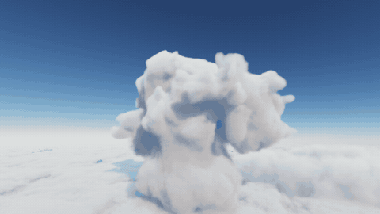
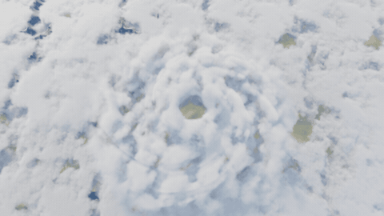
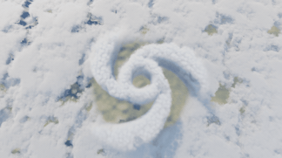
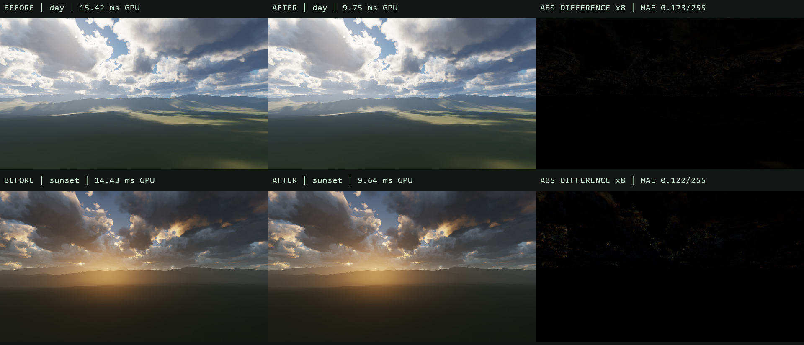
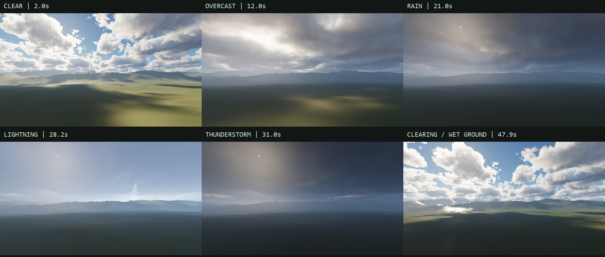
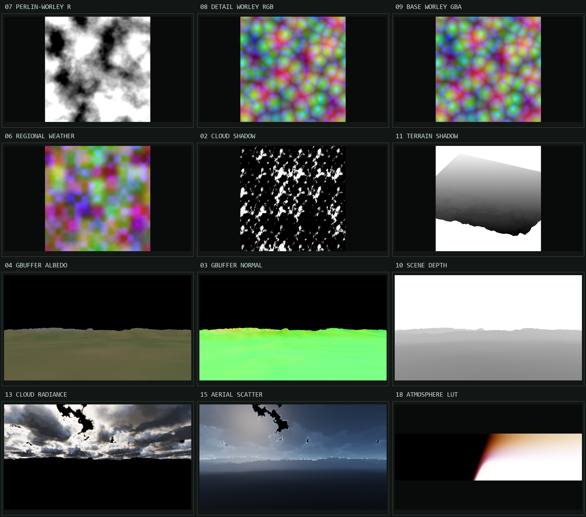
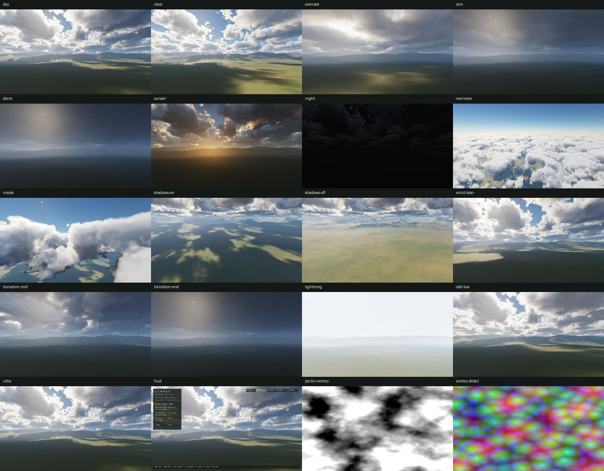

# 実機検証

各画像はエンジンのDirect3D描画から保存したものです。Windows / NVIDIA GeForce RTX 5080で検証しています。

## 2026-11-17　草原と山並み

1920×1080 / High / 15:42で、同じ出発地点と歩行経路を固定時間刻みで比較しました。出発地点の新版は、カメラの視野と近くの影を考慮し、近・中・遠に11,680、17,629、42,556束、計416,158枚分の草を選びました。同じ谷を朝、夕方、雨でも描画しました。[出発地点の実機画像](images/meadow-valley.png) · [川岸の近景](images/meadow-riverside.png) · [実装](exploration.md)

| 視点 | 草のインスタンス数 旧版 → 新版 | ジオメトリのGPU時間 | 全パスのGPU時間 |
| --- | --- | --- | --- |
| 出発地点 | 16,976 → 71,865 | 0.96 → 1.20 ms | 3.44 → 3.33 ms |
| 144フレーム歩行 | 16,461 → 72,521 | 0.97 → 1.26 ms | 3.31 → 3.43 ms |

旧版は `d82ea14` です。タイムスタンプは各キャプチャ時のGPU計測値です。歩行は1/60秒刻みで、両版とも同じ座標に着き、地面からの目の高さは1.68mでした。

配布版の出発地点はビルド元の画像と全画素が一致しました。雲を切り、カメラと太陽時を固定してシミュレーション時刻を進めると、0.80秒と3.07秒で各距離の草の配置数が一致し、画面左下の草のRGB平均絶対差は13.43 / 255でした。

Visual StudioのRelease / Debug x64、CMake Release、25個のHLSLエントリーポイント、CTest 4/4が成功しました。実GPUの76ケースでD3D11警告・エラーは0件、診断対象の非有限値は0件でした。

## 2026-11-17　川と草木

1600×900 / Highで、出発地点と対岸の目線の高さから、針葉、樹皮、草、シダ、砂利の浅瀬を確認しました。同じ川岸を午後、夕方、雨で描画しました。[出発地点](images/river-walk.png) · [対岸の近景](images/river-bank.png) · [実装と再現方法](exploration.md)

- Visual StudioのRelease / Debug x64、CMake Release、22個のHLSLエントリーポイント、CTest 4/4が成功しました。実GPUの76ケースでD3D11警告・エラーは0件、診断対象の非有限値は0件でした。
- 出発地点では水面マスクが84,081画素を示し、XZが(250km, 180km)の地点では0画素でした。川へ直進するとXが12.00mから22.29mへ進んで止まり、目の高さは地面から1.68mでした。川の中央を指定した開始位置は浅瀬へ移りました。
- 太陽時16:24とカメラを固定し、雲を切った状態で時刻0.80秒と4.68秒を比較しました。水面のマスク内39万5,599画素のRGB平均絶対差は10.32 / 255でした。水面のさざ波と反射が時間で変わることを確認しました。
- 16:24の出発地点に読み込まれた範囲には、木4,970本、草16,976束、シダ52株、岸の岩111個がありました。キャプチャ時のGPU時間は出発地点3.46ms、対岸4.07msでした。GPUパスのタイムスタンプ値で、表示を含むFPSとは計測範囲が異なります。

## 2026-11-17　探索、草木、太陽時、glTF

- Visual StudioのRelease / Debug x64、CMake Release、全22個のHLSLエントリーポイント、CTest 4/4が成功しました。以前の雲・天候を含む実GPUの72ケースでD3D11警告・エラー0、診断対象の非有限値0でした。
- 歩行経路ではZが123.84mから160.75mへ進み、128mの更新境界を越えました。新たに5枚のタイルが生成され、目の高さは地表から1.68mでした。XZが(250km, 180km)の地点でも地形、草木、雲が描画されました。
- 同じ視点で16:24の太陽高度は28.47°、00:30は−33.57°でした。時計を23:00から動かした検査では、日付の境界を越えて06:12になりました。
- 同梱のglTFパネルで金属度を255と0、粗さを60と204として描画し、G-buffer画像から読み取りました。テクスチャ入りのGLBも実機で読み込み、法線・色・金属度が描画されることを確認しました。[KhronosのGLB検証モデル](https://github.com/KhronosGroup/glTF-Sample-Assets/tree/main/Models/DamagedHelmet)
- 配布版から起動し、埋め込み画像と外部画像の両方を検証しました。空白を含む画像名と日本語を含むモデルのパスでも読み込め、金属度の描画が同梱モデルと全画素一致しました。

[昼の探索画面](images/walking-world.png) · [実装と再現方法](exploration.md)

## 2026-11-15　Rockstarの講演に基づく雲と照明

雲の二層マップと高度LUT、Perlin–Worley侵食、境界での歩幅細分、深度を持つ指数雲影、空の散乱から得る天空光、雲の下の雨霧を実装しました。[出典と採用スライド](cloud-research.md#rockstarのsiggraph-2019講演)。

[晴れ曇りと地表影の変更前後](images/rdr2-cloud-comparison.jpg) · [入道雲と渦の変更前後](images/rdr2-formation-comparison.jpg) · [測定条件と数値](benchmarks/rdr2-atmosphere.json)。

- Visual StudioのRelease / Debug x64、CMake Release、全18 HLSL、CTest 4/4が成功しました。
- 実GPUの64ケースでD3D11警告・エラー0、検査対象の非有限値0。雲マップの二層に異なる分布があり、雲影深度に遮蔽点と空の領域があることも検査しました。雲影を有効にした画面下部は平均46.95 / 255暗くなりました。
- 配布版のカスタム配置はCMakeの検証画像と全画素一致し、シェーダーファイルも一致しました。

### 同条件でのGPU計測

RTX 5080、1600×900、High、1/60秒の固定刻みで48フレーム。旧版は f8874bf の実行ファイルと同梱HLSLです。表は各1回のヘッドレス描画で得たGPUタイムスタンプの平滑値です。雲の分布と遮蔽の範囲も変わっています。

| シーン | 旧版 GPU ms | 新版 GPU ms |
|---|---:|---:|
| 晴れ曇り | 10.94 | 4.22 |
| 入道雲を近くから | 10.48 | 10.67 |
| 雲海に入道雲と渦 | 23.98 | 14.24 |
| 渦を上から | 50.52 | 18.21 |
| 嵐 | 12.86 | 3.52 |

近景の入道雲を同じ時刻で比較すると、ハーフ＋チェッカーボードは10.67 ms、ハーフ全画素は12.34 ms、出力と同じ1600×900の全画素は27.94 msでした。ハーフ＋チェッカーボードのRGB平均絶対差はハーフ全画素から0.083 / 255、ネイティブ解像度から0.630 / 255です。ネイティブ解像度との比較では99パーセンタイルが6 / 255、局所最大が150 / 255で、奥行き境界や薄い雲に差が残ります。

### 再現コマンド

```powershell
cmake --build --preset release --parallel
.\scripts\validate.ps1 -SkipBuild
$common = @('--headless','--no-ui','--width','1600','--height','900','--quality','high','--frames','48','--fixed-dt','0.0166666666666667','--debug-layer')
$scene = @('--weather','partly','--formations','towers','--camera','tower-close','--sun-azimuth','150')
.\build\Release\CirrusEngine.exe @common @scene --capture captures/rdr2-tower-half-checker.png
.\build\Release\CirrusEngine.exe @common @scene --cloud-buffer full --no-checkerboard --capture captures/rdr2-tower-full.png
```

F3のテクスチャ一覧、または `--debug-view 26` / `27` / `28` で雲マップ・高度LUT・遮蔽深度を表示できます。

## 2026-11-08：入道雲の3D制御ボリュームと実装解説

261個の階層セルから128³の形状プロファイルを起動時に焼き、64³の滑らかな周期ベクトル場と組み合わせる方式へ進めました。CPUで形を作り、GPUでPerlin–Worley/Worleyによる密度の侵食と光の積分を行います。2つの追加テクスチャは共有で計6MiBです。[コードと式を辿る実装ガイド](implementation-guide.md)を追加し、Visual Studioの`Docs`フォルダーからも開けます。

- CMake Release、Visual Studio Release / Debug、16 HLSLが成功。CTestは既存検査に3Dアセット検査を加えた4/4が成功。密度範囲、空の境界、形状の接続、再現性、変形ノイズの周期境界を検査しました。
- 実GPUの62ケースが成功。D3D11 debug layerの警告・エラー0、検査対象の非有限値0。既存の49ケースに近景・側面・内部・ネイティブ解像度・順光・夕方・形状と変形ノイズのXYZ断面・カメラ周回を追加しました。6枚の断面で実際に値が描かれることも検査しています。
- 同梱パッケージとVisual StudioのRelease実行版を、それぞれカスタム配置・48フレームで起動。両方ともCMakeの検証画像と画素単位で一致し、パッケージのシェーダー・設定もソースと一致しました。F3一覧の新しいページも実描画で確認しています。全GUI操作を自動クリックした検証ではありません。
- 同じ新版実行ファイルに旧版`12bb5e4`のHLSLを指定して比較。定数バッファは互換で、カメラ・時刻・配置・天候を一致させています。通常の雲海と渦単独はどちらも画素単位で一致。強度0も通常の雲海と一致しました。
- 同一ハーフサイズで混在シーンのチェッカーボードON/OFF差は平均0.049 / 255、99パーセンタイル1 / 255、局所最大94 / 255。
- 近景でハーフ＋チェッカーボードとネイティブ解像度を比較。逆光の平均差0.251 / 255、99パーセンタイル3 / 255、局所最大145 / 255。順光は平均0.237 / 255、99パーセンタイル2 / 255、局所最大96 / 255。空間解像度の差も含み、細い輪郭では大きな局所差が残ります。
- 960×540 / High / 固定1/24秒の8秒・192フレームでカメラを周回。同一ハーフサイズのチェッカーボードON/OFF平均差の時間平均は0.152 / 255、最大フレーム平均0.202 / 255、各フレームの99パーセンタイルの最大2 / 255、単一成分最大96 / 255。天候・風のCSVは一致しています。

近景の凸凹、側面の張り出し、内部、順光・逆光、周回による視差を実GPU画像で確認しました。形状は手続き的に作った静的アセットで、雲の物理的な成長・凝結・乱流を解くものではありません。細部の写実性には改善の余地があり、数値検査をRDR2相当の画質の証明としては扱いません。表示込みのFPS比較も今回の測定には含めていません。

| 比較対象 | 画像 |
|---|---|
| 同条件の順光・変更前と変更後 | [旧HLSL](images/cloud-volume-before-frontlit.png) / [3Dボリューム版](images/cloud-volume-frontlit.png) |
| 順光のネイティブ1600×900 | [PNG](images/cloud-volume-frontlit-full.png) |
| 逆光・側面・混在シーン | [近景](images/cloud-volume-close.png) / [側面](images/cloud-volume-side.png) / [雲海](images/cloud-volume-mixed.png) |
| 実際の3Dテクスチャ | [形状プロファイル](images/cloud-volume-control.png) / [変形ベクトル](images/cloud-volume-warp.png) / [F3一覧の実画面](images/cloud-volume-inspector.png) |

静止画の比較は1600×900 / High / Overcast / 60フレーム（1秒）です。生の診断・ケース別結果・フレーム別画像差は[JSON](benchmarks/cloud-volume.json)に保存しました。再現用は`scripts/capture-cloud-volume.ps1`で、`-ReferenceShaders`に互換な旧版のシェーダーフォルダーを指定できます。



プレビューGIFは元の24fpsの記録を480×270 / 8fpsへ縮小・減色しています。カメラが周回する動画で、形状自体は静的です。

## 2026-11-05：論文・発表に基づく大型雲の改修

[Nubis 2017 / Nubis Evolved 2022 / Procedural Cloudscapes 2018の参照箇所と実装対応](cloud-research.md)を整理し、入道雲の直接的な形状飽和と、渦の等間隔の3本の帯を置き換えました。3D制御セル、coverageによる密度のremap、半径別の回転、局所的な雲高度による照明へ変更しています。**RDR2相当の画質には未達**で、特に入道雲の近距離の形状、細かな対流構造、成長表現は調整中です。

- Visual StudioのRelease / Debug、CMake Release、16 HLSL、CTest 3/3が成功。
- 実GPUの49ケースが成功。D3D11 debug layerのエラー・警告0件、検査対象の非有限値0件。強度0、密度0、1.6倍、逆回転、雲OFF、既存の雨・雷・影・再構成を含みます。
- 大型雲OFFの旧版 `45aaeb5` との比較は、同条件1600×900 / High / Overcast / 48フレームでRGB差0、画素単位で一致。
- 同じハーフサイズの雲グリッドで、混在シーンのチェッカーボードON/OFF比較は平均成分差0.048 / 255、99パーセンタイル1 / 255、局所最大94 / 255。
- 雲グリッドもフル解像度にした比較では、混在シーンの平均差0.270 / 255、渦の上空の平均差0.371 / 255。両者の99パーセンタイル3 / 255、局所最大は103 / 255と87 / 255。こちらは空間解像度の違いも含みます。
- 960×540 / High / 固定1/24秒 / 回転速度2倍で192フレーム（8秒）を記録。半径別の速度で雲群が回転することを画像で確認。同一ハーフサイズのチェッカーボードON/OFF間で天候・風のCSVが一致し、フレーム平均差の時間平均0.111 / 255、最大フレーム平均0.117 / 255、各フレームの99パーセンタイルの最大1 / 255、単一成分の最大65 / 255。
- 雲上の2視点、フル解像度、夕方の混在シーンを目視。数値テストの成功を写実性の合格基準としては扱っていません。GUIの全キー・クリック経路や、入道雲の内部への手動飛行は今回の検証対象に含めていません。

1600×900 / High / 60フレームのキャプチャ時のGPUタイムスタンプは混在36.47ms、渦上空72.48msでした。単発キャプチャ時の平滑値であり、表示込みのFPSでも、管理された性能比較でもありません。追加の密度評価による負荷があり、軽量化を実証する変更ではありません。

[変更前後とフル解像度の原寸画像](cloud-research.md#再現と実gpu画像)、[検証・全49ケース・192フレームの画像差JSON](benchmarks/cloud-research.json)、[夕方のPNG](images/formations-research-sunset.png)を保存しています。旧版と新版は入道雲のプリセット半径も異なるため、密度式だけを変えた比較ではありません。画像差の小ささは、写実性やRDR2との一致度を意味しません。



## 2026-11-05：雲海の中の入道雲・渦巻き雲

背景雲海に最大8個の局所領域を重ね、入道雲、目と螺旋状の帯を持つ渦、両者の混在を描けるようにしました。領域の位置・半径・雲底・高さ・密度・回転をファイルから読み、視線積分・自己遮蔽・雲影・時間再構成に同じ領域を渡します。

- Visual StudioのRelease / Debug、CMake Release、16 HLSL、CTest 3/3が成功。配置テストでは不正な列・範囲・NaN・9領域以上を拒否し、世界座標と逆回転の角速度を確認。
- 既存の38ケースに大型雲10ケースを加えた48ケースの実GPU検証が成功。その後、密度0の渦の境界ケースを修正・追加検証し、計49ケースが成功。検査対象の非有限値0、D3D11 debug layerのエラー・警告0。再実行用スクリプトは49ケースを含みます。
- 入道雲・渦・混在・カスタム配置・1.6倍サイズ・強度0・逆回転・チェッカーボードOFF・雲全体OFFを確認。入道雲の上限10400m、1.6倍では15560mまでレイ区間を拡張。
- 強度0と、密度0の渦を置いた場合の最終画像は、通常の雲海と画素単位で一致。大型雲OFFの旧版比較ではRGB平均差0.000089 / 255、最大成分差1 / 255。
- 混在シーンのチェッカーボードOFF/ON比較はRGB平均差0.048 / 255、成分差99パーセンタイル1 / 255、局所最大50 / 255。同じハーフバッファでの比較です。
- 960×540 / High / 固定1/24秒で渦を8秒・192フレーム記録。回転速度2倍では積算位相16秒、約32度の回転。回転停止との比較は風と時刻を一致させ、雲帯が風の平行移動とは別に回ることを確認。
- その192フレームのチェッカーボードOFF/ON比較は、フレーム平均差の時間平均0.122 / 255、最大フレーム平均0.128 / 255、成分差99パーセンタイルの最大1 / 255、単一成分の最大差65 / 255。天候・風のCSVは一致。

GPUタイムスタンプは1600×900 / Highの混在シーンで16.82ms、渦の上空視点で31.81msでした。これは保存時点の平滑値で、表示込みのFPSではありません。大型雲の追加密度、渦の面積、回転中の雲影更新によって負荷は増えます。画質Cキーで描画予算を変更できます。

[設定とGPU診断・画像差のJSON](benchmarks/formations.json)、[混在の原寸PNG](images/formations-mixed.png)、[渦の原寸PNG](images/formations-vortex.png)を保存しています。CLIによる配置・強度・速度・描画の検証で、GUIのキー・クリック全経路を自動操作したものではありません。



## 2026-11-05：ハーフバッファとチェッカーボード

Highの雲グリッド800×450に対して、通常フレームの生バッファを400×450へ詰め、偶奇を毎フレーム交代します。履歴の再投影・深度境界の検出・追加レイマーチを実装しました。起動、視点切り替え、急変、雷の発光時は全グリッドを計算します。

- Visual Studio 2022のルートソリューションをRelease / Debugともビルド成功。16 HLSLエントリーポイントをwarnings-as-errorsでコンパイル。CMake ReleaseとCTest 2/2も成功。
- 実GPUの38ケースすべて成功。D3D11 debug layerのエラー・警告0件、検査対象の雲・空・霧・雨の非有限値0件、雲透過率は0～1。雲上の深度境界で有効な近傍がない場合も、再計算へ回すことを確認。
- 全ケースでGPUマスクの画素数の合計が雲グリッド面積と一致。半数描画では、修復分を除くレイ数が偶奇ごとの正確な半数と一致。1001×563の奇数サイズ、Low / Ultra、full / half / quarterの解像度指定でも検証。
- 通常視点の48フレーム目は、基本180,000画素＋修復1,763画素、履歴90,753画素、雲層と交差しない87,484画素。初回のみ全更新し、残り47フレームは半数描画。
- 2秒時点のカメラ切り替えでは360,000画素を全更新し、次フレームから半数描画を再開。雷の閃光でも全更新。F7とパネルに切り替えを追加し、実描画したHUD画像で表示を確認。キー・クリックのGUI自動操作は今回行っていません。
- 960×540 / High / 固定1/30秒で、カメラの平行移動と回転、晴れ→嵐、4.5秒の手動落雷を6秒・180フレーム記録してOFF/ONを全フレーム比較。天候・風・雷のCSVは一致。フレーム平均RGB差は時間平均0.194 / 255、最大0.416 / 255。各フレームの成分差99パーセンタイルの最大は5 / 255、単一成分の最大差は64 / 255。輪郭などの局所差はあります。

RTX 5080 / 1600×900 / High / Release / VSync OFFで、表示込み8秒のベンチマークをOFF/ON各2回行いました。ウォームアップ120フレーム、起動・PNG保存を除くWindowsメッセージ処理＋描画＋Presentの時間です。

| モード | 1回目 | 2回目 | フレーム数/時間を合算 |
| --- | ---: | ---: | ---: |
| ハーフバッファ、全画素計算 | 102.4 FPS | 93.9 FPS | 98.2 FPS |
| ハーフバッファ＋チェッカーボード | 126.8 FPS | 124.7 FPS | **125.8 FPS（+28.2%）** |

OFF→ON→ON→OFFの順に測定しました。全更新が増える場面、視点、GPUによって効果は変わります。基本レイ数が半分になっても、履歴の再構成・修復・雲影・地形などのコストが残るため、FPSが2倍になる方式ではありません。VRAMも履歴2組は同じ解像度のままです。

[測定JSONと各ケースのGPUマスク](benchmarks/checkerboard.json)、[描画と差分の比較画像](images/checkerboard.jpg)、[実装解説](architecture.md#ハーフバッファとチェッカーボード)を保存しています。

## 2026-11-04：雲の軽量化

RTX 5080 / 1600×900 / High / Release / VSync OFFで、旧版 `e28c51d` の実行ファイルとシェーダーを別フォルダーへ保存し、同じカメラ・天候で比較しました。FPSは初期120フレームを除き、Windowsメッセージ処理・描画・Presentを含む8秒間の実測です。

| 場面 | 旧版FPS | 軽量化後FPS | 向上 |
| --- | ---: | ---: | ---: |
| 晴れ曇り（各2回、フレーム数/時間を合算） | 62.3 | 100.6 | 61.5% |
| 嵐（雷OFF、各1回） | 68.0 | 124.7 | 83.4% |

昼の各回は旧版60.1 / 64.6 FPS、軽量化後98.9 / 102.4 FPSです。GPUのみの時間とは区別しています。

- 解像度・視線384サンプル・光の最大12サンプル・雲影1024²を維持。密度と吸収の評価を保ち、近接サンプルでの照明共有と雲影の風補正付き更新分散を導入。
- 昼・嵐・雲内部・夕景・地表の5場面を固定1/60秒×96フレームで比較。RGB平均差は0.009～0.173 / 255、RGB成分差の99パーセンタイルは0～2 / 255。夕景の最大差は28 / 255で、8を超える画素は0.016%未満。画素一致ではなく、小さな照明の近似差があります。
- 昼の平滑GPU時間は15.42→9.75ms。96フレームのうち雲影は24回、大気LUTは1回の更新。全点照明モードは雲影96回で、照明共有が無効であることを確認。
- Release / Debug、15 HLSL、CTest 2/2が成功。実GPU検証は全点照明・雲無効・キャッシュの更新条件を加えた30ケースが成功。雲・空・霧・雨の非有限値とD3D11の警告・エラーは0。
- 晴れから嵐へ遷移し、落雷を発生させる8秒・240フレームの記録でも旧版と比較。天候・風・雷のCSVは全行一致。各フレームのRGB平均差の最大は0.147 / 255、時間方向の平均は0.030 / 255。

[全計測値と画像差](benchmarks/cloud-performance.json)を保存しています。固定刻みの画像比較と、表示込みFPSの計測は別々に実行しました。



## 2026-11-04：雨・落雷・48秒の天候デモ

- Visual StudioのRelease / Debug、CMake ReleaseとCTest 2/2が成功。雨のVS/PSを含む15シェーダーを警告もエラー扱いでコンパイル。
- 天候のCPUテストは3,179チェック・失敗0。48秒のデモ順序とループ、途中の手動変更、風の連続性、濡れの蓄積・乾燥、雷の発生条件・複数閃光・シード再現性を検証。
- `scripts/validate.ps1` の実GPU検証を28ケースへ拡張。雨粒の有効/無効、雲より上での雨粒抑制、雷の有効/無効、夜の落雷、奇数解像度の雨、雷雨と雨上がりのデモ状態を確認。全ケースのD3D11警告・エラー0、検査対象の雲・空・霧・雨の非有限値0。
- 960×540 / Medium / 固定1/24秒で1,152フレームを連続保存。晴れ→曇り→雨→雷雨→晴れの48秒を記録し、2回の自然発生の雷を確認。記録全体のデバッグ層警告・エラー0、最終GPU読戻しの非有限値0。
- 全フレームのCSVで、降水量・濡れが0～1内、風と降水量が連続することを確認。終了時の降水量は0、濡れは0.906260。雷の最大強度は0.818731。MP4は24fps・1,152フレーム・48秒として確認。
- CMakeでも実行ファイルを再リンクしないシェーダー変更が反映されるよう、常時コピーする依存ターゲットを追加。コピーされた雨シェーダーとソースのSHA-256が一致。

動画は固定刻みのオフスクリーン記録です。表示込みのFPS計測とは別です。実際のクリック・キー入力のGUI自動テストは行っていません。



## 2026-11-04：コード整形とテクスチャ表示

- C++・HLSL全13ファイルを改行・字下げで整理し、日本語コメントとコードの読み方を追加。
- 整形直後のコードを、コメント・空白・等価な文字列分割を除いたトークンで整形前と比較。13ファイルすべて一致。埋め込みUIシェーダーも比較。
- ルートのVisual StudioソリューションをRelease / Debugでビルドし、全13 HLSLエントリーポイントの検証に成功。
- CMake ReleaseビルドとCTestの天候・HLSLテスト、2/2成功。日本語コメントを含む共有ヘッダー用に `/utf-8` を利用側にも伝播。
- テクスチャ全22表示、ノイズ断面の軸・位置・周期境界6ケース、一覧UIの通常・奇数解像度2ケース、通常描画1ケースの計31ケースを実GPUで描画。D3D11 debug layerの警告・エラーは全ケース0件。既存の雲・空・霧などの診断readbackでも非有限値0件。
- ノイズ断面をX・Y・Zへ切り替えた場合と、位置0.2 / 0.8で画像が変化することを比較確認。周期端のZ=0 / 1の画像は全画素一致。
- 通常描画は1600×900、High、固定1/60秒×48フレームで従来の昼画像と全画素一致。
- 範囲外の表示番号、NaN・範囲外の断面位置、不正な軸指定の計5ケースを拒否。

一覧パネル・選択状態・断面コントロールはGPU保存画像で確認しています。実際のクリック・ドラッグ操作のGUI自動確認は、デスクトップ操作ツールのアプリ承認タイムアウトにより未実施です。



## 2026-11-03：雲・天候・性能の検証

以下はMSVC 19.43で実行した初期の描画検証です。



## 結果

- Release ビルド：エラー・警告 0 件。
- 天候の CPU テスト：3,158 チェック、失敗 0 件。全プリセット間の遷移、途中での切り替え、風の位置の連続性、時間刻みの一致、同じシードでの再現性、不正入力の拒否を検証。
- HLSL：13 エントリーポイントを warnings-as-errors でコンパイル。CI 用の WARP デバイスでも成功。
- ネイティブVisual Studio：ルートの `CirrusEngine.sln` を Visual Studio 2022 の MSBuild で Release / Debug とも再ビルド成功。ビルド後に全13シェーダーを検証。ネイティブプロジェクトの実行ファイルからの実GPU描画も成功。
- 実 GPU：20 ケースすべて成功。各描画で D3D11 debug layer のエラー・警告 0 件、検査対象の雲・空・フォグの GPU readback で非有限値 0 件。
- 地表の雲影：同一のカメラ・時刻で有効／無効を比較し、画面下部の輝度差の平均は **75.16 / 255**。有効時に実際の地表・霧が暗くなることを確認。
- 風：120秒進めた保存画像と、風の積分位置が変化することを確認。
- 天候遷移：晴れ→嵐の2秒遷移について、1秒時点の中間状態と2.2秒時点の完了状態を保存・検証。
- 非整数の描画縮小：1001×563 の Low / Ultra で境界外アクセスの警告なし。

## 保存したケース

| ケース | 内容 |
| --- | --- |
| day / clear / overcast / rain / storm | 5種類の天候 |
| sunset / night | 太陽高度5度・マイナス10度 |
| overview / inside | 雲層の上・中からの描画 |
| shadows-on / shadows-off | 地表の雲影の画像比較 |
| wind-later | 120秒後の移流 |
| transition-mid / transition-end | 遷移中・完了後 |
| lightning | 嵐で12秒進めた稲光 |
| odd-low / ultra | 奇数解像度・画質別 |
| hud | 操作パネル込み |
| perlin-worley / worley-detail | 実際にGPU生成したノイズの断面 |

## GPU 時間

1600×900、High、48フレームの固定刻み描画で、最後に取得したGPUタイムスタンプの平滑値です。プロセス全体の起動時間・ノイズ生成・表示遅延は含みません。

| パス | 昼の測定値 |
| --- | ---: |
| 雲影と大気透過LUT | 3.345 ms |
| 地形・地形影 | 0.083 ms |
| 空 | 0.012 ms |
| 雲レイマーチ | 10.749 ms |
| 時間再投影 | 0.015 ms |
| 空気遠近・フォグ | 0.072 ms |
| 最終合成・コピー | 0.076 ms |
| 合計 | **14.354 ms** |

これはこの単純なデモシーン・このGPUでの測定で、他のGPUや複雑なゲームシーン、表示を含む一定FPSを保証する数値ではありません。測定した他のシーンとパラメータは [validation.json](validation.json) にあります。

表示込みのベンチマークは別途実行しました。1600×900、Release、VSync無効、ウォームアップ120フレーム後の10秒間の平均は、Medium 132.18 FPS / High 47.93 FPS / Ultra 16.48 FPS です。[測定条件とJSON](clouds-v0.2.md)を参照してください。

## 再実行

```powershell
powershell -NoProfile -ExecutionPolicy Bypass -File scripts/validate.ps1
```

`captures/validation` に各 PNG、各 JSON、`summary.json` が生成されます。D3D11 debug layer が未インストールならログにその旨を明記し、描画と数値チェックを続行します。必要なら Windows の「グラフィックス ツール」を導入してください。

今回の検証は実装と可視出力の確認です。RDR2 との比較による画質の一致、長時間の安定性、ユーザー操作を含む全入力経路、異なる実機GPUでの互換性は未検証です。
